# 把机器人调度当成网络来管：单车道门上的拥塞崩溃和解法

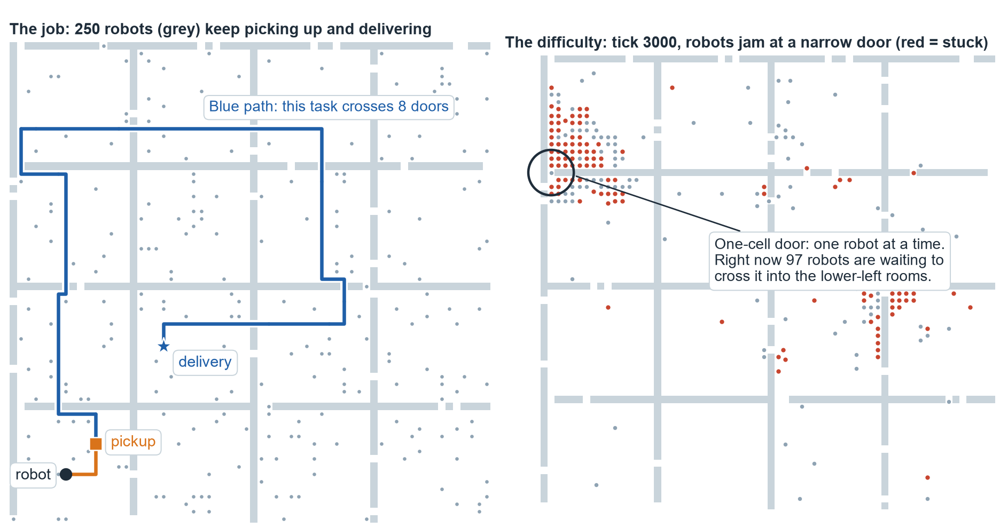{宽=12}

> 怎么读这份报告：按演讲的顺序写，每节标题就是这一节的结论；附录 D 是演讲稿，约 12 分钟。

> 这一版改了什么（v84）：附录 D 换成英文演讲稿、每段下面附中文对照（用户 2026-11-14：英文演讲，讲稿要有中文对照）；第四部分拆成三个失败各一段，每段一句粗体英文当幻灯片标题；结果段补上图 10 底部的数和图 02 三步的说法。上一版（v77，第 70 轮）把图 02 的 +27.0%、+63.0% 和附录 A 对上了口径。以前各版改了什么见 `日志\` 下各轮日志。完整的论证、数字和出处都在详细版 v58。

## 一页看完

**几百台车长时间跑，完成速度会塌到开头的三成左右。根子是一格宽的门上发生了和互联网一样的拥塞崩溃。我们用网络的流量控制管住门，官方 8 个实例平均完成数比官方程序多一倍多。**

- **问题**：车在分成很多房间的地图上不停取货送货，要在固定时间内完成最多的单。
- **难点**：车堵在门前，系统自己塌下去。前人优化路程和下一步，没有人管门。
- **办法**：把地图看成网络，加三个控制：门前限量派车、门口成批放行、全图限车数。
- **结果**：比官方程序多 +113.6%，比更强的对手多 +32.7%，没有碰撞。
- **教训**：起作用的是流量控制，不是选路。75 项网络机制只有 1 项站住。

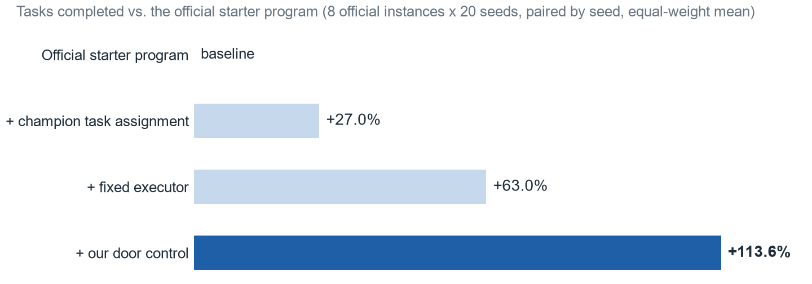{宽=11}

## 一、问题：几百台车在有窄门的地图上不停取货送货，要在固定时间内完成最多的单

**给一张地图、一队车和源源不断的任务，程序要决定谁接哪单、每台车怎么走，让完成的单最多，而且不能撞。**

### 1.1 现实里：布局改不了的窄处，车多了反而少干活

窄处一次只能过一台车。这里堵住，后面整片都走不动。公开资料里的地下矿（单车道巷道）、窄通道工厂（双向走廊）、医院（电梯和走廊）都是这样：车越多互挡越多，一个窄通道工厂的仿真里 5 台车每小时 208 单，7 台反而只有 189 单。这些场地都要回答三件事：同时放几台车进去，窄处朝哪边放，哪段路值得改建。开阔仓库用不上这套办法；上面的场地我们也没有实测过，只是类比。

### 1.2 写成网络问题：门是这张网上容量最小的边

我们用 League of Robot Runners 2026 比赛的官方平台。官方房间图是 64×64 的格子，墙切出 16 个房间、31 道门，其中 30 道只有一格宽。

| 项目 | 内容 |
|---|---|
| 输入 | 地图、N 台车、任务流。任务池里始终公开 1.5N 单，完成一单补一单 |
| 决策 | 谁接哪单；每台车下一步去哪；每一拍走还是停 |
| 目标 | 一局 5000 拍内完成的单最多。拍是模拟的时间单位，走一格要 3 拍 |
| 约束 | 一格一车，两车不能对穿；随机故障，任一时刻约两成的车停着 |

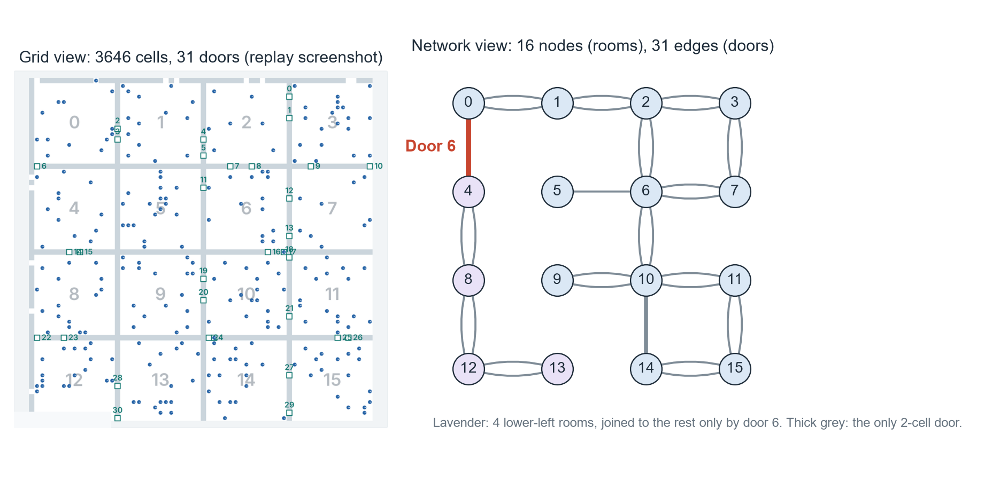{宽=12.5}

用老师课题的话说：房间是节点，门是边，一单任务是一股流，门能过多少车是容量。门 6 这种去掉就断开地图的边叫割。它把空地分成约四分之一和四分之三，所以 37.6% 的单必须过这一格。

门是程序开局从地图里自己找出来的，题目只给墙和空地。换一张图，程序找出另一批门，用同一套公式。

## 二、难点：跑久了系统自己塌掉，而前人都没有管门

**规模大、有故障，这些大家都知道。最难的是跑满比赛时长后，完成速度自己塌下去。**

### 2.1 最大的难点：门上发生了拥塞崩溃

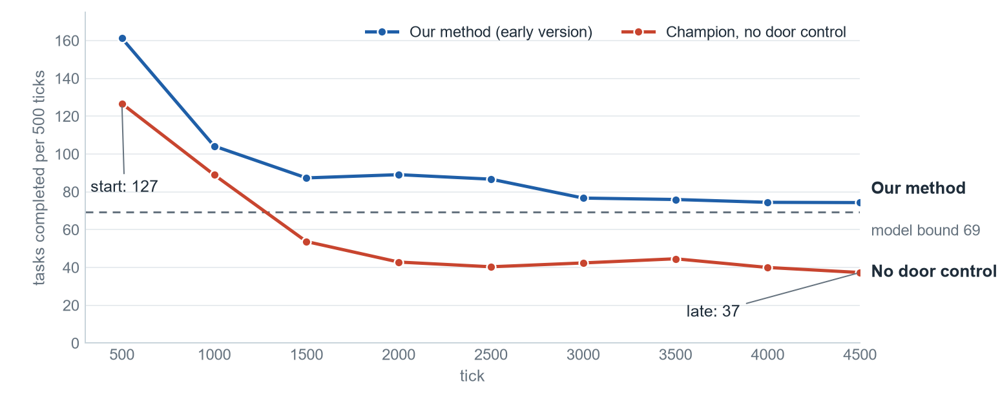{宽=12.5}

关掉故障，下滑还在。只放 100 台车，下滑也还在。堵起来的过程是这样的：

- 过不了门的单做不完，不过门的单照常做完，所以任务池里积压的都是过门单。不管门时，这个比例从开局的 38% 涨到结束时的 65%–86%。
- 车被吸到门口，两边面对面顶牛。最挤的房间从约 20 台涨到 90–160 台。
- 门每 500 拍只过 2–8 台，开头约 25 台。车越多，门过得越少。

互联网 1986 年也这样塌过：路由器转发都没错，一条线路的吞吐却只剩千分之一。这里也一样，每台车每一步都走对了，系统还是会塌。

### 2.2 前人怎么优化：各管一层，优化的都是路程和下一步

最严格的写法是时空网络：把每格每拍算一个节点，求最大流，解出来就是最优。但官方房间图一局约 1800 万个节点，任务还要事先全知道，所以用不上。实际系统都分层，每层解一个小问题：

| 层 | 决定什么 | 怎么优化 | 在门上缺什么 |
|---|---|---|---|
| 派单（官方贪心、2024 冠军） | 谁接哪单 | 按路程算代价，贪心取最便宜的（车，单） | 代价里只有距离，看不到门 |
| 引导路线（交通流优化） | 每台车走哪条路 | 在别人的流量上选最便宜的路，反复重算到没人想换 | 拥堵只是软代价，门绕不开 |
| 下一步（PIBT） | 每台车去哪格 | 等得久的优先挑格子，把挡路的车推开 | 到达保证靠环，门上没有环 |
| 滚动窗口（RHCR、WPPL） | 接下来几步的路线 | 让窗口内的总代价最小 | 只看几步，窄处靠手工停车 |
| 引导图 | 每条边的权重 | 用模拟器跑吞吐，黑箱搜索 | 还是软代价，不能说“现在别放” |

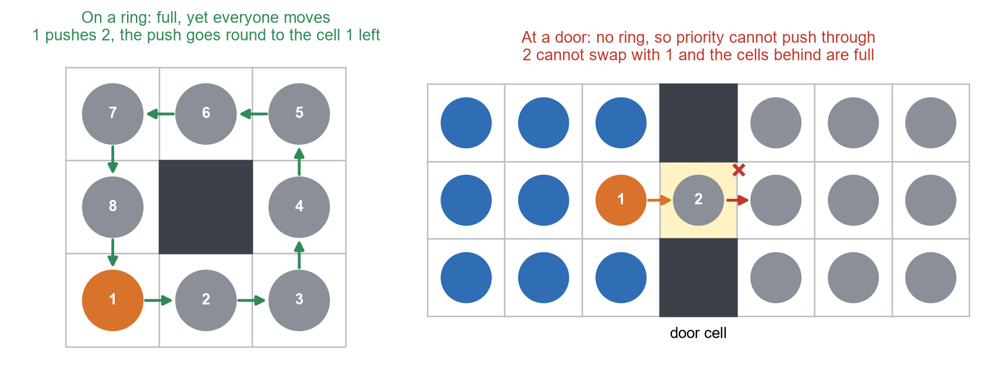{宽=11}

### 2.3 别的行业早就在限量，但管不到这道门

| 领域 | 怎么做 | 和门的差别 |
|---|---|---|
| 城市路网（周界控制） | 区内车数到拐点就停放，有定理说这样最好 | 管一片区域，门限靠实测，不管路朝哪边放 |
| 工厂 AGV（信号量） | 区域有车就在口上等，防撞防死锁 | 车到门口才数，门前照样堆 |
| 单线铁路（整数规划） | 排好谁先进区间，能解到最优 | 要事先知道所有车，这里任务边做边公开 |

所以缺的东西很清楚：没有人记“现在多少车奔向这道门的这个方向”，也没有人决定“这道门现在朝哪边放”。我们不是第一个看到拥堵，也不是第一个想到限量放行。我们做的是把崩溃定位到一格宽的门，并让门限由地图算出来。

## 三、我的办法：不改怎么走，只管放多少车、门往哪边放

**前人的派单、规划、执行都保留。我们只多两个决策：这单现在派不派，这道门现在朝哪边放。**

### 3.1 区别在决策变量，不在参数

| 对比 | 前人 | 我们 |
|---|---|---|
| 决策 | 车和单的匹配、路线、下一格 | 多两个：这单现在派不派、门朝哪边放 |
| 目标 | 路程短 | 让门的实际吞吐贴着它的能力 |
| 拥堵怎么处理 | 软代价，能说“贵”，不能说“不” | 硬上限 |
| 阈值从哪来 | 调参，或按实例手工定 | 从地图算 |

看同一个场景。门 6 前已经有车在排队，这时一台空车最便宜的单要进左下：

- **冠军派单**：这单离车近，派。门前又多一台。
- **引导路线**：门上拥挤，但没有别的路，还是穿门。
- **我们**：往左下的车已经到上限，跳过这单，让这台车接别的单。

调前人的参数到不了这一步，因为缺的是变量。给派单代价加过门成本，只多 +0.07% 到 +0.18%（1200 拍试验）。只调全图一个比例，房间图 +33.3%，我们当时的版本是 +76.1%，而同一比例到随机图是 −55.2%。

### 3.2 算法：三个控制，只缩小前人能选的范围

- **名额**：每道门每个方向，最多派多少车奔它。到了名额，派单就跳过要过这里的单。车过了门，名额自动还回来。
- **门口规则**：一格门一次只朝一边放，本侧走空才换向。走空指门这一侧 8 格内没有要过门的车。等的车退到门 4 格以外，给出门的车让路。
- **全局准入**：全图同时拿任务的车数有上限。它替没有名额的门兜底。

程序没有另解一个大优化。冠军派单还按原来的代价挑，PIBT 还按原来的优先级走，我们只缩小它们能选的范围。找门和算数只在开局做一次，运行时只查几个整数。

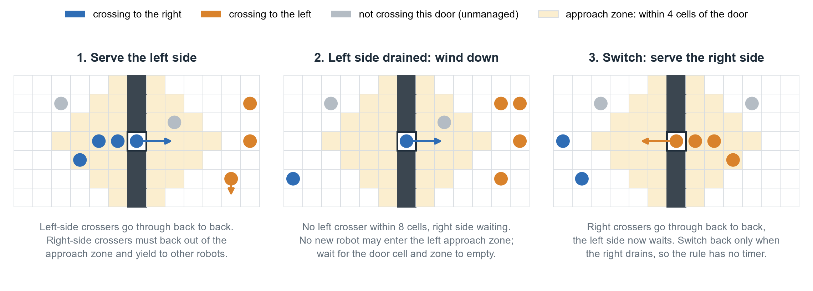{宽=12.5}

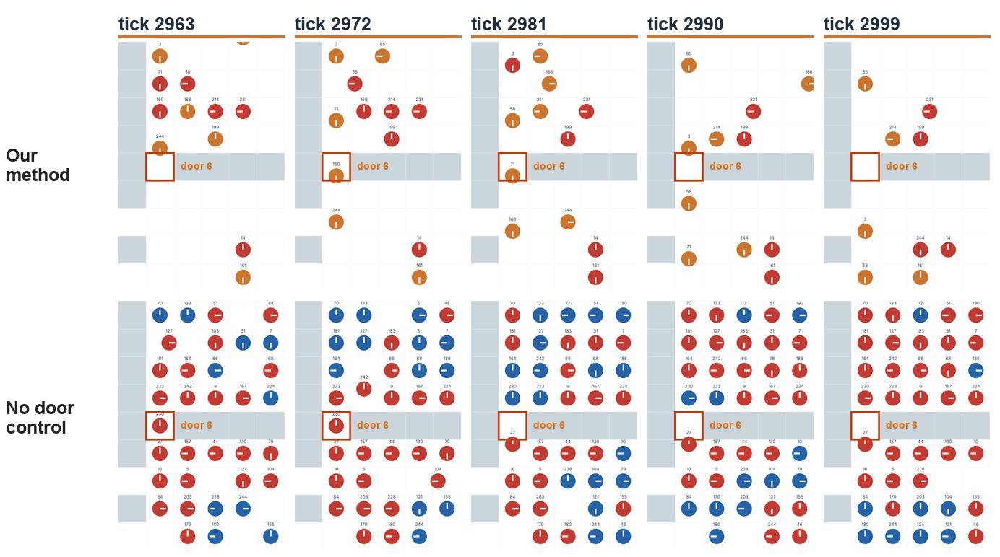{宽=11.5}

### 3.3 为什么有效：四个数都由定律算出来

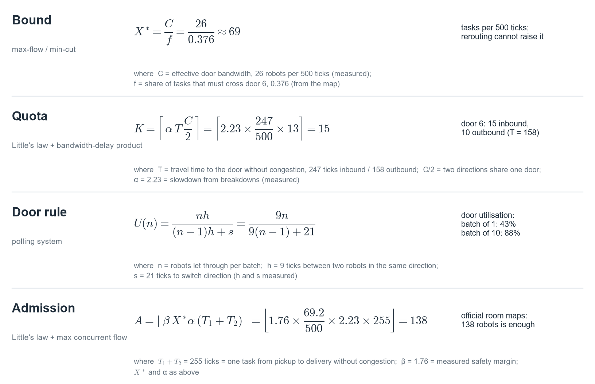{宽=12}

> 怎么读：C 是门的有效带宽，实测每 500 拍 26 台，物理上限是 83 台，差的是转身、故障和换向。f 是必须过门的单的比例。T 是车不堵时走到门的时间，进左下 247 拍，出左下 158 拍。α = 2.23 是有故障时的放大倍数。除以 2 是两个方向分享一扇门。U 是门的利用率，h = 9 拍是同向相继过门，s = 21 拍是换向，n 是一批放几台。T₁ + T₂ = 255 拍是一单不堵时的全程。β = 1.76 是实测的余量倍数。

- **上限是一道除法，换路提不高它。** 门 6 绕不开，不管车怎么走，门的带宽和过门比例都不变。所以官方房间图上，换路带来的上限提升是 0。
- **名额要卡在拐点上。** 车太少门空着，车太多只在门口排队，两侧顶住，门反而过得更少。过了拐点就回不来：车越堆门越慢，门越慢车越堆。所以要到拐点就停放。
- **门要成批放。** 换一次方向很贵，同向 9 拍过一台，换向要 21 拍。走空才换向，换向次数最少，确认比手调的放行时间多 +1.1%（95% 区间 +0.4% 到 +1.8%，20 个实例）。
- **全图只需要这么多车干活。** 这个数由地图定，和车数无关。车从 200 台加到 300 台，完成数只从 1032 涨到 1169。

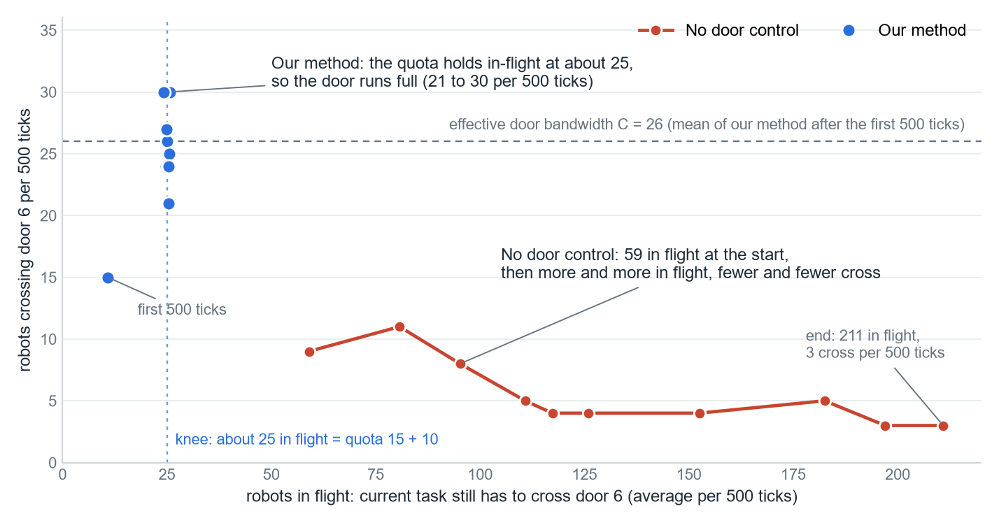{宽=10.5}

### 3.4 结果：有窄门的地图上比官方程序翻一倍多，开阔地图上控制不启用

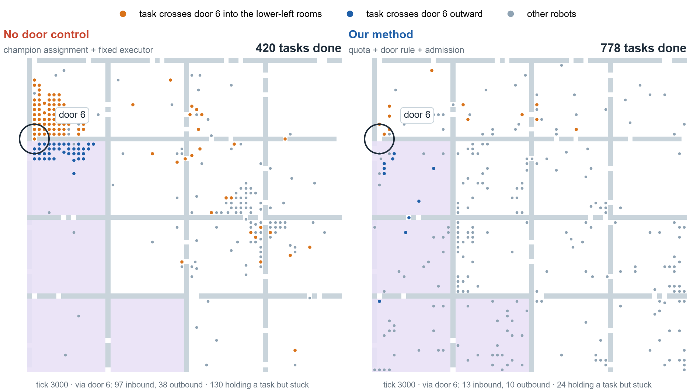{宽=12.5}

官方 8 个实例，每个 20 局，没有碰撞：

| 地图 | 对官方程序 | 对冠军 + 修好执行器 |
|---|---|---|
| 房间图 3 个 | +124% 到 +152% | +74% 到 +81% |
| 迷宫 2 个 | +135% 到 +297% | +1% 到 +31% |
| 随机和仓库 3 个 | +8% 到 +26% | 0，控制不启用 |
| 8 个等权平均 | +113.6% | +32.7% |

第二列比得最公平：两边的派单、规划、执行器都相同，只差我们的控制。门 6 每 500 拍过的车从 5.8 台涨到 24.7 台。

### 3.5 边界：这些要主动说

- 只适用于能分成房间和窄门的地图。开阔地图上不帮忙，也不伤害。
- 不全是公式：β = 1.76 是测出来的，门口让出 4 格是试出来的。
- 定律给的是方向和阈值，不是证明。这里车做完才接下一单，和定理的假设不完全一样。
- 程序不总能管到最窄的门。127 张房间图里 64 张管到了，其余靠全局准入兜底。
- 没有上过真机，实验都用逻辑时钟。要上真机还需要派单处有准入点、能测门的带宽。

## 四、尝试：最大的进步都是被失败逼出来的

**前后 150 多轮实验。每项改动先在开发图上筛，再冻结程序，到没跑过的新地图上确认，确认才算数。下面挑六个最典型的。**

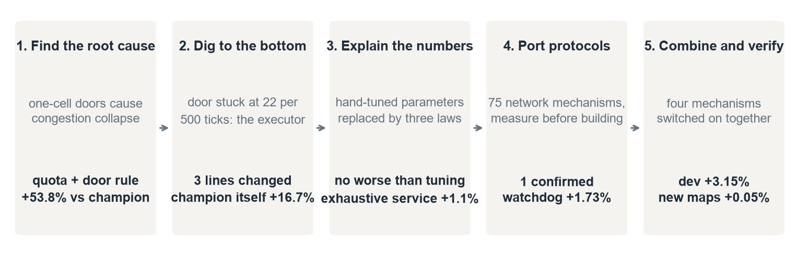{宽=12.5}

### 4.1 失败：最早的 TCP 窗口被判无效，错的其实是评测

一开始就想限制同时穿门的任务数，没看到效果，一度认为网络办法全部无效。回头审查，评测错了三处：官方代码有变量没初始化，随机种子写死成 0，测的场景根本不堵。修好后同一个窗口在 6 个标准实例上比官方程序多 +4.11%（95% 区间 +3.00% 到 +5.21%，1200 拍）。

**意识到**：结论不对时，先查评测。**改进**：种子进入抽样，判据事先写定。

### 4.2 成功：第一次把网络办法搬上门

实验跑满 5000 拍后才看到崩溃，于是用网络的两招：名额和门口规则。17 个有这种门的实例上，比冠军多 +53.8%（95% 区间 +50.5% 到 +57.1%）。

**意识到**：塌掉的原因是门，不是车多。**改进**：这两招成了方法的主体。

### 4.3 失败变成最大的发现：门卡在 22 台，查到执行器

调什么门都卡在每 500 拍约 22 台，连两个房间一道门的测试图也一样，和车数无关。逐拍查下来，上一拍刚离开的车在排队里还占着格子，后面车的动作被整段删掉。用网络的话说，空位释放了，信用晚一拍才还。

**意识到**：上限不在门口规则里，要往下查。**改进**：只改 3 行。冠军自己多 +16.7%（95% 区间 +15.3% 到 +18.1%），官方当时的最新版也有这个问题。

### 4.4 失败：换路没有用

网络里堵了就分流，我们试了加价、按负载改路、限绕路、按线性规划指定路线。这些都加在我们的方法上，没有一项确认通过，指定路线最差 −53.2%。

**意识到**：门是唯一的路，换路只是绕远。这是流量问题，不是选路问题。**改进**：停掉这条线。要抬高上限只能改地图：官方图上加一道门，实测 +7.4% 到 +21.5%。

### 4.5 失败到成功：一局塌掉，查出看门狗

有一局从 1114 单塌到 700 单。查下来是我们自己的门口规则造成的：三台车互相等，旁边有空格却不许挪，僵了近 2000 拍。

**意识到**：车上任何“禁止”都要有期限。**改进**：照交换机的 PFC 看门狗，车站满 300 拍就暂时不受门口规则管。新地图确认 +1.73%（95% 区间 +0.50% 到 +3.21%）。

### 4.6 失败：75 项网络机制只有 1 项站住

我们把成熟协议一个个搬上门，只有看门狗站住了。原因几乎相同：协议的前提在车上不成立。网络里排队不占链路，车排队却占格子；包可以丢，车不能丢。省下看得见的等待也没用，因为门过不了更多车，产量由门定。

**意识到**：便宜的收益已经拿完了。**改进**：选机制先问前提成不成立，再问能不能让门多过车。

## 五、总结：管住瓶颈比优化每一步更重要

**单车道瓶颈上，起作用的是流量控制，不是选路。网络的定律能给出上限和阈值，但一项机制有没有用，只有新地图说了算。**

- **做成了什么**：把崩溃定位到一格宽的门；用三个控制管住车流；修好执行器；手调的主要参数换成了公式。
- **还没解决的**：门 6 每过一台要 18.7 拍，要转身时最快 9 拍，多出来的主要是故障和换向。程序不总能找到最窄的门。没有上过真机。
- **和骨干网的对照**：网络越是无损、单路径、已按容量配好，流量工程越是只能保底。

## 附录 A：官方 8 个实例的完成数

每实例 20 局，不含后来才并入的看门狗。单数是 20 局的平均；百分比是每局和同种子的对手配对算提升，再 20 局、8 个实例等权平均，所以**不能拿平均单数相除去复算**（那样得约 +109%、+60%，差别只在先除后平均还是先平均后除）。图 02 的三步和 3.4 的表都出自这批运行；“提升是不是主要来自修执行器”看最后一列：房间图上不是，随机和仓库图上是。按总单数算约 +59%、+19%，因为单数最多的随机图上控制不启用。

| 实例 | 官方程序 | 冠军 + 修好执行器 | 我们的方法 | 冠军 + 修好执行器对官方 | 我们的方法对官方 | 我们的方法对冠军 + 修好执行器 |
|---|---|---|---|---|---|---|
| 房间 200 | 423 | 596 | 1032 | +41.6% | +145.3% | +74.6% |
| 房间 250 | 494 | 618 | 1106 | +25.3% | +124.2% | +81.2% |
| 房间 300 | 473 | 673 | 1169 | +44.8% | +152.2% | +73.7% |
| 迷宫 40 | 252 | 558 | 564 | +132.6% | +135.1% | +1.1% |
| 迷宫 60 | 189 | 552 | 719 | +204.9% | +296.6% | +30.9% |
| 随机 200 | 1713 | 2082 | 2082 | +21.5% | +21.5% | 0 |
| 随机 300 | 2371 | 2978 | 2978 | +25.6% | +25.6% | 0 |
| 仓库 100 | 442 | 477 | 477 | +8.0% | +8.0% | 0 |
| 8 个等权平均 | — | — | — | +63.0% | +113.6% | +32.7% |

图 02 第二行只换冠军派单的 +27.0% 同批同算法，逐实例 +27.7%、+13.6%、+33.5%、+55.4%、+48.9%、+14.5%、+14.6%、+7.8%。

## 附录 B：可能被问到的问题

**这算优化吗？最优解在哪？** 算，但解的不是原问题，原问题算不出最优。我们在房间网络上解一个线性规划，得到精确的模型上限；运行时派单用贪心。

**为什么不用整数规划？** 解不动：全局写法约 70 亿个 0-1 变量，任务和故障事先又不知道；滚动的小整数规划没试过。更精确地解同一个目标也没带来提升：派单换成最优匹配是 −1.9%（1200 拍试验）。

**线性规划和对偶给了什么？** 线性规划找出最紧的割，算出上限 69.2。对偶是证书：门 6 定价 1/f，其余门 0，对偶值也是 69.2，不管车怎么走都超不过它；这个价格的意思是门 6 每多过 1 台值 2.66 单。

**上限用的带宽是你们自己测的，不是循环论证吗？** 有一部分是。官方 250 台图完成 1106 单，是模型上限 1315 单的 84%，这只说门在现有速度下用到多满，不是离最优还差 16%。按转身时的最快速度算一局约 2100 单，我们到 53%，这条线没算故障。

**这不就是城市交通的周界控制吗？** 思路相同，名额就是“到拐点就停放”的按门版本。不同在三处：按门、按方向管；门限由地图算；还要决定门朝哪边放。没有和它做过对比实验。最接近的前人是 WPPL 按实例手工停用部分车，它管全图总数，不管门的方向。

**TCP 按价格调，你们为什么用硬名额？** 价格理论要求容量固定，而门过了拐点容量自己会塌。价格我们也试过：派单软成本 +0.07% 到 +0.18%，对偶过门费 −0.06%（95% 区间 −0.53% 到 +0.40%）。

**+113.6% 可信吗？** 换种子是稳的（95% 区间 +107.5% 到 +120.3%），把实例之间的差别算进去约 +52% 到 +178%，下限仍远大于 0；但 8 个实例只来自 4 类图。

## 附录 C：主要出处（完整的在详细版 v58）

前人：Yu、LaValle 2013；Okumura 等 2019；Chen 等 2024；Li 等 2021；Jiang 等 2024；Zhang 等 2024；Zang 等 2024。别的行业：Daganzo 2005、2007；Le-Anh、De Koster 2006；Alaghband、Moghaddam 2019。定律：Little 1961；Shahrokhi、Matula 1990；Takagi 1986；Jacobson、Karels 1988。现实场地：Eustace 等 2021；Bonetti 等 2026；新加坡国立大学学生项目海报 2026。

### 英文图的叫法和正文的对应（做幻灯片时统一用）

| 图里的英文 | 正文里的叫法：意思（图号） |
|---|---|
| Our method | 我们的方法：冠军派单 + 修好执行器 + 三个控制（2、4、7、9、10） |
| No door control | 不管门：同样的派单和执行器，不加我们的控制（4、7、9、10） |
| champion | 冠军：2024 年比赛调度成绩最好的队（2、11） |
| official starter program | 官方程序：比赛发的起始程序，+113.6% 比的是它（2） |
| executor / fixed executor | 执行器 / 修好执行器：把计划变成每拍动作的模块，见 4.3（2、11） |
| quota | 名额：每道门每个方向最多派多少车奔它（8、9、11） |
| door rule | 门口规则：一次只朝一边放，走空才换向（6、8、11） |
| admission | 全局准入：全图同时拿任务的车数上限（8、11） |
| approach zone / drained / switch | 门口 4 格 / 走空 / 换向：门口规则的三步（6） |
| inbound / outbound | 进左下 / 出左下：过门 6 的两个方向（8、10） |
| tick | 拍：模拟的时间单位，走一格 3 拍 |
| tasks completed per 500 ticks | 每 500 拍完成的单：完成速度（4） |
| crossing door 6 per 500 ticks / C | 门每 500 拍过的车 / 有效带宽 C：实测 26（8、9） |
| in flight | 在途（车）：手上的单还要穿过这道门的车（9） |
| knee | 拐点：在途约 25 台，再多门反而过得少（9） |

## 附录 D：演讲稿（英文演讲，逐段中文对照，约 11 分钟）

> 怎么用：英文是要讲的话，每段下面灰底是中文对照，意思一一对应。方括号里是配的图，编号就是 `报告源\图\en\` 里的文件号；每段开头的粗体英文可以直接当幻灯片标题。英文约 1350 词，按每分钟 125 词约 11 分钟；要压到 10 分钟，先删“Earlier work”那段的后半。这份讲稿也单独出一份 Word：`报告\演讲稿_中英对照_v84.docx`，内容相同。

**Opening: what goes wrong (1 min) [Fig 01]**

Hello everyone. My topic is managing robot scheduling as a network. On the left is the official competition map. 250 robots keep picking up and delivering tasks. Walls cut the map into 16 rooms, and the rooms connect only through narrow doors; 30 of the 31 doors are one cell wide. The blue line is one task, and it crosses 8 doors. On the right is the same map at tick 3000. Robots are jammed at a one-cell door, and the red dots are robots holding a task but unable to move. 97 robots are waiting for door 6. Today I will explain where this jam comes from, why earlier work did not prevent it, and how we fix it with ideas from networking.

> 中文对照：大家好。我的题目是：把机器人调度当成网络来管。左边是比赛的官方地图，250 台机器人不停地取货送货。墙把地图分成 16 个房间，房间之间只靠窄门连通，31 道门里有 30 道只有一格宽。蓝线是一单任务，要穿过 8 道门。右边是同一张地图的第 3000 拍：车堵在一格宽的门前，红点是拿着任务却动不了的车，97 台车在等门 6。今天我讲三件事：这个堵从哪来，前人为什么没防住，我们怎么用网络的办法解决它。

**Part 1. The problem is a network: doors are the smallest edges (1.5 min) [Fig 03]**

The input is a map, a fleet, and an endless stream of tasks. We decide who takes which task, where each robot goes next, and whether it moves or waits. The goal is to finish as many tasks as possible in 5000 ticks. The constraints: one robot per cell, no head-on swaps, and random failures that stop about one fifth of the robots at any time.

> 中文对照：输入是一张地图、一队车和源源不断的任务。我们要决定谁接哪单、每台车下一步去哪、走还是等。目标是 5000 拍内完成的单最多。约束是一格一台车，两车不能对穿，还有随机故障，任一时刻约五分之一的车停着。

In the language of this course, each room is a node, each door is an edge, each task is a flow, and the number of robots a door passes per 500 ticks is its capacity. The red edge is door 6. It is a cut: remove it, and the four lower-left rooms are disconnected. So 37.6% of all tasks must pass through this single cell. Note that the program finds these doors by itself from the walls; on a new map it finds new doors and uses the same formulas.

> 中文对照：用这门课的语言说，每个房间是节点，每道门是边，每单任务是一股流，门每 500 拍能过多少车就是容量。红色这条边是门 6，它是一个割：去掉它，左下 4 个房间就断开了。所以 37.6% 的单必须从这一格过。注意，门是程序自己从墙里找出来的；换一张新图，它找出新的门，用同一套公式。

**Part 2. The hard part: the system collapses by itself (2.5 min) [Fig 04]**

Scale and failures are hard, but the hardest part is this: over a full run, the completion rate collapses by itself. This is the average of the 3 official room instances, 20 runs each. With no door control, tasks completed per 500 ticks fall from 127 at the start to 37, about thirty percent. It still happens with failures turned off, and with only 100 robots.

> 中文对照：规模大、有故障都难，但最难的是这个：跑满一局，完成速度自己塌下去。这是官方 3 个房间实例、每个 20 局的平均。不管门时，每 500 拍完成的单从开头的 127 掉到 37，只剩三成左右。关掉故障还会塌，只放 100 台车也还会塌。

Why? Tasks that need the door are not finished, while the others are, so the task pool fills up with door tasks: from 38% at the start to between 65 and 86% at the end. Robots crowd around the door and block each other face to face. The door passes only 2 to 8 robots per 500 ticks, down from about 25. More robots, fewer crossings. The Internet collapsed the same way in 1986: every router worked correctly, yet throughput fell to a thousandth. Here too, every robot makes a correct step, and the system still collapses.

> 中文对照：为什么？要过门的单做不完，其他单照常做完，所以任务池里积压的全是过门单，从开局的 38% 涨到结束时的 65% 到 86%。车挤在门口，面对面互相挡。门每 500 拍只过 2 到 8 台，开头约 25 台。车越多，过得越少。互联网 1986 年也这样塌过：每台路由器都没错，吞吐却只剩千分之一。这里也一样：每台车每一步都走对了，系统还是塌了。

**Earlier work optimizes distance and the next step, not the door [Fig 05]**

The exact formulation, one node per cell per tick, has about 18 million nodes and needs all tasks in advance, so real systems use layers. Assignment greedily takes the cheapest robot-task pair by distance. Guidance picks the cheapest route given other traffic. PIBT moves each robot one step: the robot that has waited longest chooses first and pushes others away. This figure shows why PIBT fails at a door. On a ring, a full ring can still rotate. At a door there is no ring: robot 2 cannot swap with robot 1, and the cells behind it are full. Cities use perimeter control, factories use semaphores, and railways use integer programs. They all limit entry, but none of them counts the robots heading for this door in this direction, or decides which way the door serves now.

> 中文对照：［图 05］精确的写法是每格每拍一个节点，约 1800 万个节点，还要事先知道所有任务，所以实际系统都分层。派单按距离贪心取最便宜的（车，单）。引导路线在别人的流量上选最便宜的路。PIBT 让每台车走一步：等得最久的车先挑，把别的车推开。这张图说明 PIBT 为什么在门上失效：在环上，全满也能整圈转；门上没有环，2 号不能和 1 号对穿，身后又满。城市有周界控制，工厂有信号量，铁路有整数规划，都是限量放行，但没有一个数着“现在多少车奔向这道门的这个方向”，也没有一个决定“门现在朝哪边放”。

**Part 3. Our method: decide how many to release and which way each door serves (3 min) [Fig 06]**

We keep the existing assignment, planning and execution, and add only two decisions: release this task now or not, and which way this door serves now. There are three controls. First, a quota: for each door and direction, at most this many robots may be sent toward it; when a robot crosses, its slot comes back. Second, the door rule in this figure: a one-cell door serves one side at a time, and robots on the other side wait 4 cells back. The door switches only when this side is empty. Third, admission: a cap on how many robots hold a task at once, as a backup. We do not solve a new big optimization; we only shrink the choices of the existing modules.

> 中文对照：现有的派单、规划、执行都保留，只加两个决策：这单现在放不放，这道门现在朝哪边放。有三个控制。第一，名额：每道门每个方向，最多派这么多车奔它；车过了门，名额就还回来。第二，门口规则，就是这张图：一格门一次只放一边，另一边的车退到 4 格外等；这一边走空了才换向。第三，全局准入：同时拿任务的车数有上限，用来兜底。我们不另解一个大优化，只缩小现有模块能选的范围。

[Fig 07] Here is a replay of door 6, one frame every 9 ticks. Top row, our method: 5 robots cross one after another. Bottom row, no door control: both sides are packed, and nobody crosses.

> 中文对照：［图 07］这是门 6 的回放，每张隔 9 拍。上面是我们的方法，5 台车接连过门；下面不管门，两边挤满，一台也没过去。

**Four numbers, all from laws, not tuning [Fig 08]**

The bound comes from max-flow min-cut: door bandwidth divided by the share of tasks that must cross, 26 over 0.376, which is 69.2 tasks per 500 ticks. Rerouting cannot raise it, because door 6 cannot be bypassed. The quota comes from Little's law and the bandwidth-delay product: travel time to the door, times half the bandwidth, times a failure factor of 2.23. That gives 15 robots inbound and 10 outbound. Batching comes from polling systems: one robot per turn uses the door 43% of the time, ten per turn use it 88%. Admission is Little's law again: 138 robots are enough on the official room maps.

> 中文对照：上限来自最大流最小割：门的带宽除以必须过门的比例，26 除以 0.376，每 500 拍 69.2 单。换路提不高它，因为门 6 绕不开。名额来自 Little 定律和带宽时延积：走到门的时间，乘带宽的一半，再乘故障放大倍数 2.23，得出进左下 15 台、出左下 10 台。成批放行来自轮询系统：每次放 1 台，门只用了 43%；每次放 10 台，用到 88%。准入还是 Little 定律：官方房间图 138 台就够了。

[Fig 09] This is why the quota sits at the knee. The x-axis is robots in flight, whose task still has to cross door 6; the y-axis is crossings per 500 ticks. Our method holds about 25 robots in flight, and the door runs full at 26. With no control, robots in flight grow from 59 to 211, and the door passes only 3 to 5. Past the knee there is no way back: more robots slow the door, and a slower door piles up more robots.

> 中文对照：［图 09］这就是名额要卡在拐点的原因。横轴是在途车数，就是任务还要穿过门 6 的车；纵轴是每 500 拍过门的车。我们的方法把在途卡在约 25 台，门跑满，平均 26。不管门时，在途从 59 台涨到 211 台，门只过 3 到 5 台。过了拐点就回不来：车越多门越慢，门越慢车越堆。

**Results: more than double the official program (1 min) [Fig 10] [Fig 02]**

At tick 3000, with no door control, 97 robots wait to go in through door 6 and 420 tasks are done. With our method, only 13 wait, and 778 tasks are done. On the 8 official instances, 20 runs each, the champion's assignment gives +27% over the official starter program, fixing the executor gives +63%, and our door control gives +113.6%. Against the champion with the same fixed executor, we still gain 32.7%; that is the fairest comparison. The limits: it only helps on maps with rooms and narrow doors. On random and warehouse maps it never switches on. And it has not run on real robots.

> 中文对照：第 3000 拍，不管门时 97 台车等着从门 6 进去，完成 420 单；我们的方法只有 13 台在等，完成 778 单。官方 8 个实例、每个 20 局，都和官方程序比：换上冠军的派单到 +27%，再修好执行器到 +63%，再加我们的门控制到 +113.6%。和同样修好执行器的冠军比，我们还多 32.7%，这个比较最公平。边界是：只在有房间和窄门的地图上有用；随机图和仓库图上控制不启用；没有上过真机。

**Part 4. The biggest steps were forced by failures (1.5 min) [Fig 11]**

We ran more than 150 rounds of experiments. Every change was screened on development maps, then frozen and confirmed on new maps. Here are three typical failures.

> 中文对照：我们做了 150 多轮实验。每项改动先在开发图上筛，再冻结程序，到新地图上确认。下面是三个典型的失败。

**Failure 1: the idea was fine, the evaluation was wrong.** Our first TCP-style window looked useless. In fact the evaluation had three bugs: an uninitialized variable, a random seed fixed at 0, and a test case that never jammed. Lesson: when a result looks wrong, check the evaluation first.

> 中文对照：**失败一：办法没错，错的是评测。** 第一个 TCP 式窗口看起来没用。其实评测有三个错：变量没初始化，随机种子写死成 0，测试场景根本不堵。教训：结果不对时，先查评测。

**Failure 2 became our biggest finding: the door was stuck at 22.** Whatever we did, the door passed about 22 robots per 500 ticks. Tracing tick by tick, a robot that had just left still held its cell in the execution queue. In network terms, the slot was free but the credit came back one tick late. Three lines of code fixed it, and the champion's own program gained 16.7%.

> 中文对照：**失败二变成最大的发现：门卡在 22 台。** 怎么调，门每 500 拍都只过约 22 台。逐拍查下来，刚离开的车在执行队列里还占着格子。用网络的话说，空位已经空了，信用晚一拍才还。改 3 行代码，冠军自己的程序就多了 16.7%。

**Failure 3: rerouting does not help.** Networks reroute around congestion, so we tried pricing, load-based routing and routes from a linear program. None passed confirmation; the worst was −53.2%. Lesson: the door is the only path. This is a flow problem, not a routing problem.

> 中文对照：**失败三：换路没有用。** 网络遇到拥塞会绕路，所以我们试了加价、按负载选路、用线性规划指定路线。没有一项通过确认，最差 −53.2%。教训：门是唯一的路。这是流量问题，不是选路问题。

**What 75 network mechanisms taught us.** We ported 75 network mechanisms; only the watchdog survived. The usual reason: the protocol's assumption fails for robots. A queue of packets does not block the link, but a queue of robots occupies cells. Even four mechanisms together gave +3.15% on development maps but only +0.05% on new maps, so we trust only new maps.

> 中文对照：**75 项网络机制教会我们什么。** 我们搬了 75 项网络机制，只有看门狗站住了。常见原因是协议的前提在车上不成立：排队的包不挡链路，排队的车却占着格子。四项一起开，开发图上多 3.15%，新地图上只剩 0.05%，所以我们只认新地图的结果。

**Summary: control the bottleneck, not every step (0.5 min)**

At a single-lane bottleneck, flow control works and rerouting does not. Network laws give the bound and the thresholds, but only new maps can confirm a mechanism. We located the collapse at one-cell doors, controlled the flow with three controls, fixed the executor, and replaced hand tuning with formulas. Still open: door 6 needs 18.7 ticks per robot against a best case of 9, mainly because of failures and direction switches, and nothing has run on real robots yet. Thank you.

> 中文对照：在单车道瓶颈上，流量控制有用，换路没用。网络的定律给出上限和阈值，但一项机制有没有用，只有新地图能确认。我们把崩溃定位到一格宽的门，用三个控制管住车流，修好了执行器，把手调换成了公式。还没解决的：门 6 每过一台要 18.7 拍，最快 9 拍，多出来的主要是故障和换向；也还没有上过真机。谢谢大家。
