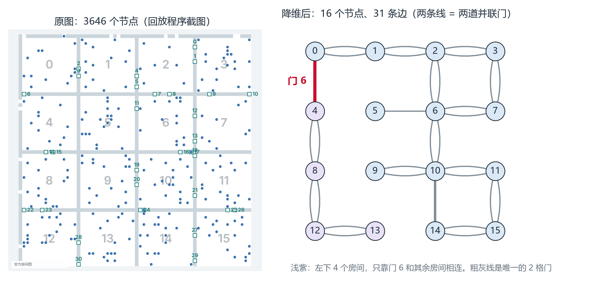
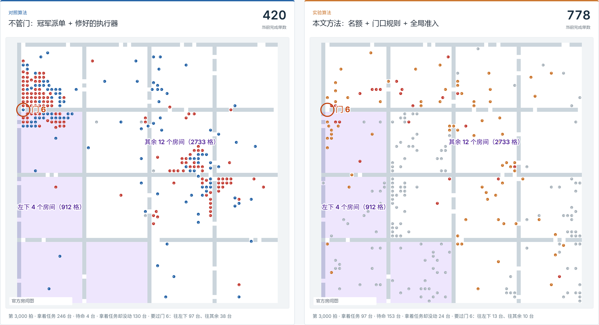
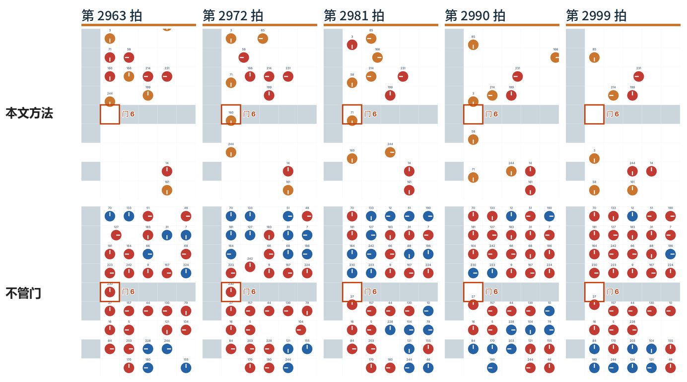
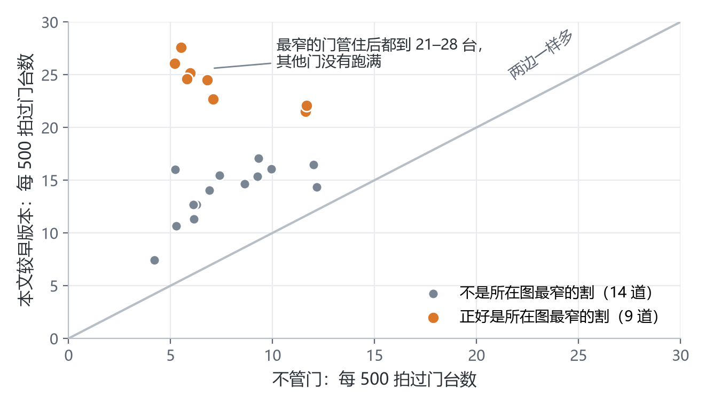

# 把机器人调度当成网络来管：单车道门上的拥塞崩溃和解法

> 怎么读这份报告：按演讲的顺序写，每节标题就是这一节的结论。附录 A 是怎么讲，附录 B 是可能被问到的问题，附录 F–I 放演讲不讲的细节。

> 这一版改了什么（v58）：查了公开资料，重写 1.1：这个问题能解决现实中什么问题。适合布局改不了、有绕不开窄处的场地，比如地下矿、窄通道工厂、医院；开阔仓库用不上。

## 一页看完

**一句话：几百台机器人跑满比赛时长后，完成速度会塌到开头的一到三成。根子是一格宽的门发生了和互联网一样的拥塞崩溃。把网络的流量控制搬过来，官方房间图上完成的单比官方程序多一倍多。**

- **问题**：几百台车在分成很多房间的地图上不停取货送货。输入是地图、车和任务流，决策是谁接哪单、每步怎么动，目标是 5000 拍内完成的单最多（拍是模拟的时间单位，走一格要 3 拍），约束是不能撞、还有随机故障。
- **难点**：跑满 5000 拍后完成速度自己塌下去。前人各层优化的都是路程和每一步怎么走，窄处的拥堵被留成开放问题，只有手工办法；没有一层把门的通过机会当成要分配的资源。
- **我的办法**：把地图降成一张由房间和门组成的网络，用三个控制管住车流：名额（每道门每个方向最多派多少车奔它）、门口规则（本侧走空才换向）、全局准入（全图最多几台车同时拿任务）。前人的派单、规划、执行都保留，只多了约束和过滤；三个阈值由经典定律和实测常数算出来。“限量放行”城市路网早就有，“数着车放”工厂 AGV 也早就有，我们新在按门、按方向管，门限从地图算，还管门朝哪边放。
- **结果**：官方 8 个实例、每个 20 局，等权平均完成数比官方程序（比赛发的起始程序）多 **+113.6%**（95% 区间 +107.5% 到 +120.3%，只反映种子；把实例差别算进去约 +52% 到 +178%），没有碰撞。实例之间差别很大：有窄门的 5 个 +124% 到 +297%，随机和仓库 3 个 +8% 到 +26%；按总单数算约 +59%（附录 C）。对手换成 2024 年调度成绩最好的队（下文叫冠军），也修好执行器（把计划变成每拍动作的模块，我们查出了它的一个错），本文方法还多 **+32.7%**（把实例差别算进去约 +9% 到 +58%）。
- **最重要的失败**：最早的 TCP 窗口（限制同时穿门的任务数）被判无效，其实是评测错了；换路在绕不开的门上没用；后来试的 75 项网络机制，只有 1 项在没跑过的新地图上站住。多数失败的原因相同：协议的前提在车上不成立。量得到的等待，省下来也变不成产量，因为产量由门定。这些失败帮我们划清了方法的边界。
- **边界**：最窄的割定上限，车塌在哪要另外量。127 张房间图里，63 张的最窄割不在程序名单上，靠全局准入兜底；程序管到了最窄的门，车也可能堵在别的门上（3.8、4.2）。这些图多数没有单独跑过。

## 一、问题：几百台车在有窄门的地图上不停取货送货，要在固定时间内完成最多的单

**给一张地图、一队车和源源不断的任务，程序要不断决定谁接哪单、每台车下一步怎么动，让 5000 拍内完成的单最多，而且不能撞。这是一个在网络上分配有限容量的问题。**

### 1.1 现实里：布局改不了的窄处，车多了反而少干活

**这个问题对应的现实场地是：有绕不开的窄处，布局又改不了，车长期循环干活。这时车不是越多越好，要决定同时放几台、窄处朝哪边放。**

订单不停地来，车做完一单接下一单，永远没有“全部做完”的时候，所以学名叫终身多机器人路径规划（lifelong multi-agent path finding，简称 lifelong MAPF）。一台车走路不难，难在大家共用通道：窄处一次只能过一台，这里堵住，后面整片都走不动。

| 现实场地 | 绕不开的窄处 | 公开资料里看到的 |
|---|---|---|
| 地下矿 | 单车道巷道，靠会车道让车 | 地质和成本只允许单车道；车越多互挡越多，加车的收益越来越小 |
| 窄通道工厂 | 窄的双向走廊 | 一个布局的仿真里，5 台车每小时 208 单，7 台只有 189 单 |
| 医院 | 电梯、走廊 | 一个学生项目的仿真里，电梯拥堵是主要风险，3 台加到 4 台提升已经很小 |
| 半导体厂式车间 | 只容一两台的长走廊 | 开发者在开源调度框架的论坛上要走廊预约和准入上限，回复建议用单向车道或动态关闭车道 |

这些场地的做法是：铁路式的闭塞区间、一次只放一台进区域、单向车道，以及用仿真扫出最好的车数。这个问题要回答三件事：

- **运行时**：同时放几台车进去，窄处朝哪边放。
- **买车前**：这个场地几台车就够了，再多只是堵。
- **改建前**：哪道门、哪段路值得加宽或加一条。

**开阔仓库用不上。** 我们的仓库图上找不到这种窄处，控制不启用。上面这些场地我们也没有试过，对应关系是类比。

老师课题里的案例（带时间窗的车辆路径、邮政网络、航空公司网络）都是在一张网上分配有限资源，这里也一样。多出来的麻烦是车本身占地方：排队的车也是障碍。

别的行业管窄处也是“限量”和“分向放行”：单线铁路持路签才能进区间，苏伊士运河的船分向编队通过，波士顿洛根机场试验过把滑行中的离港飞机数控制在实测饱和点附近。这些系统的量靠经验或实测定，本文要做的是让程序从地图把这些量算出来。

我们用 League of Robot Runners（LoRR）2026 比赛的官方平台，地图、任务、故障都是标准的，结果可以和别人比。

### 1.2 先看地图：墙把空地切成房间，房间之间只靠窄门连通

官方房间图是 64×64 的格子，有 3646 格空地。墙把它切成 16 个房间，每个约 15×15 格，房间之间有 31 道门，其中 30 道只有一格宽。一格宽的门一次只能过一台车，而且只能朝一个方向。

一个实例是一张地图加一个车数和一批任务。官方一共 8 个实例：房间图 3 个（200、250、300 台车）、迷宫 2 个、随机障碍和仓库 3 个。同一个实例要跑很多局，每局换一组种子（决定故障和规划里的随机选择）；两个程序用同一组种子各跑一局，叫一对。

一项改动算不算数分两步。开发：在 17 个开发实例上比，用来筛选。确认：把程序冻结，到从没跑过的新地图和新种子上再比，这一步才算数。新地图用我们写的生成器生成，也是房间图。

### 1.3 问题写清楚：输入、决策、目标、约束

- **输入**：格子地图；N 台车和起点；任务流。每单一个取货点、一个送货点，任务池里始终公开 1.5N 单，完成一单补一单，更后面的单看不见。
- **决策**：① 派单：谁接哪单。② 规划：每台车接下来几步的动作，每 15 拍算一次。③ 执行：每一拍告诉每台车走还是停。
- **目标**：一局 5000 拍内完成的单最多（下文叫完成数）。
- **约束**：一格一车，两车不能对穿；前进一格或转 90° 都要 3 拍；取货后不能换单；随机故障：平均每拍有 1% 的车新发生故障，原地停 10–30 拍。

> 怎么读：j 是一单，τ_j 是它完成的时刻，H = 5000 拍。p_r(t) 是车 r 第 t 步站的格子，v 是格子，a_r(t) 是它这一步的动作，σ_r(t) 是它手上的单，P(t) 是此刻公开的任务池。粗体 1 后面的方括号成立记 1，否则记 0；¬ 表示方括号里的事不许发生。前两条约束就是网络的容量：节点容量是 1，一条边两个方向不能同时用。为了好读，这里一步算一个动作，实际一个动作占 3 拍。

故障不是小事：250 台车时平均每拍有 2.5 台新故障，每次停约 20 拍，所以任一时刻约有 50 台（两成）停着。实测也是这样：17 张图上，故障占全部车时间的 21.07%。计划再好也会被打乱。

看一个具体的单就明白了。官方任务文件里有一单，取货点和送货点横竖加起来只差 22 格，但最短路线要过 8 道门、162 个动作，不堵也要约 486 拍。

{宽=10.5}

### 1.4 用网络的语言看：门是这张网上容量最小的边

| 网络的说法 | 在这个问题里 | 官方房间图上 |
|---|---|---|
| 节点 | 空地格；降维后是房间 | 3646 个；16 个 |
| 边 | 相邻两格；降维后是门 | 降维后 31 条 |
| 流 | 一单任务：从取货点到送货点的一股流，每种起终点是一种商品 | 同时有几百股 |
| 容量 | 一格一台车；门每拍只能放过有限的车 | 一格门实测每 500 拍约过 26 台 |
| 资源分配 | 把门的通过机会分给各股流 | 全图的关键 |
| 路由和调度 | 车走哪几道门；谁什么时候出发、门往哪边放 | 由规划、派单和执行决定 |

这张网上最紧的是门 6。它把空地分成约四分之一和四分之三，任务的两端在空地上均匀分布，所以有 37.6% 的单必须过这一格。

> 怎么读：w₁、w₂ 是门两侧的空地占全图的比例。一单的两端落在同一侧的概率是 w₁² + w₂²，这样的单不用过门；1 减去它，就是必须过门的比例 f。这个比例只用地图算，不用偷看任务：152 个割上，它和任务文件实际算出的值最多差 0.019。

原问题没法直接求最优解。把每格每拍算一个节点，就有约 1800 万个时空节点（3646 × 5000），还要为每台车各解一份；后面的任务和故障事先又不知道。所以只能在线决定，每 15 拍算一次。

### 1.5 门是程序从地图里找出来的，不是题目给的

**题目只给墙和空地。我们要设计的不是某张图的最优解，而是一段对任何地图都能用的程序：开局读地图、自己找出瓶颈，再用通用公式算出控制用的数。**

程序开局做一次：把空地看成图，用深度优先搜索（Tarjan 算法）找“去掉就断开”的格子，再试相距 12 格以内的两道一格门合起来能不能断开地图；断开后两边都要占空地的 5% 以上才算。官方房间图上它找到 9 个割（单门 2 个、门对 7 个），其中门 6 最紧；随机障碍和仓库图上一个也找不到，控制就不启用。这段程序只看一道门和相距近的两道一格门，所以不是每张图的最窄处都在它的名单上（3.8）。

{宽=10}

下面讲“门 6”时，都是指官方房间图上程序算出的这道门。换一张图，程序会找出另一批门，用的是同一套公式。

## 二、难点是跑久了系统自己塌掉；前人各管一层，没有一层把门当成要分配的资源

**规模大、要实时、有故障，这些大家都知道。最难的是跑满比赛时长后完成速度自己塌下去。前人看到过这种恶化，但留成了开放问题，只用手工办法绕开。**

### 2.1 常规的难点

- **组合爆炸**：几百台车求最优解是 NP 难的，总时间、最晚到达时间、总路程这几种目标都一样（Yu 和 LaValle 2013），只能用局部办法。
- **永远跑不完**：任务不断来，每一步都有时限，没法离线排好。
- **车不能丢**：网络里堵了可以丢包重发，车堵了只能原地等，而且等着还占地方。
- **随机故障**：车随时可能停 10–30 拍，再好的计划也会被打乱。

### 2.2 我们量到的难点：门上的拥塞崩溃

把实验从 1200 拍延长到比赛规定的 5000 拍后，官方房间图上每 500 拍完成的任务从 100–120 个掉到 10–30 个。

这不是故障造成的（关掉故障还在），不是官方程序预先算的引导路线造成的（关掉它还在，见 2.6），也不是车太多（只放 100 台也出现）。每隔 100 拍画一张快照才看清：车都堆在一个一格宽的门两侧。这扇门就是 1.4 里的门 6，图论里叫**割点**，去掉它地图就断成两块。

堵起来的过程是这样的：跨门任务通不过门就完成不了，不跨门的任务照常完成，车做完后又可能领到跨门任务。于是任务池里剩下的越来越多是要过门的单：官方 200 台图上，开局 38%（正好是 1.4 算的比例），第 2000 拍 74%，结束时 92%。这组数取自本文较早版本的一局；完全不管门时，结束时也有 65%–86%。

车就这样被吸到门口，面对面顶牛。用冠军派单时，最挤的房间从约 20 台涨到 90–160 台，里面九成以上已经取了货、出不去；进这个房间的车八成以上只是路过。门每 500 拍只过 2–8 台，开头约 25 台。这和网络里“负载越大、吞吐反而越低”的拥塞崩溃是同一类现象。

### 2.3 最严格的写法：时空网络上的流，精确但解不动

**Yu 和 LaValle 把多车路径问题写成时空网络上的流。这是这个问题最接近老师课题的写法，也说明了为什么只能退回局部办法。**

把每个格子按时间复制成很多份，一台车就是一条时空路径。决策变量是每条时空边走不走车，节点和边的容量都是 1，目标是到达时间或总路程，解法是建网后求最大流。解出来就是最优，但任务要事先都知道；每台车有指定终点时是 NP 难的。官方房间图一局约 1800 万个时空节点，任务边做边公开，还有故障，所以用不上（附录 F.1）。

### 2.4 实际系统把问题切成四层，每层解一个小问题

解不了整体，大家就分层。官方程序和比赛冠军都是这个结构，下面一层一层看它们到底怎么优化。每节只写决策变量、目标、步骤、保证和在我们图上的结果；小例子、复杂度、公式细节和出处在附录 F。

| 层 | 代表工作 | 决策变量 | 优化什么 | 用什么信息 |
|---|---|---|---|---|
| 派单 | 官方贪心、2024 冠军 | 车和单的匹配 | 路程 | 距离表 |
| 引导路线 | 交通流优化；引导图 | 每台车的不带时间的路线；每条边的权重 | 路程 + 路线重叠；吞吐 | 大家的计划路线；模拟里的边使用量 |
| 下一步动作 | PIBT；RHCR、WPPL 的窗口规划 | 每台车接下来去哪格 | 离目标近；窗口内总代价 | 邻格、优先级 |
| 执行 | 时间依赖图 | 每拍走还是停 | 不破坏先后顺序 | 每格的排队 |

### 2.5 派单：比路程，不比门

**官方贪心。** 决策变量是每台空闲车接哪单，目标是这台车自己的路程最短，没有全局目标，约束是一单一车、派完不改。步骤是逐台车遍历没派出的单，取“车到取货点 + 取货到送货”最短的。250 台车的官方房间图上只完成 494 单，是一局模型上限 1315 单的 38%（这条线的含义见 3.4）。

**2024 调度冠军（No Man's Sky 队）。** 比官方好在两点：全局比较，并且没开工的单每次都可以重新分。

- **优化问题**：决策变量是可换的车和可换的单之间的匹配，目标是总代价小，约束是一单一车、取货后不能换。

> 怎么读：c(r, j) 是车 r 接单 j 的代价，d 是最短路距离。W 让“车赶到取货点”这段比任务本身更贵，车就少跑空路。公开代码在主要地图类型上用 W = 5，本文的重写版用 W = 2，冠军和本文用同一个值。

- **W 是怎么定的**：事先写定在 1、2、5 里取平均最高的，用 18 个开发实例（房间 9、迷宫 6、开阔 3），每实例 10 局。对官方程序 W = 2 +17.69%，W = 1 +17.32%，W = 5 +15.38%。这是 1200 拍、执行器还没修时的结果，后来没有重扫（附录 B.2）。
- **步骤**：每台车把所有单按代价排序，放进一个堆，每次取全局最便宜的（车，单）；单没被用就定下；每个规划周期重做一遍。
- **保证**：贪心，没有最优保证。
- **在我们图上**：同样修好执行器时，官方房间图 250 台 618 单，是模型上限的 47%。崩溃还在，因为代价里只有距离，一单要不要过门 6、门前已经有多少车，它都不知道。

### 2.6 引导路线：把车流分开，但只在有路可分时有用

**交通流优化（Chen 等，AAAI 2024）是唯一看全局流量的一层。它算的是用户均衡式的路线，拥堵是软代价，没有容量约束。**

- **优化问题**：决策变量是每台车一条不带时间的路线。流量 f_uv 是计划走边 u→v 的路线数。每台车在别人的流量上走最便宜的路，直到大家都不想换，这就是交通里的用户均衡。论文没有写成带约束的优化模型。

> 怎么读：1 是走一格的路程。第二项是对向流量：v→u 已有 f_vu 条路线，加上我这条，顺向和逆向的路线数相乘，所以两个方向都有车时代价飙升。n_v 是进入格子 v 的路线数。论文的主版本把对向项放在第一位比较，先比对向再比路程；这里写的是实际运行的相加版本。

- **步骤**：① 每台车算一条路线，并把它加进流量表。② 目标变了就重算。③ 反复挑几台车，拿掉它们的路线，在别人的流量上重算，再放回去。④ 规划时 PIBT 不再朝目标走，而是朝这条路线走。
- **保证**：没有收敛或最优的证明。论文把设计更准确的目标函数留作以后的工作。
- **在我们图上**：有路可分时它已经很好，官方地图上实际最忙门的利用率只是最优路由的 1.07–1.12 倍。但门 6 是割，代价再高也绕不开，所以按门加价反而掉分（−5.2%）。

### 2.7 下一步动作：PIBT 靠环来保证到达，门上没有环

**PIBT（Okumura 等，IJCAI 2019，期刊版 2022）没有全局目标，它是一条每步都能算完的局部规则。它的到达保证靠图上的环，门恰好不在环上。**

- **优化问题**：没有全局目标。每一步给每台车定下一格，满足不撞、不对穿。规则是没到目标的车每步优先级加 1，所以等得越久越优先。

- **步骤**：① 全部车按优先级排序。② 高优先级的车先挑离目标最近的邻格。③ 格子上有低优先级的车，就让它继承自己的优先级先去找地方，这样一路推下去。④ 被推的车无路可走就回报“推不动”，推它的车换下一个格子（回溯）。
- **小例子**：下图左边，一圈全满，1 号想往前。它推 2 号，2 号推 3 号，一直推到 8 号，8 号可以进 1 号让出的格子，全圈转一格，所以不需要空位。
- **保证和前提**：每对相邻节点都在一个简单环上时，每台车都能在有限时间内到达；在取送货问题里还要求拿着任务的车最终能拿到最高优先级、并一直保持到任务完成。论文明说，没有这个图条件时，有些车可能永远到不了。
- **在我们图上**：门格两侧的边不在任何环上。下图右边，1 号优先级再高，2 号也不能和它对穿，身后又满，只能回报推不动。这说的是定理的前提没了，不是每次都卡死，门 6 开头每 500 拍还能过约 25 台。车一多就掉到 2–8 台。

### 2.8 滚动窗口：RHCR 和 WPPL 只看眼前几步，窄处要手工补

**这两个工作把长问题切成一段段短窗口。WPPL 明确写到拥堵会随时间恶化，也写到窄走廊和死胡同还是开放问题，它用的是手工停车的办法。**

**RHCR（Li 等，AAAI 2021）。** 它只管路径，派单在它外面。

- **优化问题**：决策变量是每台车的路线，目标是窗口内的总用时，约束是前 w 步不相撞，窗口外当作各走各的最短路。
- **步骤**：每 h 步重解一次（w ≥ h），前 w 步解决冲突，后面的冲突留到下一次。

- **保证**：没有。论文给了窄道的例子：两台车在走廊里对向，窗口太短时，两边都觉得等一等总代价最小，于是永远等下去。它的补丁是进展不够就加大窗口，但论文明说这样仍不完备，选择优先吞吐。

**WPPL（Jiang 等，2024，LoRR 2023 冠军）。** 窗口规划加大邻域搜索。

- **优化问题**：决策变量是窗口内每台车的路线，目标是窗口内代价加窗口外的最短路估计（公式在附录 F.5），约束是窗口内不撞。论文自己说这个目标变好，吞吐不一定变好。
- **步骤**：先用 PIBT 给出一个解，再在剩余时间里反复挑一组车重新规划。

- **窄处怎么办**：论文承认几何上困难的结构还是开放问题，所以用了一个临时技巧，**停用部分车**：把这些车的目标设成原地、优先级设成最低，别人可以推开它。哪些车、多少台都是按实例定的：随机图的两个实例上停用目标在死胡同的车；游戏图上扫车数，发现 2500 台最好，就随机停用 1500 台。去掉这个技巧，三个实例分别掉 15.7%、51.8%、47.0%。
- **它留下的问题**：论文把“怎么确定最优车数”“局部区域的最优车数”“派单时考虑未来拥堵”都写成了以后的工作。
- **在我们图上**：我们实现的是它的一般形式，任何时刻最多一定比例的车拿任务。比例在 0.3–0.8 里，用 5 个房间开发实例替它选最好，选出 0.3。一直开着时，相对冠军房间图 +33.3%，迷宫 −33.4%，随机 −55.2%，仓库 −61.2%。这个比例没有为后三类图单独选过：放到 0.6，随机和仓库图是 −27% 到 −31%。所以这些数只说明一个固定比例不能通吃，不说明按图选也这么差；原版正是按实例手工打开的。

### 2.9 执行：时间依赖图保证按顺序走，不管顺序好不好

**时间依赖图把计划变成“谁先过哪格”的先后关系。它解决的是故障打乱时间后怎么不撞，顺序本身在规划时就定死了。**

- **优化问题**：没有目标。决策是每台车每拍走还是停，约束是不违反先后顺序。
- **步骤**：同一格子被多台车经过时，按计划时间排队；每台车只有等前面的车都过了这格才走。
- **保证**：这张先后关系图没有环时，车一定能到、不撞也不死锁。
- **在我们图上**：顺序不能随便换，我们试过让后面的车先过，一局回归就整图卡死，完成数 1130 → 351。但官方实现更新排队的时机有问题，这就是 4.3 的发现。

### 2.10 引导图：调的是全图的边权，吞吐先升后降它也看到了

**引导图（Zhang 等，IJCAI 2024；在线版 Zang 等，2024）是路径规划这一支里离我们最近的新工作。它们用模拟器直接优化吞吐，但决策变量还是边的代价，不能说“现在别放”。**

- **优化问题**：决策变量是引导图上每条边的权重 ω，也就是走这条边、在这格等要付多少代价。目标是吞吐最大，吞吐由模拟器跑出来，没有解析式。约束只有权重的上下界。
- **步骤**：用 CMA-ES（一种黑箱进化搜索）抽一批权重，每组跑模拟得到吞吐，再往吞吐高的方向移，重复约 5 万次（附录 F.7）。
- **保证**：没有，权重是黑箱搜出来的。
- **它们也看到了拐点**：两篇论文的吞吐曲线，多数图上都是车数过了某点就往下走。RHCR 在 220 台的仓库图上不加引导时，全部模拟都因堵塞提前结束。它们的办法是改边的代价，车数是输入，不是决策。
- **在我们这里**：我们没有跑过引导图，下面是推断。门 6 是割，边权再高也得走这里，这和 2.6 的情况相同；我们自己试过的路线加价没有变好的：门格加价 −5.2%，过门费 −0.06%（4.4）。在线版每 20 步能改权重，原则上能偏向一个方向，但那是软代价，车已经派出来了。两篇论文的主要实验都只跑 1000 步。

### 2.11 城市路网：周界控制早就在限量放行，门限靠实测

**这是最接近本文思路的前人，不在机器人领域。城市交通早就发现路网有拐点，并证明过“到拐点就停放”这条规则最好。本文不能说限量放行是自己想到的。**

- **蓄水池模型（Daganzo 2005、2007）**：把一片城区看成一个蓄水池，n 是里面的车数，G(n) 是出流。超市收银台的出流不随人数变，城区不一样：车要办完事才能离开，太挤就办得慢。所以 G(n) 先升后降，到某个车数 n_m 最高，再多反而变少。
- **优化问题**：状态是每个区域的车数 n_i，决策变量是边界上放进区域的流量，目标是累计离开的车最多。约束是车辆守恒和这条曲线。
- **步骤**：单区域时用“开关式”规则：n 超过 n_m 就一辆不放，等于 n_m 时走一辆放一辆，低于 n_m 时能放多少放多少。这只用此刻的 n，不用预测，也不用起终点表。放不进来的车留在边界外。两区域的规则见附录 F.8。
- **保证**：工作论文的定理 1：在这个模型里，任何其他放行办法，任何时刻累计离开的车都不会更多，所以先进先出时每辆车都不晚。工作论文只写了“可以证明”，证明没有给出。前提是 G 只看此刻的 n、先升后降。
- **解决了什么**：旧金山网络的仿真里，4 小时完成 60347 次出行，不控制是 45083 次，多 34%，路上的车还更少。
- **门限怎么来**：曲线从仿真或实测数据拟合，临界值论文说可以按天微调估出来，不用算准。

周界控制的代价是边界外排长队，这一点我们也有：名额挡住的车留在原地空等（附录 H.4）。和本文的逐项对比见 3.1 和附录 F.8。

### 2.12 AGV 区域控制：数着车放早就有，守的是不撞和不死锁

**工厂里的 AGV 早就“进区域要许可”，计数器就是操作系统里的信号量。这里的容量是安全容量，要守住的是不撞、不死锁，吞吐的拐点不在里面。**

- **优化问题**（Reveliotis 的写法）：导引路径是一张图，每条边是一个区域，一次只能有一台车。决策是每一拍把哪个区域分给哪台车。目标是全部车走完的总用时最短，约束是不撞，还要保持活性：每台车以后都还能完成任务。
- **步骤**：分区控制：车到区域口，控制器查里面有没有车，有就等。信号量（Evers 和 Koppers 1996）：一个非负整数记剩余容量，车到受保护的地方减一，离开加一，到 0 就等。更细的做法（Reveliotis）每当有车到达下一个目的地，就重解一个小的路线问题，只走能避开死锁的状态（附录 F.9）。
- **小例子**：把门格当一个区域，容量 1。A 在门里，B 到门口减一失败，只好等。不会撞，但 B 已经站在门口了。第 3000 拍门前那 97 台车，每一台都合规。
- **保证**：封闭、可掉头、路线可变的系统里（定理 12），只要 车数 ≤ 区域数 − 1 − 最长的“不在环上的路径”，任何车都能走到任何区域。“不在环上”的路径，正是门这种地方。
- **在我们图上**：这一类最接近我们的系统。官方房间图的格子图只有 16 条边不在环上，连起来最长 2 条。粗略代入（论文把车放在边上，我们放在格子上），3646 格能容下三千多台车，250 台差得远。所以门 6 的崩溃不是无解的死锁，是有解但越来越慢，活性理论管不到这件事。论文也把吞吐留给了滚动优化，而那个滚动做法的目标是总用时，不是长期吞吐。

### 2.13 单线铁路：排班能解到最优，前提是事先知道所有车

**单线区间和半双工门是同一种资源。铁路用整数规划排先后，能解到最优，但车次要事先给定；容量研究还说明，单线的容量不是一个数，要看换向多少次。**

- **优化问题**（Alaghband 和 Moghaddam 2019 的模型）：决策变量是每列车进出每个区间的时刻，加上二进制变量：谁先进这个区间。目标是优先级加权的总运行时间最小。约束有区间运行时间下限、同向最小间隔，以及对向：后进的车要等先进的车走完这个区间。
- **步骤**：小问题交给整数规划求解器，或用分支定界：Higgins 等 1996 按估计的剩余会车延误定优先级。大问题用启发式。
- **容量看换向**：Emery 2010 分析了瑞士 88 条繁忙单线，定义换向比例：相邻两列车方向相反的比例，100% 是完全交替。这些线的关键区间平均 82.5%，因为等间隔时刻表不许同向成组。同一个区间，按标准算的占用率可以是 47% 也可以是 93%（附录 F.10）。软办法用完，就只能修会车站或复线。
- **在我们图上**：门 6 就是一个区间，“谁先进”就是门往哪边放。但整数规划用不上：任务边做边公开，故障随时发生，每 15 拍要重来一次。我们比铁路多一个自由：车没有时刻表，可以成批放。回放里本文方法相邻两次过门方向相反的只占 10%，每批约 10 台（3.6）。

### 2.14 前人的缺口：优化的都是路程，门的通过机会没人分配

把各层放在一起，缺的东西就清楚了：

- 没有一层有“现在有多少车奔向这道门的这个方向”这个变量。
- 没有一层有“门现在该朝哪边放”这个决策。
- 交通流优化有流量，但数的是计划路线，而且是软代价；引导图看的是实际使用量，还是软代价；窗口规划看得见冲突，但只看几步；WPPL 的停车管到了车数，但靠手工按实例调。
- 周界控制有“放不放”这个决策，但管的是一片区域，门限靠实测，也不管半双工的方向。
- AGV 的信号量也数车，但容量是安全容量，车到门口才数；铁路排得出谁先过，但要事先知道所有车，时刻表也不让成批。

为什么这件事没有早点变成主角？这里要说得小心。评测的时长并不都短：RHCR 跑 5000 步，WPPL 的实验从 500 到 5000 步。但它们主要跑仓库、分拣、随机和游戏图。交通流论文用了房间图，一局只有 640 步，图也和我们的不同。**我们的贡献不是第一个看到拥堵，也不是第一个想到限量放行，而是在官方房间图上跑满 5000 拍，把下滑定位到一格宽的割点，并把它写成可以计算的网络问题：门限由地图算出，方向由门口规则定。**

## 三、我的办法：不改怎么走，只管放多少车、门往哪边放

**前人优化每一步谁走哪格；我把地图降成一张几十条链路的网络，新加两个前人没有的决策：这单现在派不派、这道门现在朝哪边放。好处是定律直接告诉我们上限在哪、阈值取多少。**

后面都用这几个词：

- **在途车**：手上的单要穿过这道门、还没穿过的车。
- **名额**：一个瓶颈、一个方向上在途车的上限。到了上限，派单就跳过要过这里的单。
- **门口规则**：一格门同一时间只朝一边放，本侧走空才换向。
- **全局准入**：限制全图同时拿任务的车数，这个台数叫准入台数。
- **有效带宽**：门实际能过的车数，一格门约每 500 拍 26 台（3.3）。

### 3.1 和前人的区别：决策变量、目标、信息都不一样

互联网有过同样的经历：路由器转发都没错，网络却在 1986 年 10 月塌过，一条线路的吞吐从每秒 32 千比特掉到 40 比特，只剩千分之一。解决办法不是把路由做得更聪明，而是让发送方别发太多（Jacobson 和 Karels 1988）。这里也一样，规划器一步步都走对了，系统还是会塌。

| 对比 | 前人 | 本文 |
|---|---|---|
| 决策变量 | 车和单的匹配、路线、下一格 | 多两个：这单现在派不派、门朝哪边放 |
| 目标 | 路程短，窗口内代价小 | 让门的实际吞吐一直贴着它的有效带宽 |
| 约束 | 不撞；拥堵只是软代价 | 派单时每个瓶颈每个方向的在途车数不超过名额，这是硬上限；已取货的车不受影响 |
| 用的信息 | 每台车的位置、计划路线 | 每个瓶颈、每扇门几个计数（附录 G.3） |
| 阈值从哪来 | 调参，或按实例手工定 | 定律 + 实测常数，由地图算出 |
| 开阔地图上 | 一个比例一直开着：按房间图选的 0.3 损失 55%–61%，0.6 损失 27%–31%（我们实现的一般形式） | 不启用，逐步相同 |

**同一个场景走一遍（官方 250 台图）。** 门 6 两边都有车要过，门前已经有车在排队。这时又有一台空闲车，它最便宜的单要进左下：

| 谁 | 它看到什么 | 它怎么决定 | 结果 | 缺什么 |
|---|---|---|---|---|
| 冠军派单 | 这单离车近 | 派 | 门前又多一台 | 代价里没有门 |
| WPPL 式停车 | 全图拿任务的车数 | 比例没到就派，到了全图都停 | 不分门、不分方向 | 不知道这单过哪道门 |
| 周界控制（照搬过来） | 左下区域里的总车数 | 过了临界值就少放车进区域 | 区域总量稳住 | 分不出车堵在门前还是在房间深处，也不管门朝哪边 |
| AGV 信号量（照搬过来） | 门格里有没有车 | 有车就在门口等 | 不撞，门前车越等越多 | 车到门口才数，容量是安全容量 |
| 引导路线 | 门上流量高，但没有别的路 | 路线还是穿门 | 代价高也只能走这里 | 软代价，不能说“不” |
| 本文 | 往左下在途已到名额 15；门正放对面 | 跳过这单；门走空才换向 | 门前不加车，成批放行 | 代价是车可能空等（附录 H.4） |

回放里第 3000 拍的差别就是这个：不管门时 97 台要往左下过门 6，本文方法下 13 台，没超过名额 15；完成数 420 对 778（见 2.2 的截图）。

**为什么给前人调参到不了：** 缺的是变量，不是系数。这些都是项目里真试过的：

| 调前人的什么 | 比的是 | 结果 | 说明 |
|---|---|---|---|
| 换派单、换规划组合 | 互相比 | 所有组合都会崩溃 | 派单的代价里没有门 |
| 派单代价加过门软成本；换最优匹配 | 冠军 | +0.07% 到 +0.18%；−1.9%（都是 1200 拍探索） | 门前堵不堵，代价里还是看不到 |
| 规划多算一倍 | 官方程序 | +1.60%，同一批窗口 +4.11%（都是 1200 拍） | 算得再多，变量还是那些 |
| 在路线代价上加价 | 本文方法 | 门格加价 −5.2%；全图共用格子的代价加倍 −3.76% | 门绕不开，加价只是绕远；同向共用格子本来也不怎么耽误人 |
| 调全图比例（在房间开发图上替对手选最好） | 冠军 | 房间图 +33.3%，而本文当时的版本 +76.1%；同一比例在随机图 −55.2% | 一个全图比例分不出哪道门、哪个方向 |
| 只换回官方派单、保留本文控制 | 官方派单 | +31.4%（5 个有门的官方实例，最好官方 200 台 +65.0%，最差迷宫 60 台 −1.7%） | 提升来自控制，不靠哪种派单 |

这张表的比较对象不一样，行与行之间不能比大小。

第四行是在已经管住门的程序上再加价，只说明加价换不来更多。没管门的程序上也单独加过价，都没有管住门：

- **派单层**：对官方程序，一种价格在 6 个实例上先是 +1.79%（95% 区间 +0.82% 到 +2.76%），和同一批计算量翻倍一样大；后来的确认里，价格单独用 −0.18%（95% 区间 −1.35% 到 +1.04%），官方 200 台图 +0.3%，250 台图 −5.6%。第二行的软成本也是这一类，比的是没管门的冠军。
- **路线层**：把实测等待的价格加进引导路线，开发 +0.7% 到 +1.7%，和平局规则的扰动分不开，计算还多 30%–60%。
- **共用格子的代价加倍**：随机和仓库图上控制本来不启用，所以这就是没管门的程序，−1.1%、−1.8%，每图 10 局都输。

门格加价和过门费这两种只对门收的价，我们查到的记录都是在管住门的程序上跑的。

派单也没有派错车：最忙的门上空车去取货只占过门的 2.06%。该决定的不是派谁，而是现在派不派（附录 G.2）。

**前人留下的问题，这里的回答：**

| 前人写的 | 本文的回答 | 边界 |
|---|---|---|
| WPPL：怎么确定最优车数 | 由最大并发流和 Little 定律算（3.7），官方房间图上是 138 台 | 只算房间型地图；1.76 这个倍数是测的 |
| WPPL：局部区域的最优车数 | 每个割、每个方向一个名额（3.5） | 只在割上有名额，其余链路靠全局准入兜底 |
| WPPL：派单时考虑未来拥堵 | 名额就加在派单这一步 | 只看在途数，不做预测 |
| PIBT：图上要有环 | 不改 PIBT，在没有环的地方另加门口规则 | 能减少对峙，不能证明完全消除 |

**哪些是别人的，哪些是本文新做的：** 最大流最小割、Little 定律、带宽时延积、轮询系统都是经典结果，PIBT、交通流优化和冠军派单都原样保留。把车数留在拐点上这个思路，城市路网的周界控制早就有（2.11）；数着车放的计数法，AGV 的信号量早就有（2.12）。本文新做的是：① 把长时间下滑定位到割点上的拥塞崩溃；② 把房间地图降成网络并测出门的有效带宽；③ 用经典结果算出三个阈值，并做成能自动启用的控制；④ 找到并修好执行器的同步问题；⑤ 划清换路、故障绕行这些办法在这里为什么不灵。

### 3.2 算法：前人的目标不动，只多两条约束和一个过滤

**程序没有另解一个大优化。冠军派单还按原来的代价挑，PIBT 还按原来的优先级走；本文只缩小它们能选的范围，这个范围开局就算好了。**

- **优化问题**：每个规划周期，派单解的还是 2.5 的匹配，多了下面两条硬约束；门的方向由规则决定。

> 怎么读：x 表示车 r 接单 j，c 是 2.5 的冠军代价。n 是要穿过割 b、进入 s 侧的在途车数，K 是它的名额（3.5）。σ_r(t) ≠ ∅ 表示车 r 手上有单（1.3），A 是准入台数（3.7）。d 是门 b 当前放行的一侧，它不解方程，由“本侧走空才换向”决定（3.6）。e = 1 表示车 r 这一步要进门 b，s_r 是它所在的一侧。这个小问题仍用贪心解，不保证最优。

- **开局算一次**：① 找割和要管的门（1.5）。② 算每个割、每个方向的名额。③ 由地图算准入台数，算出来不用限就不开。
- **派单，每个规划周期**：① 重数在途：每台拿着单的车，沿“车 → 取货点 → 送货点”看要跨哪些割、进哪一侧，各记一台。车过了门就不再数，名额自动还回来，这就是网络里的确认。② 从堆里取最便宜的（车，单）。③ 准入台数用完就停止派单。④ 这单要穿的割里有一个方向已满，就跳过，看这台车下一便宜的单；都没满才派。车已经拿着的单不再检查，半路的车不会被赶下来。
- **门口，每个规划步**：① 数门两侧 8 格内要过门的车：门是割时，看目标在不在对面；门不是割、但绕开它要多走 20 格以上时，看引导路线是不是马上穿门。② 按下图放行：对侧要过门的车退到门 4 格以外（这一圈叫门口区），排到 PIBT 最后。③ PIBT 给车挑下一格时多问一句“门口规则许不许”，不许就换下一格。④ 看门狗：有任务的车站满 300 拍、门也没在过车，这台车暂时不受门口规则管。看门狗是后来才并入的（4.6），开头的 +113.6% 不含它，官方房间图上它的效果约为 0。

- **小例子**：官方 250 台图，门 6 进左下的名额是 15，出左下是 10。此刻进左下已有 15 台在途，空车 A 最便宜的单要进左下，这单被跳过，A 接下一便宜、方向没满的单；一张也没有，A 就空着。等有车穿过门，下次重数变成 14，后面的空车又能接这种单。
- **算得动**：找割、算名额只在开局做，割最多记 16 个。运行时派一单只查几个整数。
- **保证和前提**：不撞靠官方的 PIBT 和执行器，门口规则只删候选格，不加动作，所以这条保证没动。名额在派单时是硬上限。不死锁、不饿死都没有证明，靠看门狗和规划器能改道兜底（3.8）。

### 3.3 建模：地图降维成网络

房间是节点，门是链路，一单任务是一条平均过 3.6 扇门的多跳流。一格宽的门是**半双工链路**，一次只能走一个方向。官方房间图降维后是 16 个房间、31 道门。17 张开发图有 16–36 个房间、22–62 道门、7–28 个独立的环，最忙的门只占全部过门的 4%–10%。所以门 6 是官方图上最紧的一条边，不是全图唯一的边。

和 2.3 的时空网络比，这里放弃了精确：不再为每格每拍建节点，而是把门的能力概括成一个实测速率，所以模型只能给上限和阈值，不能给每台车的路线。路线仍交给规划器。

**门的带宽是 26，不是物理上的 83。** 这条链路的带宽要拆开看。车直行时单向最快每 6 拍一台，每 500 拍 83 台。但多数车要在门前转身，走进门前一格、转身、进门各 3 拍，所以实际最快的流水线是 9 拍。再算上故障和换向，本文方法下门 6 平均每 18.7 拍过一台，500 ÷ 18.7 ≈ 26.7，和实测的 26 对得上。这 18.7 拍一半是流水线本身，到门前先转好向我们试过，没省下来（4.4）；其余最大的一项是故障，绕开故障也没成（附录 H.5）。分解图在附录 G.3。

这几个速度不要混，都是每 500 拍：物理上限 83 台；要转身时最快 55.6 台；有效带宽 26 台，公式用它；门 6 在本文方法下整局平均 24.7 台，含开头；不管门 5.8 台；修执行器之前，一格门卡在约 22 台（4.3）。

时间丢在门两侧这段“端口”里：要过门的车离门 1–3 步时，不前进的时间是前进的 4.2 倍，再往外基本畅通（附录 G.3）。

### 3.4 道理一：上限是一道除法，换路提不高它

**一道割的上限，就是它的带宽除以必须过它的任务比例。** 每完成 X 单，就有 f·X 单要过门 6，这个数不能超过门的带宽 C。

> 怎么读：C 是割上所有门的带宽之和，门 6 每 500 拍约 26 台。f 是必须过这道割的单占多少，门 6 是 37.6%（1.4）。X 是每 500 拍完成的单。S 是地图上任意一道割，X* 取所有割里最小的一个。官方房间图上最小的就是门 6，精确值是每 500 拍 69.2 单。

这是最大流最小割定理在多种任务上的说法。不管车怎么走，门的带宽不变，f 只由地图定，所以官方房间图上换路带来的上限提升是 **0**。39 个实例里 23 个都是 0；另外 16 个来自 9 张有环的生成图，上限 +11.5% 到 +134.4%。这些图的上限也是一道割的除法，只是车都走最短路时到不了这个数（附录 G.8）。这个提升只在全图都被门卡住时才拿得到，实测也没拿到（见 4.4）。

**线性规划只负责找出是哪道割。** 一张图的割太多，手工挑不出最小的。所以每张图用脚本解一次最大并发流：所有起终点的任务按同一比例一起放大，放到某条边先满为止。官方房间图约 1000 个变量，运行时不解。解出来的数等于最小那道割的除法，还附一张证书，证明不管怎么走都超不过它；这个“等于”是算过的图上的观察，没有证明（附录 G.8）。

官方 200 台图上，本文方法在后段贴近这条线（70–77 单），门口不控制时远低于它（19 单）。70–77 比 69.2 略高不矛盾：69.2 是稳态值，用的是平均带宽，这时任务池还在攒过门单（这是我们的解读）。

管住以后完成速度也会降，但那是不过门的单做完了，速度收敛到上限，不是崩溃（附录 G.4）。

**84% 是对模型上限说的，不是离最优还差 16%。** 把任务池这个缓冲算进去，官方 250 台图一局的模型上限是 1315 单：官方程序到 38%，冠军修好执行器到 47%，本文方法 1106 单到 84%（公式见附录 G.4）。这不是挑的最好一张：官方 3 个房间实例是 81%–87%，11 张图是 69%–94%，不受割限制的一张只有 35%。这条线用的带宽 26 是本文方法下实测的，已经含故障和换向，所以它只说门在现有速度下用到多满。三个程序是用同一把尺子量，不是说它们的门都有 26。

这个定理也说明了优化方向：单车道瓶颈上要做的是别让门的实际吞吐掉到容量以下，所以是流量控制问题，不是选路问题。

### 3.5 道理二：名额取在拐点上（Little 定律 + 带宽时延积）

按 Little 定律，在途车数 = 吞吐 × 时延。在途车太少，门有空闲；太多，多出的车只在门口排队，而半双工门两侧的排队会互相顶住，吞吐反而下降。最好的工作点是吞吐刚满、排队为零的拐点，这是 Kleinrock 说的最优工作点，也是 TCP 把窗口设成带宽时延积（带宽 × 时延，正好塞满链路的数据量）的道理。

{宽=12.5}

这张图和城市路网的宏观基本图（2.11）是同一种形状：过了拐点，车越多过得越少。

**过了拐点就回不来，所以规则只能是“到拐点就停放”。** 这是 2.11 蓄水池模型的结论，放到门上正好说明崩溃为什么一路走到底，也说明名额为什么是这个形式。

> 怎么读：n 是在途车数，f 是放入速度，G(n) 是离开速度，它在 n_m 最高。L* 是用这条规则时累计离开的车数，L′ 是换任何别的放行办法时的累计数。在门上，n 是手上任务要穿过门的车，n_m 约 25 台，也就是名额 15 + 10。名额满了不派单就是第一条，车过门还回名额再派就是第二条。

在下降段是正反馈：n 多一点，G 就小一点，出去的更少，n 又多一点。上升段没有这个问题，多出来的车会让出流变大，自己消化掉。所以系统在下降段不会停在半路，只会滑到底。我们用它解读附录 H.2：等测到堵了再限流，车已经在下降段，太晚了。

回放里，不管门的一局在途从 52 台涨到 213 台，本文方法前 500 拍之后一直约 25 台（附录 G.5）。

定理在门上只算解释，不算证明，有三个前提对不上：

- **G 不只看 n**：门还看两侧怎么分、门朝哪边。上面的拐点是两种控制各一局，不是同一系统上量出的曲线。
- **车挡在外面也占地方**：定理里被挡的车在系统外，这里空车还站在格子上（附录 H.4）。
- **到达不是给定的**：我们是闭环，车做完才接下一单，门放得快，来得也快。

定理给的是形状：一个门限、不用预测。门限取多少，靠下面的公式。

> 怎么读：K 是名额，方括号表示向上取整。T_free 是车不堵时走到门的时间：领任务约 25 拍，加上对侧每格到门的平均时间，走一格、转一次都算 3 拍。进左下的车从大的一侧来，247 拍；出左下 158 拍。α = 2.23 是有故障时实际时延与不堵时之比。c₁ 是实测的门的有效带宽，每 500 拍 26 台；除以 2 是因为两个方向分享一扇门，所以每个方向每拍 0.026 台。代入得进左下 15 台、出左下 10 台，手调的最好值是 16。瓶颈由 m 扇门组成时，带宽再乘 m。

实测和理论形状一致：不控制时，排队一长吞吐就掉；控制后稳定在每 500 拍约 25 台。门 6 在两种情况下都约 85% 的时间有排队，每 500 拍却分别过 5.8 台和 24.7 台（官方 250 台图，不管门对管住门的较早版本，各 5 局平均；回放里的最终方法也是 24.7 台）。

公式用回放验算过，实测时延比公式长一到两成，所以名额略偏紧。扫一遍名额也是这个形状：8 太紧，32 以上开始堵死，16–24 最好（附录 G.5）。

### 3.6 道理三：门口要成批放（轮询系统）

半双工门由两侧队列轮流使用，这就是经典的轮询系统。换一次方向很贵：同向相继通过约 9 拍，换向约 21 拍。

> 怎么读：每次连放 n 台再换向，U 是门的利用率。h = 9 拍是同向时距，s = 21 拍是换向时距。n = 1、5、10 时，U 分别是 43%、79%、88%。图里的旧规则是放 196 拍就强制换向，多付的开销约 5.8%。

所以规则是**穷尽服务**：本侧走空才换方向。走空指本侧 8 格内没有要过门的车，门格和本侧门口区也空了。经典结果是它在任何负载小于 1 时都稳定，而且不需要任何时间参数。

{宽=13}

我们试过轮询理论里两个不用时间参数的规则，都和手调的放行时间比。结果正好按“换向多少”排成一列：

| 换向规则 | 怎么换 | 确认结果（对手调放行约 196 拍） |
|---|---|---|
| 门控服务 | 只放轮到时已经在等的车，换向最多 | −0.90%（95% 区间 −1.49% 到 −0.33%），最差 −3.5% |
| 穷尽服务 | 本侧走空才换，换向最少 | +1.1%（95% 区间 +0.4% 到 +1.8%），最差 −1.7% |

两次确认都是 20 个实例（官方 8 个、新图 12 个），每实例 20 局，但新图不是同一批，只看方向。门控服务开发时还是 +0.36%，换新地图才看出差。

**+1.1% 全来自新地图。** 新图 12 个平均 +1.9%，其中两张 +10.4%、+7.0%；官方房间图 3 个 −0.4%，250 台图 −1.7%；没有窄门的图逐局相同。所以它在官方房间图上不算提升，确定的好处是去掉一个手调的时间，新图上还略好。

**这个排序有定理撑着。** Levy、Sidi 和 Boxma 1990 年证明：同样的到达和换向时间下，穷尽服务在任何时刻剩下的总工作量，都不多于其他任何服务规则（定理 3）。这是逐条样本路径比的，不是平均意义上的。道理很直接：换向时门谁也不服务，穷尽服务只在实在没车时才付这笔开销。放行时长封顶和门控都在它下面。

定理有两个前提，边界要说清。一是不能在空队列前等车，论文说违反了能造出反例，下面的“等路上的车”就属于这种，所以定理管不到它，只能靠实验。二是到达不受规则影响，而我们是闭环，门放得快，后面的车也来得快。所以定理在这里是解释，不是证明。

**再改换向时机，都赢不了穷尽服务。** 我们在它上面又试了四种网络规则：等路上的车、提前释放令牌、限时放行、固定时间表，没有一种确认通过，规则越不看来车结果越差（附录 G.6）。

单线铁路不能成批（2.13）：瑞士繁忙单线相邻两列车方向相反的比例平均 82.5%，门 6 在回放里只有 10%（247 次过门、24 次换向）。

门口规则只装在割和绕路至少 20 格的一格门上，多装没有用；放行规则本身能省的时间也都到不了 2% 的线（附录 G.6）。

### 3.7 道理四：全图只需要这么多车在干活（Little 定律 + 最大并发流）

要跑满模型上限，只需要 A* = 上限吞吐 × 每单用时 台车同时拿着任务，再多只会挤在门口。

> 怎么读：X* 就是 3.4 那道除法，全图每 500 拍 69.2 单，也就是每拍 0.1384 单。T₁ = 25 拍是领任务到取货，T₂ = 230 拍是取货到送货，乘 α = 2.23 得每单用时约 570 拍，所以 A* ≈ 78.8 台。A* 是按只剩过门单的稳态算的，一局前大半段还有很多不过门的单，要更多车同时干活。所以实测的饱和点是 A* 的 1.40–2.28 倍，β = 1.76 是开发图上的中位数。向下取整后，准入台数是 138 台。

这个上限只由地图决定，和车数无关。车从 200 台加到 300 台（+50%），完成数只从 1032 涨到 1169（+13.2%），正好印证了瓶颈不在车数。如果算出来不需要限，模型就自动不限：有两张新地图判为不限，比手调的固定比例 0.6 分别多 +18.0% 和 +10.3%。这是最好的两张：全部 20 个实例平均 +0.71%（95% 区间 +0.15% 到 +1.32%），新图 +1.3%，官方房间图 −0.5%，最差一张 −9.0%（见 3.8）。所以结论是不差于手调，不是更好。

**有了名额为什么还要它？** 名额只设在程序找到的割上（3.8）。一张生成图上去掉全局准入，同一种子的一局完成数从 1509 掉到 1021：两个房间之间的两道一格门不是割，没有名额，两个方向的车在门上对峙，两个房间各堆 50–60 台。全局准入是在替这些没设名额的链路兜底。

它防的是少数图上的堵死，不是每张图都要。当时 16 组开发实例上只去掉它，平均 −0.80%（95% 区间 −1.74% 到 +0.12%）：这张图 −11.1%，官方 300 台图 −5.1%，官方 200、250 台图反而略好。

什么时候开也由这个公式定：算出的比例小于 1 才开（附录 G.7）。

**一个比例不能照抄到别的图上。** 第二阶段的新图没有算公式，照抄了官方图的比例（附录 G.1）。事后补算，这 48 张图的公式比例从 0.39 到 1.90，96 个实例里 24 个根本不用限。这成了一次没有计划的对照：照抄比公式紧得多的图，再收紧一成，4 个实例都亏 3.6%–4.9%；照抄和公式差不多的 4 个实例基本不变（附录 H.4）。这是事后看到的，只有 6 张图。

### 3.8 优势和边界

| 理论 | 说了什么 | 实测证据 |
|---|---|---|
| 最大流最小割 | 割上换路提不高上限 | 39 个实例里 23 个上限提升为 0；另 16 个有提升，实测也没拿到（4.4） |
| Little 定律 + 带宽时延积 | 在途车数要卡在拐点 | 门 6 每 500 拍 5.8 台 → 24.7 台；9 个实例 23 道一格割点门中位 6.8 → 16.1 台，道道都多（下图） |
| 蓄水池模型 + 定理 1 | 过了拐点是正反馈，到拐点就停放最好 | 不管门时在途 52 → 213 台，本文方法一直约 25 台（只有官方 250 台图的一局，别的图补不了，附录 G.5） |
| 轮询系统 + 占优定理 | 门要成批放，走空才换向；穷尽服务任何时刻剩下的工作量最少 | 穷尽服务 +1.1%（新图 +1.9%，官方房间图 −0.4%）；受管的门平均每批约 6 台，门 6 约 10 台 |
| Little 定律 + 最大并发流 | 全图只需要这么多车干活 | 官方图 200、250、300 台都是 138 台，另一张图 200、254 台都是 160 台；17 个开发实例 92–184 台，5 个不限 |

**门 6 不是特例。** 去掉一道门地图就分成两块，这种门叫割点门。第 40 轮量过 9 个实例的 23 道一格割点门，每道都是管住时过得多。其中 9 道正好是所在图最窄的割：不管门时只有 5.2–11.7 台，管住时都是 21.5–27.6 台，中位 24.6。另外 14 道不是最窄的，管住时 7.4–17.1 台，中位 14.5，门没有跑满。所以每 500 拍约 26 台的有效带宽，不是门 6 一道门的数，是 6 张图上最窄的门都量到的数。

{宽=12}

**程序管的门，只有一半图上包括最窄的割。** 门 6 是最窄的割，程序也找到了，但这不是每张图都成立。我们逐图解出最窄的割，再和程序的名单对：

| 这张图最窄的割 | 图数 | 程序看不看得到 |
|---|---|---|
| 一道一格门，或相距近的两道一格门 | 64 | 看得到 |
| 两道一格门，相距 16–69 格 | 28 | 看不到，只试相距 12 格以内的 |
| 含 2 格门 | 22 | 看不到，只认一格门 |
| 三道以上的门 | 13 | 看不到，只试一道和两道 |

这 63 张看不到的图上，程序管的最紧的割，上限中位是全图上限的 1.6 倍，也就是它管的不是决定产量的那道；8 张图一道割也没找到。全局准入的台数来自 3.4 的上限，线性规划看得到所有的割，所以它能替名额兜底（3.7）。这也是这两个控制都要留着的理由。第 30 轮的开发实例上看得到一点：roomQ 的最窄割是 2 格门，只开全局准入（+41.7%）比只开名额和门口规则（+24.4%）好，另外四个实例反过来（4.2）。

**管到最窄的割也不够。** 最窄的割定上限，车塌在哪是另一件事。4.2 里 roomP、roomR 的最窄割都在名单上，提升却只有 +0.9% 到 +13.5%，因为车堵在别的门上。

这不等于这些图没管好，也不能说管到就一定好。第一阶段确认的 6 张新图里（对比冠军 + 修好执行器，每张图两种车数），只有一张没管到，它的提升（+41.5%、+63.7%）低于四张管到的图（+85.8% 到 +128.0%）；但另一张管到的图也只有 +30.5%、+64.3%。只有 6 张，只作描述。程序看不到的 63 张图，多数没有单独跑过。

**优势：**

- **说得清模型上限**：能算出换路最多能提高多少、哪扇门是瓶颈。
- **阈值有来由**：手调的名额、放行时间、准入比例都换成了公式，确认实验里都不比手调差（附录 G.7）。

- **算得动**：每步只是几次查表。一个较早版本实测，每局运行时间比冠军还少（16.4 秒到 10.6 秒），因为堵得少了。
- **不伤害**：没有瓶颈的地图上，和原方法逐步相同。
- **好迁移**：换场地只要重测有效带宽和时延倍数。

**边界（要主动说）：**

- 1.76 是测出来的倍数，不是推出来的。它只看稳态容量，看不到门口偶发的对峙：一张图算出比例 0.983，几乎不限，比手调比例 −9.0%。事后查明，这张图上 2 格门组成的环没有名额，放松后两个房间挤进 67、49 台。全局准入一松，没设名额的地方就露出来了（4.5 就从这里开始）。
- 名额和准入比例的确认结论是“不差于手调”，不是“显著更好”；再往两边调也拿不到（见附录 H.4）。
- 平均模型看不到偶发和成团，所以定律给得出上限和排序，给不出精确数字：门口偶发的对峙要靠门口规则和看门狗；最大并发流把加门的收益高估 2.8–8.2 倍；轮询公式算的每批放行时长，实测是预测的 3.8–8.1 倍，因为车是成团到的。
- 占优定理和蓄水池定理都假设到达不受控制影响，我们是闭环，所以它们只解释方向（3.5、3.6）。
- 穷尽服务没有时间上限，名额公式有时偏紧，门口让出 4 格仍是试出来的，名额公式只在部分割上确认有效（附录 G.7）。

- 名额只管程序看得到的割，127 张图里 63 张的最窄割不在其中，这些图只靠全局准入和门口规则。管到最窄的割也不保证管到车堵的门（4.2）。
- 只适用于能分成房间和窄门的地图；随机、仓库地图不起作用，也不伤害。

## 四、最大的进步都是被失败逼出来的

**前后 150 多轮实验里，这里挑八个主线案例，按道理排，不按时间。其余的尝试在附录 H，每个案例的后续在附录 I，演讲不讲，被问到时用。**

实验分两个阶段。第一阶段（前 75 轮）把方法建起来，4.1 到 4.3 和 4.5 都在这里。网络协议阶段（后 78 轮）拿现成协议往已经管住门的程序上加，4.6 到 4.8 在这里，4.4 两个阶段都有。

“过没过”的线都在看到结果之前写定，两个阶段写法不同。第一阶段每轮自己写：4.1 到 4.3 是写定主假设，冻结程序，到新种子上做显著性检验；4.5 的线写在那一节。网络协议阶段用同一套关卡：① 先量：不改程序，先算这个损失最多能省多少，不够大就跳过。② 写协议。③ 开发：17 个实例上，按实例平均大于 0，没有实例低于 −3%（“最差”就是最差的那个实例）；先跑一小段，低于 −1% 就不再跑，叫第一段筛掉。④ 确认：见 1.2。

{宽=12.5}

| 节 | 尝试 | 比的是 | 结果 | 意识到什么 | 改进 |
|---|---|---|---|---|---|
| 4.1 | 最早的 TCP 窗口 | 官方程序，1200 拍 | 判为无效 | 错的是评测，不是想法 | 重建评测，翻案 +4.11% |
| 4.2 | 名额 + 门口规则 | 冠军 | **成功** +53.8% | 塌掉的原因是门，不是车多 | 成为方法的主体 |
| 4.3 | 调什么门都卡在 22 台 | 没修的冠军 | 全部无效 | 上限不在门口规则里 | 查出执行器问题，**成功** +16.7% |
| 4.4 | 几类换路办法 | 本文方法 | 都没有提升 | 这是流量问题，不是选路问题 | 停掉这条线 |
| 4.5 | 给漏掉的割补名额 | 本文方法 | 连败四次 | 是瓶颈也不一定在堵 | 看到在漏才管，确认通过 +6.8%，集中在 2 张图 |
| 4.6 | 分道门有一局塌了 | 本文方法 | 没过开发 | 门口规则自己会造成僵局 | 做出看门狗，**成功** +1.73% |
| 4.7 | 把成熟协议搬上门 | 本文方法 | 前 23 轮 25 种没有一种站住 | 协议的前提在车上不成立 | 先问前提，再量损失 |
| 4.8 | 按账本追房间里的等待 | 本文方法 | 到点换目标 −1.36%，再加重算路线 +0.53%，都没过 | 产量由门定，省下的等待变不成过门 | 先问能不能让门多过车 |

按道理，这八个能连成一条线，时间上有交错。第一阶段：评测修好，才看得见门；门管住了，又发现门卡在 22 台，查到执行器；门过得动以后想分流，换路都没用，只能回到名额；名额要挑门，于是只管真在漏的门。网络协议阶段：分道门塌掉的一局查出门口规则自己会造成僵局，于是有了看门狗；再搬协议、追等待，都说明便宜的收益已经拿完。

### 4.1 失败到翻案：最早的 TCP 窗口被判无效，错的是评测

**当时的想法**：项目一开始就想用 TCP 窗口：派单时，同时要穿过中线门的任务不能超过窗口。只跑了 3 个种子，没看到效果，判为无效。后面又试了价格、背压、半双工，一度得出“网络机制全部无效”。

**结果和认识**：回头全面审查，错的是评测本身，而且错了三处。

| 错在哪 | 后果 |
|---|---|
| 官方搜索代码有一个变量没初始化 | 结果随编译方式变，同一批迷宫实验的一项结论从 −4.43% 翻成 +8.59% |
| 规划器内部的随机种子写死成 0 | 官方 200 台图上种子 0 碰巧好（195.8 单，其他种子 181–189），任何改动都显得变差 |
| 测的场景没有堵点 | 只测了迷宫、仓库，双房间图只有 40 台车，门口根本不堵 |

**改进**：修好后，规划器种子也进入抽样，每次带随机对照，判据事先写定。同一个窗口重测，比官方程序，跑 1200 拍，6 个标准实例 **+4.11%**（95% 区间 +3.00% 到 +5.21%），官方 200 台图 +16.2%（19 胜 1 负），计算时间不增加。随机对照 −2.46%，换一条线就无效，说明起作用的确实是这条门线。

**翻案没有翻干净。** 同一批确认还加了两个更挤的实例：官方 300 台图 +16.0%，迷宫 60 台 −9.8%（15 局输），两个平均 +3.08%（95% 区间 −1.79% 到 +8.40%）。标准实例里迷宫 40 台也是 −1.3%。一条写死的门线在房间图上有用，到了迷宫就伤人。后面先改成每条门线一个窗口、堵了才限，最后才走到程序自己找门、每道门每个方向一个名额（4.2，经过见附录 I.2）。

### 4.2 成功：第一次把网络办法搬上去

**为什么这么晚才走到这一步**：之前绝大多数实验只跑 1200 拍，自己生成的地图每面墙都有门，崩溃不出现。经过见附录 I.2。

**当时的想法**：既然是瓶颈链路被占满，就用网络的两招：给每个瓶颈每个方向发名额（网络里叫信用额度），门口按半双工放行。

**结果**：在 17 个有割点的实例上，相对冠军 **+53.8%**（95% 区间 +50.5% 到 +57.1%），按总单数 +39.6%。这 17 个是当时的确认实例，官方 5 个加新地图 12 个，和 1.2 的开发实例不是一批。

这个平均里差别很大：

| 实例 | 平均 | 范围 |
|---|---|---|
| 官方房间图 3 个 | +55.2% | +38.4% 到 +74.9% |
| 官方迷宫 2 个 | +27.6% | +18.9% 到 +36.3% |
| 新分区图 4 个 | +126.7% | +62.9% 到 +170.1% |
| 新房间图 8 个 | +23.3% | −2.6% 到 +89.8%，其中 6 个不到 +14% |

新房间图上多数没管住，但不是因为最窄的割没看到。把 4 张图逐张解开：

| 新房间图 | 最窄的割 | 当时的程序看到没有 | 两种车数的提升 |
|---|---|---|---|
| roomS | 一道一格门 | 看到 | +89.8%、+74.7% |
| roomP | 一道一格门（有两道一样紧） | 看到 | +3.8%、+13.5% |
| roomR | 一道一格门 | 看到 | +0.9%、+3.1% |
| roomQ | 一道 2 格门 | 看不到 | +3.1%、−2.6% |

roomR 和 roomS 的最窄割一样紧（上限都是每 500 拍 71.0 单，切开的两块空地也一样大），结果差七十到九十个百分点。所以上限相同，不等于塌的地方相同。下一轮查出，roomP、roomR 上车困在的门 4 个里 3 个不是割点，绕别的房间也能到，只是要多走 20 格以上，当时的名额和门口规则都没管到。门口规则后来才推广到这类门（3.2），全局准入也是这一轮加的：

| 开发实例（每个 10 对，相对冠军） | 第 29 轮的做法 | 名额 + 推广后的门口规则 | 只开全局准入（比例 0.6） | 两样都开 |
|---|---|---|---|---|
| 官方 200 台 | +52.8% | +57.6% | +11.1% | +63.5% |
| 官方 250 台 | +67.1% | +75.7% | +22.7% | +82.0% |
| roomP 199 台 | +7.4% | +45.6% | +35.7% | +68.4% |
| roomR 194 台 | −4.0% | +54.7% | +21.0% | +102.3% |
| roomQ 254 台 | +10.9% | +24.4% | +41.7% | +51.3% |

这是选配置用的开发结果，可能偏乐观，只看方向。roomQ 记录里点名的 2 格门也不是最窄那道，程序只认一格门，所以门口规则管不到它，只有全局准入管得到。

两部分都有用。另一批每实例 10 对的消融里，只用名额 +29.1%，只用门口规则 +27.6%，两个一起 +51.2%。三种做法最差的都是同一个新房间实例：−9.5%、−2.1%、−8.1%。

还差得远：名额是从 4 个候选里挑的 8，公式后来才有（3.5）；只管一格宽的割；门口规则在迷宫的长走廊上有害，开发时迷宫 60 台 −16.3%。

**认识**：塌掉的原因是门，不是车多，所以该管的是门，不是每台车怎么走。这两招后来成了方法的主体；门口规则怎么磨出来的见附录 H.1。

### 4.3 失败到最大的发现：门为什么卡在每 500 拍 22 台

**当时的想法**：门口参数还没调好。

**结果**：放大名额、改转身代价、调门口参数都没有可靠提升。我们做了一张极简的测试图，两个房间一道门，所有任务都要过门，结果还是约 22 台，而且和车数（20、40、60）无关。

**认识**：上限不在门口规则里。逐拍记录后发现，门前的车常常突然没有动作、白等十几拍，规划器明明给了动作。原因在执行器：上一拍刚离开某格的车，在排队里还占着那格，后面的车的新动作被整段删掉，只能等下一个规划周期。用网络的话说，**空位已经释放，信用却晚一拍归还**。

**改进**：新计划到达时，先把已经离开旧格的车从旧格的排队里删掉，只改 3 行（其中 1 行是注释）。官方当时的最新版 v3.1.0 里同样有这个问题，在官方原版上修好后，房间例题（150 台）+22%、随机例题（400 台）+13%，这两个数各只有 2 局。冠军本身 **+16.7%**（95% 区间 +15.3% 到 +18.1%），20 个实例全部为正，但差得很远：仓库图 +0.2%，官方房间图 +6.7% 到 +9.8%，迷宫 60 台 +103.4%。在同样修好的执行器上本文方法相对冠军 **+54.8%**：官方 8 个 +30.8%，新地图 12 个 +70.8%；迷宫 40 台只有 +1.1%，3 个没有门的实例是 0。这是一个所有人都能受益的发现，它来自一次“调不动”的失败。

+54.8% 和 4.2 的 +53.8% 看着差不多，其实对手变强了：这里的冠军已经修好执行器。放到同一把尺子上，同一批 20 个实例都比没修的冠军，上一版 +56.5%，这一版 +78.3%。

### 4.4 失败到认识：绕不开的门上换路没用，能绕的图上也没拿到

**当时的想法**：网络里堵了就分流，骨干网流量工程就是干这个的。**结果**都在下表，全是在本文方法上再加，没有一项确认通过。

| 做法 | 结果 |
|---|---|
| 路线加价：门格按容量加价、全图共用格子的代价加倍（庇古税式）、系统最优过门费 | −5.2%（5 张图各 2 局快速试跑）、−3.76%、−0.06% |
| 给最挤的格子加权（Fortz–Thorup 式） | −0.29%（95% 区间 −1.10% 到 +0.60%） |
| 按实时负载改路线代价（ARPANET、HN-SPF 式，四种） | −6.80% 到 −25.88% |
| 只在测到抖动的图上阻尼（BGP 路由阻尼式） | 开发 +0.88%，新地图 +0.20%（95% 区间 −0.02% 到 +0.61%），没确认 |
| 限制绕路长度（CSPF 式，两种） | −8.70%、−20.98% |
| 按线性规划的解指定路线（分段路由式，有环的图 6 个实例） | 4 个变差、1 个看不出、1 个变好（+5.6%），最差 −53.2%，没过开发 |

**认识**：官方图上这和 3.4 的定理一致，门是唯一的路，换路只是绕远。有环的图不同，算出的换路上限有 +11.5% 到 +134.4%，硬性指定路线却还是输。最差的一张图我们查了一局：只有 2.8% 的单被指定绕路，平均多走 1 步，所以亏的不是路程。路线固定破坏了门口规则的前提：穷尽服务隐含“这一侧总会走空”，路线固定后来车源源不断，门 8 整局只换向 3 次（正常 38 次），另一侧被饿死。其余几张图没有逐张查。

**骨干网最常用的三招，错在前提上。** 调链路权重要有别的链路可分，这里最挤的格子只是门口外的排队；链路代价限变要两个方向互不影响，单车道上对向车流是顶牛的风险；限绕路长度要绕路是纯代价，这里绕路是在躲迎面车流（附录 I.4）。

**改进**：停掉这条线。结论是单车道瓶颈上起作用的是流量控制，不是选路。路线代价一动，全图车流和派单都跟着变：门前少拐弯换一个取值，一张官方图从 −11.81% 变成 +1.14%，这是换了一种随机走法，不是规律（每图只有 2 局；这个办法本身 17 张图平均 −1.32%、−2.09%，第一段筛掉）。

**真要抬高上限，只能改网络本身。** 官方图上在门 6 所在的墙上加一道门，实测 +7.4% 到 +21.5%，模型预测 +60.1%，高估了 2.8–8.2 倍（附录 I.4）。

### 4.5 失败到成功：补名额连败四次，最后改成“看到在漏才管”

**当时的想法**：准入公式在一张图上 −9.0%，查出是那张图的割没有名额（3.8）。再查，程序漏掉了很多割，73 个房间实例里 65 个都有，共 354 个。补上名额总该更好。这张图补上后确实 +6.5%，但只是开发里的一张。

| 这一次的规则 | 结果 | 为什么不够 |
|---|---|---|
| 漏掉的割全补 | −1.12%，一张图 −15.8% | 很多割不是瓶颈 |
| 只补全图的瓶颈割 | 受影响的 27 张图 −2.78% | 环形割上车本来能绕 |
| 只补绕不开的割 | 平均 +2.1%，最差 −4.5% | 很多割只通向死胡同 |
| 只补绕不开的全图瓶颈 | 平均 +1.6%，最差 −7.2% | 是瓶颈，也不一定在堵 |

事后逐图解出最窄的割再看，前两次的原因更清楚了。354 个漏掉的割里，只有 22 个是所在图上最窄的，所以第一次多数是白补。第二次的 27 张图里，22 张确实补在最窄的割上，另外 5 张的最窄割要三道以上的门，当时只比了一道和两道的割。这 5 张基本不变（−3.4% 到 +0.4%）。

| 第二次补名额的 27 张图，按最窄的割分 | 图数 | 平均 | 范围 |
|---|---|---|---|
| 两道一格门，相距远 | 14 | −5.9% | −12.6% 到 +3.5%，13 张变差 |
| 含 2 格门 | 8 | +1.6% | −16.0% 到 +18.5% |
| 三道以上（补的不是最窄的割） | 5 | −0.9% | −3.4% 到 +0.4% |

每张图只有 4 对，分组是事后做的，只作描述。但方向清楚：相距远的两道门，车本来能在两道门之间选，合起来算名额几乎只有坏处；真正分不清好坏的是 2 格门。所以后面的分析都落在 2 格门上。

**认识**：把最后变差的图和变好的图放在一起看。同样的名额，都把在途车压到约 20 台，结果相反。

| 同样是 2 格宽的瓶颈门 | 派单到进门 | 门前等 | 每 500 拍过门 |
|---|---|---|---|
| 变好的图：不加 → 加名额 | 1003 → 336 拍 | 114 → 50 拍 | 25.8 → 29.9 台 |
| 变差的图：不加 → 加名额 | 549 → 395 拍 | 46 → 15 拍 | 37.8 → 25.1 台 |

> 怎么读：X 是过门速率，L 是在途车数，T 是派单到进门的时间。名额把 L 砍掉一半多。T 主要是排队时，T 跟着大降，X 反而升；T 主要是走路时，T 降不动，X 就掉。J 是门忙时实际放行速率除以标称带宽。变好的图 J = 0.81，门口在损失能力；变差的图 J = 1.19，门已经跑满，名额只会限速。

**改进**：开局不管，每 500 拍量一次 J，连续两次低于 0.9 才开名额。14 张生成图上开发 +1.4%，最差 −0.4%。这条规则是看着前四次的数据定的，开发过线不算证据，要看新地图。代价也有：名额开得晚，开发里一张真堵的图从开局就管的 +20.3% 降到 +13.6%。6 张新地图、12 个实例确认 **+6.8%**（95% 区间 +0.01% 到 +13.6%，t 区间），最差 −0.8%。事先写的线是平均大于 0、下限大于 −1%，过了。

要说清楚：这个通过不硬。12 个实例是 6 张图各两种车数，不互相独立。按图平均是 +27.9%、+9.1%、+2.9%、+1.0%、+0.3%、−0.4%，按 6 张图算区间 −4.6% 到 +18.2%，含 0（附录 D）。提升集中在真的在漏的图上（一个实例 +33.2%），240 对里 120 对名额从没开过。这些地图是按“有 2 格宽的瓶颈门”挑的；官方图和旧确认图的 32 个实例上它一道门也不选，所以没有并入基线，也不在 +113.6% 里。

最窄的割也分不开这 6 张图。逐张解开，最窄的割全是一道 2 格门，和生成时挑图的条件一致。同是这一类，按图平均从 +27.9% 到 −0.4%。分开它们的是门口在不在漏，这正是这条规则量的东西。

排队信号代替不了这个量法：它分不出门是塌了还是只是忙。CoDel、DCTCP 先量就跳过，PFC 逐跳暂停 −4.11%（95% 区间 −6.57% 到 −1.65%），令牌桶 −1.82%（95% 区间 −3.36% 到 −0.13%），见附录 I.5。

### 4.6 失败到成功：一局塌掉，查出了看门狗

**当时的想法**：把忙的 2 格门分成两条单向道，相当于全双工。这条线早先被跳过，因为全图平均对向等待只有 0.095%。后来按图看，三张图的 2 格门特别堵，只量这三扇门，对向车挡每过一台 2.64 拍，过了先量的线（0.5 拍）。平均值把集中的损失盖住了。不过这 2.64 拍只占这些门等待的 4%，同向排队才是大头，所以一开始就不该指望太多。

**结果**：所有 2 格门都分，+0.87%（95% 区间 −0.67% 到 +2.78%），最差 −3.31%。只分每张图最忙的约三分之一，换一组规划种子，开发 +2.43%（95% 区间 +0.14% 到 +5.12%），一张生成图 10 局全赢（+14.09%）。但有一局从 1114 塌到 700，最差实例 −3.14%，比 −3% 的线差 0.14 个百分点，没过。

**认识**：这局塌掉和分道门无关。离它 29 步的地方，两扇只隔一步的门交汇处，三台车互相等，旁边有空格，但门口规则不许挪，僵了近 2000 拍。我们自己的规则造成了死锁，这和无损数据中心网络（PFC）的死锁是同一类问题。2.12 的定理说这种图上车总走得开，但它假设车想动就能动；门口规则禁掉了一些动作，这个前提就没了。这是我们的解读。两套门口规则互相卡死以前也出过一次，当时只修了那一种布局。

**改进**：照交换机的 PFC 看门狗做：车站满 K 拍就暂时不管门口规则。塌掉的那局从 700 救回到 1061–1091，但这局事先看过，不算数。第一版两个取值都没过开发，K = 300 最差 −3.79%；第二版加了“门还在过车就不放行”的条件，换一组规划种子后 K = 300 过了开发（+0.64%）。过线主要靠换种子，不靠这个条件：同一组种子上不加条件也是 +0.72%，最差 −1.38%。这说明最差实例会随种子摆动，算数的只有确认。新地图确认 **+1.73%**（95% 区间 +0.50% 到 +3.21%），最差 −0.61%。好处主要在留出的房间图上，官方房间图约为 0。这 12 个新实例的比例是照抄的，但这不是照抄带来的：roomUA、roomUB 的比例和公式只差 1%，4 个实例 +2.9% 到 +11.2%（附录 G.1）。

这是网络协议阶段唯一确认通过的一项，已经并入基线。

后续见附录 I.6：看门狗查出 97% 是假放行，已改成有任务才计时；分道门本身换新地图后 +0.20%（95% 区间 −0.23% 到 +0.65%），没站住；想让僵局形成不了的三条路也都没成。

### 4.7 失败到认识：协议搬不过来，多半是它的前提在车上不成立

**当时的想法**：网络里成熟的协议，找到门上对应的损失，搬过来就行。

**结果**：网络协议阶段的前 23 轮试了 25 种机制，2 种按字面过了开发，确认都没站住。后面到第 78 轮还是这样，只有看门狗站住了。

**认识**：把失败放在一起看，原因几乎相同。每个协议都靠一个前提，车上没有这个前提。

| 协议 | 它靠的前提 | 门上的事实 | 结果 |
|---|---|---|---|
| DiffServ 优先转发 | 优先和普通分两条队 | 大家挤在同一片格子，前面有车站着就过不去 | −0.74%，没过 |
| 逐跳信用 | 上游排队不占链路 | 门外等也占格子，下游缓冲只有 1 格 | −2.74% |
| 严格优先（SWAN 按优先级逐类分配） | 被压的后台流量不影响总价值 | 被压的过门单才决定总产量（4.8） | −1.25%（95% 区间 −2.71% 到 +0.14%） |
| 窗口扩大（TCP） | 多发的数据不会过时 | 计划每 15 拍就旧，窗口越大冲突越多 | −2.36%、−2.92%，第一段筛掉 |
| 有序更新（oFIB） | 只是推迟，更新完就解除 | 我们搬成了没有期限的禁止 | −64.09%，17 张图全掉 |

**改进**：以后选机制先问前提成不成立，再量损失够不够大；并且一类一类收掉，不一项一项调：换向时机（3.6）、排队信号（4.5）、绕开故障（附录 H.5）、门口排法（本节）。

有序更新那一行是最惨的一次，也留下一条规矩：**车上任何“禁止”都要有期限。** 规则是不许退回刚离开的格，想消掉来回白走的 1.5%。可是车被挤开后，刚离开的格才是正路，它就永远等着，后面整队跟着停，最差 −79.87%。门口规则也是一种禁止，它造成的僵局最后也靠看门狗加了期限（4.6）。网络里包可以丢，车不能丢，所以一台车停住，代价会一路传回去。这一条是我们的归纳。

这也说明第三部分为什么靠定律，不靠协议。这是我们的归纳，不是实验结论：定律只要车数守恒、系统大致平稳就成立，协议却带着它原来环境的假设。本文的方法借的是定律，再按车的物理重新定规则。

### 4.8 失败到认识：省下的等待变不成产量，产量由门定

**当时的想法**：门口能想的办法都试了，那就记一本全系统的账，看时间到底丢在哪，从大头下手。

**结果**：图里最大的等待是“别处等”，就是不在门口的等待。我们只计数、不改行为，一层层往下查，查到最大的一类：车走到取货点或送货点后，这份计划剩下的几步目标没换，只能站着（附录 I.8）。动手修：到点就换目标，第一段（每图 2 局）−1.36%（95% 区间 −3.36% 到 +0.59%），低于 −1% 的线，就此筛掉；同时重算引导路线 +0.53%（95% 区间 −0.70% 到 +1.89%），最差 −4.52%。都没过。

门口那边也一样，看得见的损失，真动手就没了：前车一走后车马上跟 −1.24%（95% 区间 −3.50% 到 +0.91%），窗口扩大（4.7，让执行器多留几步动作）−2.36%（95% 区间 −4.49% 到 −0.21%），其余先量就跳过。

**认识**：在有单门割的图上，产量是门定的。做完的单里过门和不过门的比例，长期要等于公开任务里的比例，所以总完成数约等于门过的车数除以过门比例 f。f 约 0.38 时，门每少过 1 台，就少 2–3 单。这个 1/f 就是线性规划里门 6 的对偶价格（附录 G.8）。

严格优先（4.7）从反面说明了这一点。把车优先派去等得久的不过门单，官方 250 台图同一局过门单 237 → 223，不过门单也从 893 掉到 796，这张图 10 局平均 −7.17%。门外省下的时间，只是让池子里攒下更多过门单。

**改进**：先量不再只量等待，要先问这件事能不能让门多过车。

## 五、总结：管住瓶颈比优化每一步更重要

**一句话：单车道瓶颈上，起作用的是流量控制，不是选路；网络的定律能告诉你上限和阈值，但一项机制有没有用，只有新地图说了算。**

**做成了什么：**

- **定位**：把长时间运行下的下滑定位到一格宽割点上的拥塞崩溃，并说清它和 PIBT 理论前提的关系。
- **方法**：名额 + 门口规则 + 全局准入，程序自己从地图找门，官方 8 实例等权平均 +113.6%，没有碰撞。
- **修复**：执行器“空位晚一拍归还”，3 行修改，各方法都受益。
- **理论**：把调度降维成网络，三条定律给出三个阈值，手调的主要参数都换成了公式。
- **边界**：换路、故障绕行、排队信号、名额微调在这里都不灵，原因说得清（第四部分）。

**骨干网的对照**：网络越是无损、单路径、已按容量配好，流量工程越是只能保底（防死锁）。

**还没解决的：**

- 门 6 每过一台要 18.7 拍，要转身时最快 9 拍，直行 6 拍，多出的主要是故障（4.8 拍）和换向（2.2 拍）。所以 84% 只是对模型上限，真实最优在哪我们不知道（3.4）。
- 程序找的门不总是最窄的：127 张房间图里 63 张的最窄割不在名单上，多数没有单独跑过。而且最窄的割只定上限，车塌在哪现在还要跑起来才知道（3.8、4.2）。
- 全部实验用逻辑时钟，没有在真实时限或真机上测试。
- 借交换机 VOQ 的一项过了开发（+1.07%，95% 区间 +0.00% 到 +2.51%），确认因实验暂停没做，我们不看好（附录 H.7）。

## 附录 A：演讲怎么用这份报告

按 10 分钟算。5 部分结构不用大改，有四处小调整：

- 开头加 30 秒结果，先用一个数字和一张图抓住人。
- 第二部分把难点落到“拥塞崩溃”这一个发现上，不要平铺难点清单。
- 第三部分先讲区别，再讲定律，每条定律只留一句话、一个数字、一张图。
- 第四部分按“失败、认识、改进”讲，从 4.1–4.8 里挑 3–4 个，用开头那段串成一条线。

| 部分 | 时长 | 配图 | 重点句 |
|---|---|---|---|
| 开场 | 0.5 分钟 | 阶梯图 | 同样的车、同样的地图，8 个实例平均完成数翻了一倍多 |
| 一、问题 | 1 分钟 | 问题图、地图 | 布局改不了的窄处，车多了反而少干活 |
| 二、难点和前人 | 2 分钟 | 门口快照、PIBT 环与门 | 跑满时长会塌，前人各管一层，门的通过机会没人分配 |
| 三、办法和理论 | 3 分钟 | 分层对比、门口三步、实测拐点、门 6 连拍、推导链 | 上限由最小割定，名额取在拐点 |
| 四、成功和失败 | 2.5 分钟 | 路线图、两房间测试图，挑 4.1、4.3、4.4、4.6 | 最大的进步都是被失败逼出来的 |
| 五、总结 | 1 分钟 | 无 | 管住瓶颈比优化每一步更重要 |

被问到“程序是不是总能找到瓶颈”时，不要说总能。一半图上它管到最窄的门，其余靠全局准入兜底，管到了车也可能堵在别处（附录 B.3）。

回放演示放在第二部分最有效：`outputs\talk-replay-door6` 里有现成的回放和截图。

## 附录 B：可能被问到的问题

> 怎么读：分方法、实验、适用范围三组，组内把老师最可能问的排在前面。每问第一句就是答案，括号里是展开的地方。

### B.1 方法：这算什么优化，和前人差在哪

**这算优化吗？最优解在哪？** 算，但解的是两个小问题，不是原问题的最优解。原问题算不出来（2.3）。房间网络上解最大并发流，这是精确解，得到上限和准入台数；运行时每个周期解带约束的匹配，用贪心。所以能说的是到了模型上限的多少（官方 250 台图约 84%），不能说离最优只差 16%（3.4）。

**为什么不用线性规划或整数规划？** 线性规划用了，只用来算上限；整数规划没用，因为解不动。全局写法约 70 亿个 0-1 变量，任务和故障事先又不知道。滚动的小整数规划我们没试过，但更精确地解同一个目标没有带来提升：派单换成最优匹配 −1.9%，规划多算一倍 +1.60%（附录 G.8）。

**最大并发流到底解了什么？** 解的是：任务比例固定，门的带宽固定，稳态下每拍最多完成几单。它不解每台车怎么走，也不解什么时候放车。输出一个上限和一组门的流量。

**对偶给了什么信息？** 三件事。一张证书：门 6 的价格是 1/f，其余 30 道门是 0，对偶值等于 69.2，所以没有任何路由能超过它，换路上限是 0。一个价格：门 6 每多过 1 台值 2.66 单，只在 26 到 41.6 台之间成立。一张名单：有价格的门就是最窄的割。这个价格改不了路线，因为谁过门 6 都得付。能改路线的是另一个线性规划的过门费，实测 −0.06%（附录 G.8）。

**这个线性规划不就是一个除法吗？** 在我们算过的图上是。127 张房间图的对偶解都落在一个割上（1 到 8 道门），上限等于这个割的带宽除以过割比例。线性规划的用处是不用猜哪个割最窄，还给出证明。一般的图上找最窄的割是 NP 难的，它和线性规划的值也可能不等。有环的图上换路上限不是 0，是因为走最短路到不了这个割的带宽，不是因为上限不是除法（附录 G.8）。

**TCP 就是按价格调的，你们为什么用硬名额，不用价格？** 因为门过了拐点容量自己会塌，价格理论的前提不成立，试过也都不行。价格的理论要求门的容量固定、效用是凹的。实测：门格加价 −5.2%，全图共用格子的代价加倍 −3.76%，对偶过门费 −0.06%，派单软成本 +0.07% 到 +0.18%。名额可以看成价格的开关形式：没到名额价格为 0，到了价格无穷大（附录 G.8）。

**这不就是城市交通的周界控制吗？** 思路相同，名额就是 Daganzo 开关式规则的按门版本，这一点我们承认（2.11、3.5）。不同有三处：周界控制管一片区域，靠区内拥堵均匀，而这里全堵在一格门上，所以我们按门、按方向管；它的临界值靠拟合和微调，我们由地图算；它不用决定一条路朝哪边放，单车道门要。我们没有和它做过对比实验，WPPL 式全图比例（附录 H.2）是最接近的一个对照。

**WPPL 不是已经停用部分车了吗？** 是，它是最接近的前人。差别有三点：它按实例手工定车数，我们由地图算；它管全图总数，我们按门、按方向管；它不管门朝哪边放。它的论文把确定最优车数写成了以后的工作。我们比的是它的一般形式，不是原版程序。

**名额不就是信号量吗？** 计数的办法是，这一点我们承认（2.12）。差别有两处。AGV 的信号量在车到门口时才减，容量是能同时待几台的安全容量，门格是 1；名额在派单时就减，这时车离门通常还有一两百拍以上，数值是吞吐的拐点，门 6 是 15 和 10。门口等着的车已经占了路，所以要在上游挡。

**单线铁路能解到最优，为什么不用整数规划？** 因为它要事先知道全部车次。这里任务边做边公开，还有随机故障，表每 15 拍就旧了。门口规则这一步也不需要解：穷尽服务不用参数，还有占优定理（3.6）。

**为什么不用更强的路径规划？** 因为上限由门的容量决定，路线再好也穿不过这个上限。能同时规划所有车的完美算法原则上不会更差，但它算不动，也说不清每个数从哪里来。

**运行时要多花多少计算？** 基本不多花。找割、算名额只在开局做一次，运行时派一单只查几个整数（3.2）。一个较早版本在 15 个房间实例上，每局运行时间从 16.4 秒（冠军）降到 10.6 秒，因为堵得少了。最终版本的这个数我们没有核。

**把几扇挨着的门合成一个路由器，模型不是更好吗？** 好一点，没有好到值得换。这个门簇模型预测每单用时，比只看距离准 12.7%，比数过几道门只准 7.4%，没到事先写的 10% 线；堵的图上最多准 29%。门簇统一调度也先量跳过了：跨门互挡每过一台只有 0.21 拍。所以模型保留数门的简单写法，门簇只用来描述。

### B.2 实验：数字怎么来的，可不可信

**+113.6% 是怎么算的？** 是 8 个实例的百分比等权平均，不是总单数的提升。逐实例看，有窄门的 5 个实例 +124% 到 +297%，随机和仓库 3 个 +8% 到 +26%。按 8 个实例的平均单数加总，是 6357 单到 10127 单，约 +59%，因为单数最多的随机图提升小。逐实例的表在附录 C。

**提升是不是主要来自修执行器？** 要看地图，房间图上主要来自本文的控制。8 个实例平均，对官方程序：换冠军派单 +27.0%，再修执行器 +63.0%，再加本文方法 +113.6%。同样修好执行器时，本文方法在官方房间图上多 +76.5%，迷宫上 +1.1% 和 +30.9%，随机和仓库图上是 0，因为控制不启用。那 3 个实例的提升全来自派单和执行器。8 个实例平均是 +32.7%，官方 8 + 新地图 12 个实例上是 +66.0%。

**95% 区间说明了什么？** 说明换种子结果是稳的，不说明换一批地图还在这个范围。+113.6% 的区间固定这 8 个实例，只在每个实例的 20 局里重抽，所以很窄，而实例之间从 +8% 到 +297%。按实例重抽是 +52% 到 +178%，下限仍远大于 0，但这 8 个实例只来自 4 类图，也不代表所有地图。换地图还行不行，要看新地图上的确认（附录 D）。

**和对手比公平吗？** 比 +32.7% 时只差控制，派单、规划、执行器两边相同。这里的冠军指它的派单，是我们照公开代码重写的，权重也和本文同值（2.5）。官方程序没有调过，不设任何开关，所有程序用同一个逻辑时钟。WPPL 式比例是在 5 个房间开发实例上替它选的最好值 0.3，开阔图没有单独选（2.8），比的也是一般形式。RHCR、WPPL 和引导图的原版我们都没有跑过，周界控制也没有对比实验。

**冠军的 W = 2 是它最好的值吗？** 不一定。三类图都用上了，比 WPPL 式比例选得宽，但有三点要说。一是只跑 1200 拍，执行器还没修，和 +32.7% 的条件不同，5000 拍和修好执行器后没有重扫。二是 W = 2 领先 W = 1 只有 0.37 个百分点，全靠迷宫 60 台一个实例（+22.0% 对 +0.1%，这个实例 10 局里有输有赢），去掉它 W = 1 是 +18.3%，W = 2 是 +17.4%。三是房间图上 W = 1 更好，+19.8% 对 +17.8%。所以房间图上的对手可能还能再强一点。这个差别是 1200 拍量的，不能直接拿来扣 +76.5%；W 改变的是谁接单，代价里还是没有门，我们预计崩溃还在，但没有测过。

**上限用的带宽是你自己的方法测的，这不是循环论证吗？** 有一部分是。26 是本文的方法下门的实测平台，换一种门口办法也许能更高。所以 84% 的意思是门在现有带宽下用到了多满，不是离最优还差 16%。换成别的线：要转身的 9 拍流水线一局约 2100 单，本文方法到 53%；全部直行的 6 拍约 2840 单，到 39%。这两条都没算故障，每过一台 4.8 拍，所以实际到不了（3.4、附录 G.8）。

**1.76 是不是调出来的？** 是测出来的，不是推出来的，但也不是比成绩挑的。它取自 11 张开发图的饱和曲线，其中 10 张有饱和点。它看不到门口偶发的对峙，割没有名额的图上会放得太松（一张图 −9.0%，3.8）。

**为什么 75 项只过了 1 项？** 因为便宜的收益已经被第一阶段拿走了，车上协议的前提又常常不成立。第一阶段的方法已经相当于一套协议；车不能丢、不能复制，排队占地方（4.7）。剩下的损失又短又随机：多数上限在每过一台 0.5 拍上下，而每过一台约 19 拍，也就是 2%–3%，和同一实例几局之间的差别差不多大。

**新图的比例是照抄的，这些确认还算数吗？** 算数，但只算“在这个基线上”。两边用同一个比例，只差被测的机制，配对比较成立。官方 8 个实例用的是公式值。直接动比例的项目受影响最大：收紧准入在新图上亏，大半是因为比例本来就比公式紧（附录 H.4）。其余项目的结果和比例差距没有一致的方向（附录 H.7）。唯一通过的看门狗，好处很大的 4 个实例比例和公式只差 1%（4.6）。

**门 70% 的时间是空的，为什么说门满了？** 因为一台车在 9 拍的流水线里只占门格 3 拍，门格空不等于门闲。按有效带宽算，门 6 利用率是 0.96–0.97。

**后半程那么多车没任务，为什么不多放一点？** 因为门已经在平台上，多放也过不去。后半程有 150 多台车没任务，门 6 每 500 拍约 27 台。名额翻倍是 −1.45%，房间反而更挤。有了看门狗后把准入台数放大 1.15、1.30 倍，也是 −0.46%、−1.08%（每图只有 2 局）：看门狗只救僵局，救不了持续的拥堵。收紧和按实测调也没站住，见附录 H.4。

**为什么不直接看门口排队长度判断堵没堵？** 因为单车道门上排队是正常的，健康的门信号也一直亮，会塌的门排队信号反而可能更低（见 4.5）。能分开的是送达率：门忙时实际放行速率除以标称带宽。

**VOQ 早先不是跳过了吗？** 是，但两次量的东西不同，不矛盾。第 9 轮量的是全图平均，3.38%，没到 5% 的线。第 78 轮换成每扇门单独量，按事先写的规则只选 3 张图 4 扇门，先量不用来跳过，直接做开发。选中的图也不一样。

### B.3 适用范围：换一张图、换一个场地还行吗

**真实系统能用吗？** 还不能说能用，我们没有在真机上测过，实验都用逻辑时钟。要用需要三个条件：地图能分成房间和窄门、有一个派单的准入点、能从运行记录测链路参数。

**这能解决现实中什么问题？** 布局改不了、有绕不开窄处的场地：运行时定放几台车、窄处朝哪边放；买车前算几台够用；改建前排哪道门最值。地下矿、窄通道工厂、医院都有这种窄处（1.1）。这是类比，我们没有在这些场地试过。

**仓库用得上吗？** 开阔仓库用不上，仓库图上找不到这种窄处，控制不启用，结果和原方法逐步相同。所以不要说这个方法能提高仓库效率。

**工业界不是已经有区域控制和单向车道了吗？** 有，所以我们不说这是新需求。这些做法多是一次放一台、固定方向，车数靠仿真扫。本文想做的是由地图算出放几台。有没有商用系统已经这样做，我们没查全。

**是不是只在自己生成的地图上好？** 不是，官方 8 个实例也在内。确认都用开发前生成、从未跑过的地图和全新种子，同时包含官方 8 个实例。局限是新地图由我们写的生成器产生，也都是房间图。

**什么地图上没用？** 没有窄门的地图上没用，也不伤害。随机和仓库图上控制不启用，结果和冠军逐步相同。开不开由公式定：算出的比例小于 1 才开（附录 G.7）。要小心的是割没有名额的图：全局准入一松，这些地方就露出来，一张图比手调比例 −9.0%（3.8）。

**换一张图要重新调什么？** 不用手调，程序开局自己找门、算名额和准入台数。换场地时要重测门的有效带宽和时延倍数。在最终方法下重测过，一格门 25.5、两格门 34、时延倍数 2.11，原值 26、32、2.23，不用重新标定（附录 G.7）。

**程序管到全图最窄的地方了吗？** 一半图上管到了。127 张图里 64 张的最窄割在程序名单上；其余是相距远的两道一格门 28 张、含 2 格门 22 张、三道以上 13 张。给这些割补名额试过，相距远的门对 14 张 13 张变差，2 格门有好有坏，所以没有全补。这些图上全局准入用的仍是全图上限（3.8、4.5）。管到了也不一定够：roomR 管到了最窄的门，车堵在别的门上（4.2）。

**门不是一格宽怎么办？** 不直接套公式，先量它在不在漏。名额公式只在一格割点和相距很近的一格门对上确认有效。2 格门上同样的名额有的图变好、有的变差，所以改成量到在漏才开，新地图 +6.8%（95% 区间 +0.01% 到 +13.6%），提升集中在 2 张图，按 6 张图算区间含 0（4.5）。

**车再多会怎样？** 上限不变，多出来的车帮助很小。车从 200 台加到 300 台（+50%），完成数只从 1032 涨到 1169（+13.2%），因为瓶颈在门，不在车数（3.7）。

## 附录 C：数字对照（不要混用）

| 数字 | 比的是什么 | 实例 |
|---|---|---|
| +113.6% | 本文方法对官方程序 | 官方 8，每实例 20 局 |
| +32.7% | 本文方法对“冠军 + 修好执行器” | 官方 8；其中官方房间图 +76.5% |
| +66.0% | 同上 | 官方 8 + 新地图 12，每实例 20 对 |
| +78.3% | 较早版本对没修的冠军 | 官方 8 + 新地图 12 |
| +54.8% | 较早版本对“冠军 + 修好执行器”；官方 8 个 +30.8%，新地图 12 个 +70.8% | 官方 8 + 新地图 12 |
| +53.8% | 最早版本（名额 + 门口规则）对没修的冠军；按总单数 +39.6%；新房间图 8 个只有 +23.3% | 17 个有割点的实例 |
| +16.7% | 修好执行器对冠军本身 | 官方 8 + 新地图 12 |
| +1.73% | 看门狗对本文方法 | 官方 8 + 留出 12 |
| +6.8% | 看到在漏才管的 2 格门名额对本文方法 | 按结构挑的新地图 6 张、12 个实例；官方图上不起作用 |
| +4.11% | 早期 TCP 窗口对官方程序 | 6 个标准实例，1200 拍 |

+113.6% 不含看门狗，+1.73% 是另一组实例上的，两个数不能相乘。除了标明的，这张表都是跑满 5000 拍。

**+113.6% 和 +32.7% 是 8 个实例百分比的等权平均，不是总单数的提升。** 下表是每实例 20 局的平均完成数。

| 实例 | 官方程序 | 冠军 + 修好执行器 | 本文方法 | 本文对官方 | 本文对冠军 + 修好执行器 |
|---|---|---|---|---|---|
| 房间 200 | 423 | 596 | 1032 | +145.3% | +74.6% |
| 房间 250 | 494 | 618 | 1106 | +124.2% | +81.2% |
| 房间 300 | 473 | 673 | 1169 | +152.2% | +73.7% |
| 迷宫 40 | 252 | 558 | 564 | +135.1% | +1.1% |
| 迷宫 60 | 189 | 552 | 719 | +296.6% | +30.9% |
| 随机 200 | 1713 | 2082 | 2082 | +21.5% | 0 |
| 随机 300 | 2371 | 2978 | 2978 | +25.6% | 0 |
| 仓库 100 | 442 | 477 | 477 | +8.0% | 0 |
| 合计 | 6357 | 8534 | 10127 | 约 +59% | 约 +19% |

合计行是把上面的平均单数加起来算的，没有区间。随机图一局两三千单，占了总数的一半，而控制在那里不启用，所以总单数的提升比等权平均小得多。两种算法都对，讲的时候要说是哪一种。

## 附录 D：术语和待核

**术语：**

- **拍**：模拟的时间单位，一局 5000 拍。论文里写作“步”。
- **实例、种子、一对**：实例是一张地图加车数和任务；种子决定故障和规划里的随机选择；两个程序用同一组种子各跑一局叫一对。
- **在途车**：手上的单要穿过这道门、还没穿过的车。
- **门口区**：门 4 格以内，对侧要过门的车要退到这圈外面。看车的范围是门两侧 8 格。
- **先量**：不改程序，先算一个损失最多能省多少。
- **最差**：17 个开发实例或确认实例里变化最差的那个。
- **割 / 割点**：去掉后地图断开的门或格子，也就是瓶颈。
- **名额**：同时允许多少台车的路线穿过某个瓶颈的某个方向。
- **全局准入**：控制全图同时拿任务的车数；这个台数叫**准入台数**。**全局限流**专指 WPPL 式的固定比例，一直开着。
- **新地图**：冻结程序前生成、从没跑过的地图，也叫留出地图。
- **开发对比**：在 17 个开发实例上比，用来筛选。
- **确认**：冻结程序后，用新种子和新地图比，这才算数。
- **95% 区间**：真实效果大概率落在的范围。下限大于 0 说明确定变好；第 45、46、51、55、71 轮的判据是下限大于 −1%，意思是不差于对照。全文有四种算法，宽窄不能互比，见本附录的“区间口径”。
- **门 6**：官方房间图上过门最受限的割点门，编号是程序找门时排的，论文里也叫关键门。
- **不管门**：冠军派单加修好的执行器，不加名额、门口规则和全局准入。
- **模型上限**：用门的实测带宽算的完成上限，官方房间图稳态每 500 拍 69.2 单，250 台一局 1315 单。
- **物理上限**：门每 6 拍过一台，每 500 拍 83 台，不算故障和换向；折成官方 250 台图一局约 2840 单。
- **准入台数**：全局准入设的台数，是我们定的控制量，不是算出来的上限。

**回放截图上的字：** 第 3000 拍截图的标题和角标是出图后改成本文叫法的，车的位置和所有数字都是回放原样。

**地图名：** room200、room250、room300 是官方房间图的 200、250、300 台实例；roomGB_194 这类是我们生成的房间图，后面的数字是车数；maze 是迷宫，random 是随机障碍，warehouse 是仓库。

**4.4 指定路线的出处：** 第 61 轮结果表（每实例 10 对）。论文第 14.1 节只列了 3 个数：两个判据实例和唯一变好的一个；6 个实例的全部结果在附录 I.4。第 62 轮的诊断只跑了一局（种子 9700 × 规划 101）。

**4.8 的出处：** 到点换目标和重算路线是协议第 48、49 轮的结果。图里“站在目标上”占 27.6%，只是追到的最大一类，还有 40.8% 对不上（见下面的待核），所以不能说根都找到了。

**本文方法的代码位置：** 在 `dev_src_p78\default_planner` 下。找割和算名额：`window_control.cpp` 的 `br_detect`；重数在途和派单检查：同文件 `begin_schedule`、`br_route`、`allowed`；派单循环和准入台数：`nms_scheduler.cpp` 的堆循环和 `budget`；门口三步和看门狗：`netmac.cpp` 的 `begin_step`、`allow_move`、`pfc_wd_update`。这两份源码里大部分开关是历次实验留下的，正式方法用的只有 `harness\lcap_env17_wd.json` 里打开的那些。

**实测拐点的来源：** 第 99 轮用回放数据离线算的，是 20 对里差值居中的那一对（故障种子 11701、规划种子 145）。过门按车换到门另一侧记一次：本文方法整局 247 次（每 500 拍 24.7 台），不管门 56 次（5.6 台，20 局平均是 5.8 台）。

**放入与离开、换向比例的来源：** 第 100 轮用同一对局离线算的。在途集合是回放每帧记的“手上任务要穿过门 6 的车”，每 3 拍一帧；放入是新进集合的车次（开局已在的也算），离开是退出集合的车次。不管门 701 和 488，本文方法 315 和 289。换向比例是过门序列里相邻两次方向相反的比例：本文方法 246 对里 24 对，不管门 55 对里 12 对。附录 G.6 图注写换向 23 次，这里和 3.6 按过门序列数出 24 次，差 1 次，原因没查。格子图的不在环上的边用找桥的算法算：3646 个点、6800 条边、16 条桥，连起来最长 2 条。

**门 6 连拍的来源：** 过门时刻是第 102 轮从回放离线数的。回放每 3 拍记一帧，所以时刻准到 3 拍；本文方法这局用同样的数法整局 239 次，每 500 拍 14–30 次，和实测带宽 26 对得上。不管门这局有车长时间站在门格里，这种数法会漏，所以“第 2900–3060 拍没有一台穿过去”用两种数法各查了一遍，都是 0。

**核对情况：** 第 90 轮把全文带 95% 区间的 54 组数字逐组对回原始结果文件，全部对上；其余数字都能在结果文件里找到，关键的逐个手工核过，对照表在 `报告源\通读\数字核对表.md`。公开资料里，SWAN、B4、Simaiakis、Daganzo 工作论文、Le-Anh 报告版、Reveliotis 两篇、Emery 读了原文；Alaghband 由读网页的代理读取；Jacobson、铁路路签、苏伊士运河只看了公开版本的搜索摘录。

**区间口径：全文的 95% 区间有四种算法，大结论换一种算法都还在。** 第 107 轮逐个查了代码。所有数都是先算每对局的变化，再在实例内平均，再把实例等权平均，不按总单数加权；只有第二行例外。

| 算法 | 怎么算 | 反映什么 | 用在哪些数 |
|---|---|---|---|
| 固定实例重抽 | 实例不动，每个实例里重抽局 | 只有种子 | +113.6%、+32.7%、+53.8%、+16.7%、+10.03%、+4.11%、+1.79%、+3.9%、+1.18%、+0.11%、+0.08%、−0.90%、+1.1%、−1.45%、−2.64%、门价格 −0.06% |
| 同上，先加总单数再求比 | 实例里用总单数之比，抽 2000 次 | 只有种子 | 门口让出 1、2、3、6 格的扫描（附录 H） |
| 按实例重抽 | 把每个实例的平均值当一个数，抽 4000 次 | 实例之间的差别，不含局内噪声 | 网络协议 75 项的开发对比和确认 |
| t 区间 | 平均值加减 t 乘标准误 | 看样本是什么 | +6.8%（12 个实例的平均值）；附录 I.4 每个实例的结果（10 对） |

| 数 | 实例数 | 只算种子 | 连实例一起算 |
|---|---|---|---|
| +113.6% 总结果对官方程序 | 8 | +107.5% 到 +120.3% | +52.3% 到 +178.3% |
| +53.8% 名额加门口规则对冠军 | 17 | +50.5% 到 +57.1% | +30.9% 到 +80.1% |
| +32.7% 本文控制对冠军 + 修好执行器 | 8 | +31.1% 到 +34.6% | +9.5% 到 +57.5% |
| +16.7% 修好执行器 | 20 | +15.3% 到 +18.1% | +9.6% 到 +27.3% |
| +10.03% 门线窗口 + 价格 + 转弯成本 | 6 | +8.15% 到 +12.01% | +2.88% 到 +17.47% |
| +4.11% 修好评测后的窗口 | 6 | +3.00% 到 +5.21% | +0.45% 到 +9.10% |
| +3.9% 调门口参数 | 20 | +3.1% 到 +4.6% | +1.1% 到 +7.3% |
| +1.18% 按占用重算路线 | 24 | +0.71% 到 +1.64% | +0.58% 到 +1.82% |
| +1.1% 穷尽服务 | 20 | +0.4% 到 +1.8% | +0.1% 到 +2.4% |
| −0.90% 门控服务 | 20 | −1.49% 到 −0.33% | −1.35% 到 −0.44% |
| −2.64% 门口让 3 格 | 20 | −3.41% 到 −1.83% | −6.06% 到 +0.16% |

右列是第 107 轮用结果文件里每个实例的平均值离线算的，算法和网络协议阶段相同，没有跑模拟。这些平均值文件里只留到一位小数，所以右列可能差 0.1 个百分点以内。

**换一种算法，变的只有两处。** 让 3 格的区间含 0 了：判据是下限大于 −1%，两种算法都不过，所以还是不用，但不能说“确定变差”，只能说“不能确认不差”。+6.8% 见下一段。按实例重抽也不一定更宽，门控服务的实例结果很齐，反而略窄。

**+6.8% 的四种算法。** 12 个实例 t 区间 +0.01% 到 +13.6%，这是事先写定的算法；12 个实例按实例重抽 +1.8% 到 +13.1%；6 张图 t 区间 −4.6% 到 +18.2%；6 张图按图重抽 +0.7% 到 +15.7%，只有 6 个数，这个偏窄。同一张图的两种车数不独立，所以按 6 张图算更老实，它含 0。事先写的线过了，这是事实；但这个结果只能说在 2 张真的在漏的图上有用，不能说一般地有用。

**按实例算也不等于换地图的范围。** 实例不是随机抽的，同一张图的不同车数也不独立，官方 8 个实例只来自房间、迷宫、随机、仓库 4 类图。实例只有 6 个、8 个时，这种区间本身也不稳。所以判断换图行不行，靠的是冻结程序后在新地图上的确认，不是这张表。

**还没查实、用的时候要留心：**

- 2.11 读的是 Daganzo 2005 工作论文原文，它是 2007 期刊文章的前身。定理 1 在工作论文里没有证明，期刊版有没有写、写法是否相同都没读到，只读了摘要。定理 1 在 PDF 里写作“A′ ≠ A*”，我们按“任何其他办法”理解。Geroliminis、Daganzo 2008 只读了摘要。旧金山曲线的 3000、9500 是从 Geroliminis 博士论文图 5.3 上读的。
- 2.12 的 Vis 2006 综述全文没读到，只读了摘要。Evers 和 Koppers、Egbelu、Bozer 和 Srinivasan 都是 Le-Anh 报告版的转述。定理 12 代入官方房间图是粗略的，论文把车放在边上，我们放在格子上。“这一类最接近我们”指封闭、可掉头、路线可变，这是我们的归类。
- 2.13 的 88 条线和 82.5% 是 2009 年瑞士的时刻表，用来说明方向，不和门 6 比高低。47%、93% 是论文的示意算例。Alaghband 论文的约束下标有笔误，不影响这里的写法。Higgins 等 1996 和 Caprara 等 2002 的全文没读到。
- 附录 G.5 的放入和离开是一局回放，离开远多于过门的原因推测是改派，没有逐条核对。
- 2.10 引导图的“多数图上先升后降”是从两篇论文的图 4 上看的，不是论文的结论句。
- 1.1 的现实场地是轻量研究，见 `报告源\通读\现实场景_轻量研究.md`。工厂的 208、189 是 Bonetti 等表 5 的仿真结果，布局 1 的 5 台和 7 台，每小时；那篇论文的办法和本文不同。医院一行出自学生项目海报，具体数字已隐去，证据弱。论坛帖不代表官方文档。窄处在现实场地里有多普遍，没有统计数据。商用系统的做法只看了搜索摘录，没查全。本文没有建模电梯。
- 2024 调度赛道冠军：比赛代码库的成绩表里，调度一栏最高分是 No Man's Sky（6.876），但表上没写“冠军”，官方排行榜页面也读不到内容，所以“冠军”是按分数说的。

- 附录 G.8 的对偶价格是第 115 轮用自己写的单纯形法解的，这台机器没有 scipy。第 115、116 轮共 126 张图的最优值都和原值或第 114 轮的值一致，证书都用最短路验过。第 117 轮换了一种解法（列生成：每次用门的价格走最短路，生成一种新的走法，再解一个小线性规划），和单纯形互不依赖。126 张图的值和割全部相同，上下界差不到 1e-9，每张约 1 秒内解完，地图 roomB（64 个房间，单纯形没解完）也解出来了，上限每 500 拍 428.0 单，割有 8 道门；roomC 只有一个房间。“只落在一个割上”说的是一个最优解。第 117 轮逐门把带宽减 1% 再解，查 125 张图有没有别的最紧的割（roomB、roomAF 房间多，没查）：120 张只有一个，5 张有一样紧的割，是 roomKA 门 11、12，roomP 门 3、17，roomUA 门 7、11，roomUB 门 11、19，roomA 有 10 道门带价格。最窄割和程序名单的对照，用的是程序找割那段代码的 Python 版，72 张图上找到的割数和第 48 轮程序打印的全部相同；两个割算同一个的标准和第 48 轮一样，比切出的小块，重合 90% 以上。一样紧的割也查了：看不到的 63 张图上，程序的割都比最窄的宽，最接近的差 1.4%。迷宫、随机、仓库图第 117 轮解了上限（迷宫一道 2 格门，每 500 拍 64 单；随机 4 道门，11124 单；仓库一道门，30436 单，后两个远超车能跑的，所以不开），换路上限仍是第 60 轮的值；9 张有环图的换路上限重算后和第 60 轮一致。过门费只核了官方图。70 亿变量、约 2100 单、53% 是第 104 轮用报告里的数算的，约 1590 单、约 2840 单是第 105 轮用同一公式算的，都不是实验结果。约 2100、约 2840 单没有扣故障。
- 附录 G.8 的 Kelly 等、Low 和 Lapsley、Leighton 和 Rao 只看了摘要和检索摘录。“门塌了所以价格理论的前提不成立”是我们的判断，没有做过对比实验。带名额的匹配和它的最优解差多少没有算过。
- 附录 G.4 的 0.225 次和 146 → 70 是较早版本量的；用现在的方法没有重量。
- 4.1 里“评测的两个缺陷”按时间对应未初始化变量和种子写死。第 16 轮的结论只写了“两个缺陷”，“只跑了 3 个种子”也只出自这一段，第 1–2 轮的原始材料没有找到。
- 附录 I.5 的 CoDel、DCTCP 比例是 4 张图各 1 局；健康和会塌的分类沿用当时记录。
- 附录 H.5 第二次调换顺序的失败原因是推测，日志没写出调换次数。第一次的循环原因也没分清。H.5 折成门时间是原文的算法：占比乘 7.6%，没扣有路的车里 22% 在走或转身，所以略偏大。
- 2.5 的 W：W = 1、5 没有在 5000 拍或修好执行器后跑过，房间图上对手还能强多少不知道。“崩溃还在”是推断。去掉迷宫 60 台的平均是第 113 轮用开发表手算的，没有区间。
- 附录 G.1、H.4：第二阶段新图的公式比例是第 114 轮事后补算的，用的是自己写的单纯形法，只在官方和开发实例上验证过。相关系数只是描述，没有做检验；同一张图的两种车数不独立。换成公式比例后这些确认会怎样，要新实验才知道。
- 2.8 的比例：我们没查到在开阔图上单独扫比例的记录，0.6 那组是带着本文控制跑的，但这些图上控制不启用。附录 H.2 的约 +32% 是第 112 轮用 11 个实例的表算的，没有区间。官方 200、300 台的 87%、81% 是用附录 G.4 的公式算的，不是新实验。
- 69 项的盘点只到第 71 轮，漏斗图也是；它按尝试算，同一机制做两次算两项，和 4.7 的 25 种只差任播和 CDN 合成一项。附录 H.7 的 75 项是后来手工加的：加分层名额、恢复计时、门外站着（跳过），门前转向（没过），看门狗计时、VOQ（过开发）；分道门从“开发没过”改记“过开发没确认”。看门狗计时只在组合里确认过，归类有判断成分。
- 附录 H.4 的门饿着 5.20%：room250 和 room300 的四个百分比完全相同，可能是每 15 拍采样碰巧相同，没有逐拍核对。
- 附录 I.6 分道门、附录 H.4 收紧的“为什么”都是推测，没有拆账。
- 开发和确认的对比图里，各项的确认图、种子都不同，只能看趋势。
- 附录 I.8 追查链里最大一类 27.6% 之外，还有 40.8% 的等待对不上那份计划的记录，原因没查清；日志也只覆盖每局前 2475–4875 拍。
- 附录 I.8 预判跟进和到点换目标亏的原因都是推测，没有逐局核实。
- 附录 H.7 的 0.34 拍和 2.02 拍车的范围不同，单位算小只是很可能，不完全确定。
- 4.6 只分最忙门的 +2.43% 和全分的 +0.87% 用的规划种子不同；同样的分法在一张图上 +6.70% 和 +16.97%，所以这个差别里有种子的成分。

## 附录 E：前人出处

- Yu、LaValle，Multi-agent Path Planning and Network Flow，Algorithmic Foundations of Robotics X，2013。
- Yu、LaValle，Structure and Intractability of Optimal Multi-Robot Path Planning on Graphs，AAAI 2013。
- Okumura、Machida、Défago、Tamura，Priority Inheritance with Backtracking for Iterative Multi-agent Path Finding，IJCAI 2019；期刊版 Artificial Intelligence 2022（arXiv 1901.11282）。
- Chen、Harabor、Li、Stuckey，Traffic Flow Optimisation for Lifelong Multi-Agent Path Finding，AAAI 2024。
- Li、Tinka、Kiesel、Durham、Kumar、Koenig，Lifelong Multi-Agent Path Finding in Large-Scale Warehouses，AAAI 2021。
- Jiang、Zhang、Veerapaneni、Li，Scaling Lifelong Multi-Agent Path Finding to More Realistic Settings，arXiv 2404.16162，2024。
- Zhang、Jiang、Bhatt、Nikolaidis、Li，Guidance Graph Optimization for Lifelong Multi-Agent Path Finding，IJCAI 2024。
- Zang、Zhang、Jiang、Chen、Harabor、Stuckey、Li，Online Guidance Graph Optimization for Lifelong Multi-Agent Path Finding，arXiv 2411.16506，2024。
- Geroliminis，Increasing Mobility in Cities by Controlling Overcrowding，博士论文，UC Berkeley，2007。
- Daganzo，Urban Gridlock: Macroscopic Modeling and Mitigation Approaches，Transportation Research Part B，2007（只读了摘要）。
- Geroliminis、Daganzo，Existence of Urban-Scale Macroscopic Fundamental Diagrams，Transportation Research Part B，2008（只读了摘要）。
- Daganzo，Improving City Mobility through Gridlock Control: an Approach and Some Ideas，UCB-ITS-VWP-2005-1，2005。
- Levy、Sidi、Boxma，Dominance Relations in Polling Systems，Queueing Systems 6，1990。
- Le-Anh、De Koster，A Review of Design and Control of Automated Guided Vehicle Systems，ERIM 报告 ERS-2004-030-LIS，2004；期刊版 European Journal of Operational Research 171，2006。
- Vis，Survey of Research in the Design and Control of Automated Guided Vehicle Systems，European Journal of Operational Research 170，2006（只读了摘要）。
- Reveliotis，On the State Liveness of Some Classes of Guidepath-based Transport Systems and Its Computational Complexity，Automatica 113，2020。
- Reveliotis，An MPC Scheme for Traffic Coordination in Open and Irreversible, Zone-controlled, Guidepath-based Transport Systems（作者公开稿）。
- Alaghband、Moghaddam，An Optimization Model for Scheduling Freight Trains on a Single Rail Track，arXiv 1912.04454，2019。
- Higgins、Kozan、Ferreira，Optimal Scheduling of Trains on a Single Line Track，Transportation Research Part B 30，1996（只读了摘要）。
- Emery，Increasing the Capacity of a Single-track Line，STRC 2010。
- Hönig 等，Multi-Agent Path Finding with Kinematic Constraints，ICAPS 2016。
- Ma、Kumar、Koenig，Multi-Agent Path Finding with Delay Probabilities，AAAI 2017。
- Su、Veerapaneni、Li，Bidirectional Temporal Plan Graph，AAAI 2024。
- 比赛代码库 MAPF-Competition/Code-Archive，2024 Competition，Team_No_Man's_Sky。
- Simaiakis 等，Demonstration of Reduced Airport Congestion Through Pushback Rate Control，ATM Seminar 2011（1.1 的机场例子）。
- Moan、McBeth、Morales、Amato、Hauser，Experience-based Multi-Agent Path Finding with Narrow Corridors，RSS 2024（只读了摘要）。
- Jacobson、Karels，Congestion Avoidance and Control，SIGCOMM 1988。
- Bonetti、Proia、Guidetti、Sabattini，A Traffic Management System for Large and Heterogeneous Vehicles in Narrow Industrial Environments，arXiv 2609.10400，2026（1.1 的工厂例子，读了摘要和相关段）。
- Eustace、Bobbermen、Hronsky，Simulation of Carrapateena Underground Haulage Operations，Winter Simulation Conference 2021（1.1 的矿山例子）。
- 新加坡国立大学 IE3100R 学生项目海报，Modelling of AMR Routes for Delivery within New Emergency/NNI Building，2026（1.1 的医院例子）。
- Open Robotics 论坛，Congestion-aware Traffic Planning for Dense and Narrow Industrial Environments，帖子 57410，2026（1.1 的车间例子）。
- Little，A Proof for the Queuing Formula: L = λW，Operations Research，1961。
- Shahrokhi、Matula，The Maximum Concurrent Flow Problem，Journal of the ACM，1990。
- Leighton、Rao，Multicommodity Max-Flow Min-Cut Theorems and Their Use in Designing Approximation Algorithms，Journal of the ACM，1999（只看了摘录）。
- Kelly、Maulloo、Tan，Rate Control for Communication Networks: Shadow Prices, Proportional Fairness and Stability，Journal of the Operational Research Society 49，1998（只看了摘要）。
- Low、Lapsley，Optimization Flow Control I: Basic Algorithm and Convergence，IEEE/ACM Transactions on Networking 7，1999（只看了摘要）。
- Takagi，Analysis of Polling Systems，MIT Press，1986。
- Kleinrock，Power and Deterministic Rules of Thumb for Probabilistic Problems in Computer Communications，ICC 1979。
- Hong 等，Achieving High Utilization with Software-Driven WAN（SWAN），SIGCOMM 2013。
- Jain 等，B4: Experience with a Globally-Deployed Software Defined WAN，SIGCOMM 2013。

## 附录 F：前人工作的细节

> 怎么读：主文 2.3–2.13 写了决策变量、目标、步骤和在我们图上的结果。这里补小例子、复杂度、公式细节和出处。

### F.1 时空网络（对应 2.3）

- **优化问题**：把每个格子按时间复制成很多份，一台车就是一条从起点到终点的时空路径。决策变量是每条时空边上走不走车；节点和边的容量都是 1；再加一个小结构，禁止两车在一条边上对穿。目标可以是平均到达时间、最晚到达时间或总路程。

- **步骤**：定一个时间长度 T，建网，求最大流；每台车有指定终点时是整数多商品流，车可以互换终点时是单商品流。

- **小例子**：上图左边，车从左房间过门到右房间。门格每拍只有一份、容量 1，所以两台车同一拍过不去。

- **算得动吗**：车可以互换终点时能算，O(nVE)，n 是车数，V 和 E 是图的节点数和边数；每台车有指定终点时要解整数多商品流，是 NP 难的。

- **保证**：解出来就是这个时长内的最优解。前提是所有任务事先知道。

- **在我们这里**：官方房间图一局约 1800 万个时空节点，任务边做边公开，还有随机故障，所以不能直接用。

- **出处**：Yu 和 LaValle，《Multi-agent Path Planning and Network Flow》，2013，第 3 节。

### F.2 派单（对应 2.5）

- **小例子**：车 A 到单 1、单 2 的代价是 10、20，车 B 是 12、13。官方若先处理 B，B 拿走单 1，A 只能拿单 2，总代价 32。全局比较先定最便宜的 A–单 1，再把单 2 给 B，总代价 23。

- **算得动**：排序加堆，比最优匹配便宜。公开代码里匈牙利算法写了但没有调用，退火在提交版里也没启用。我们试过把贪心换成最优匹配，反而 −1.9%（开发种子上的探索）：总路程最小不等于完成最多。起作用的是改派，关掉它少 5.2%。

- **出处**：比赛代码库 2024 Competition 的 Team_No_Man's_Sky 目录，调度赛道版本的调度求解代码。

### F.3 引导路线（对应 2.6）

- **小例子**：两道门相距不远，20 台车都想走近的那道。第一轮都走近门；重算时，后面的车发现近门流量太高，改走远门，车流分开。

- **算得动**：每次只动几台车，随时可以停，论文里上万台车每步不到 1 秒。

- **解决了什么**：论文的仓库图上吞吐明显提高。但论文也写到，房间图的单格宽走廊很多，双向车流很难组织：1000 台车时基础版吞吐 2.2，还不如 PIBT 的 2.8，放宽路线长度后才到 3.1。它们的房间图一局只跑 640 步。

- **出处**：论文第 4.1–4.4 节；比赛程序的流量和搜索代码。

### F.4 PIBT（对应 2.7）

> 怎么读：p_i 是车 i 的优先级。没到目标的车每步加 1，所以等得越久越优先；到了目标就退回一个小于 1 的随机数 ε_i，它只用来保证大家的优先级不相同。

- **算得动**：每台车每步只看 5 个选项，一步的计算量大约和车数成正比。

- **出处**：论文第 4.2 节算法 1，第 4.3 节引理 1 和定理 1，第 4.4 节定理 3。

### F.5 RHCR 和 WPPL（对应 2.8）

> 怎么读：x_i(w) 是车 i 在窗口结束时的位置，g_i 是目标。方括号里是窗口内的实际代价加上窗口外的最短路估计。窗口外的相撞和拥堵都看不见，这就是“短视”。

- **算得动**：只解决 w 步内的冲突，比解决全程冲突快到 6 倍，吞吐几乎不变。它在仓库图上跑 5000 步，1000 台车。

- **和我们的关系**：官方规划器也在滚动，每 15 拍给 6 个动作。RHCR 的走廊例子正是门 6 的缩小版。我们没有跑过 RHCR。

- **保证**：没有。论文说目标是近似的，吞吐不一定变好。

- **出处**：RHCR 第 4、4.4、5 节；WPPL 第 3.2、4.1、4.2 节。

### F.6 时间依赖图（对应 2.9）

- **小例子**：计划里 A 先过格子 X、B 后过。A 故障停了 20 拍，B 就在 X 前等，到 A 过了再走。时间全变了，顺序没变。

- **算得动**：每拍每车查一次排队。

- **不足**：有时为了守顺序白等。Su 等 2024 允许部分顺序在执行时互换，减少了 8%–20% 的无谓等待。

- **出处**：Hönig 等，ICAPS 2016；Ma、Kumar 和 Koenig，AAAI 2017；Su、Veerapaneni 和 Li，AAAI 2024 第 2.2 节。

### F.7 引导图（对应 2.10）

- **步骤（离线版）**：① 用 CMA-ES（一种黑箱进化搜索）从一个高斯分布里抽一批权重，或抽一个小网络的参数，由它按边的使用量算权重。② 每组跑模拟，得到吞吐。③ 把分布往吞吐高的方向移。④ 重复，一共约 5 万次模拟。

- **步骤（在线版）**：训练方式相同，但学到的是一个策略。运行时每 20 步，它读过去 20 步的边使用量和当前目标，重算一次全图权重。

- **小例子**：一条走廊，把向东的边调便宜、向西的调贵，车流自然分成单向，迎面少了。任务往一个角落集中时，在线版把那里的等待代价调高，车就不往那里挤。

- **算得动**：优化很贵，运行便宜。在线版论文里每步平均运行时间不超过 0.026 秒，但只支持四邻接的格子图。

- **解决了什么**：离线版在 8 张图上都提高了吞吐，其中 room-64-64-8、1500 台、1000 步，从 2.51 到 3.13。在线版比离线版最多再高 30.75%。

- **出处**：Zhang 等，第 2.2、4、5 节，图 4，表 3；Zang 等，第 3、4 节，图 4。

### F.8 周界控制（对应 2.11）

- **两区域的规则**：查一张按三段划分的表：都不在下降段，就不限；一个在下降段，要看去那里的出行多不多；都在下降段，限目的地更密的那个。期刊版的摘要说单区域有帕累托最优策略，多区域的原则不用知道起终点表。

- **宏观基本图（MFD）**：这条 G(n) 后来有了实测。Geroliminis 和 Daganzo 2008 用横滨的检测器和出租车数据，看到全网的点落在一条平滑曲线上，论文的说法是“提示存在，没有证明”。工作论文给的条件是路网大致均匀、目的地分布均匀。旧金山网络的仿真里，n 约 3000 时出流最高，约 9500 时掉到接近 0。

- **现实里**：工作论文举的例子是苏黎世，用公交在市中心的车速决定放多少车进去；伦敦用拥堵收费。

| 对比 | 周界控制 | 本文 |
|---|---|---|
| 管的单位 | 一片区域的总车数 | 每个割、每个方向的在途车数 |
| 控制在哪里 | 边界路口的红绿灯 | 派单：不派就不上路 |
| 门限从哪来 | 拟合曲线，按天微调 | 从地图算，只测两个常数（3.5） |
| 规则 | 到 n_m 就停放，有定理 | 同一条规则，定理的前提只部分成立（3.5） |
| 拥堵的样子 | 区内大致均匀 | 全集中在一格门上，均匀假设不成立 |
| 方向 | 限进入流量，路本身是双向的 | 门是半双工，还要决定门朝哪边放（3.6） |
| 车的来源 | 开放系统，外面还有车要来 | 封闭系统，车数不变，车做完继续接单 |

- **出处**：Daganzo，工作论文 UCB-ITS-VWP-2005-1，第 3 节式 (1)、(2) 和定理 1，第 4 节；Geroliminis 博士论文，UC Berkeley 2007，第 5 章（第 80–87 页）。2007 和 2008 的期刊版只读了摘要。

### F.9 AGV 区域控制（对应 2.12）

- **滚动做法怎么避开死锁**：判断用银行家算法式的“有序状态”：能排出一个次序，让车一台接一台走到车库。

- **算得动吗**：要判断某个状态还活不活，开放系统路线固定时是强 NP 完全的，路线可变又不可掉头时复杂度还没解决；开放且可掉头时不用判断，每个状态都活。有序状态是多项式的，代价是放行偏保守。

- **出处**：Le-Anh、De Koster 2006 的报告版第 2.4、3.1、4.4 节；Reveliotis，Automatica 2020，第 3.3 节和附录 A；Reveliotis 的滚动控制论文第 I–III 节。Evers 和 Koppers、Egbelu、Bozer 和 Srinivasan 是从综述读的。

AGV 还有一个专门的问题：要买几台。

> 怎么读：N 是要买的车数。分子是一个班次的总工作量：D_ij 是工位 i 到 j 的空载加载货路程，V 是车速，f_ij 是 i 到 j 的运次，t_u、t_l 是卸货和装货时间。分母是一台车一个班次能干活的分钟数：T 是班次小时数，t 是换电池损失的时间。

这个式子和 3.7 是一个思路：工作量除以时间。差别在用途。它算的是买几台，买来全上路；3.7 的车已经在场上，算的是同时让几台干活。综述写到，各模型的差距主要来自空驶和阻塞损失怎么估，算完还要用仿真复核，因为阻塞和车数互相影响。本文把这一项拆出来：门的带宽先定吞吐，再由吞吐定车数。

另一条路是把拥堵设计掉。串联布局（Bozer 和 Srinivasan 1991）把路网切成互不重叠的小区，一区一台车，货在交接点换车，所以没有拥堵，代价是货要多次转手、一台车坏了整区停。我们的题目地图是给定的，取货后也不能换单，这条路走不通。

### F.10 单线铁路（对应 2.13）

- **占用率**：47% 和 93% 是按 UIC 406 标准算的示意算例；只占 13% 的区间也可能已经加不进车。

- **小例子**：甲东行、乙西行，都要过一个区间。二进制变量取 1 表示甲先进，乙最早在甲出来后进，会车放在区间端的车站。

- **算得动吗**：那篇论文 3 列去 2 列回 1 秒解完，更大的算例靠启发式，没有最优保证。

- **保证**：解到最优就是这张时刻表的最优。前提是所有车和时刻窗事先给定。

- **出处**：Alaghband、Moghaddam，arXiv 1912.04454，第 2.1 节（由代理读取）；Emery，STRC 2010，第 2.3 节和表 12。Higgins 等 1996 只读了摘要和别人的转述。

## 附录 G：第三部分的补充量测

> 怎么读：主文第三部分只留定律、公式和结论。这里是支持它们的量测和没有入选主文的边界。

### G.1 全局准入现在还是脚本预先算的（对应 1.5）

有一处要说实话：找割和名额是程序开局自己算的，全局准入比例目前是脚本从地图预先算好再交给程序。程序自己算的版本已经写好，39 个实例上开不开准入的判断全部一致，但开发对比 −0.27%（95% 区间 −1.21% 到 +0.65%），下限没过 −1% 的线，所以没换。

**第二阶段的新图没有用公式。** 第一阶段的确认（含 +66.0%）每张新图都按公式算比例。第二阶段换到本机跑，没有解线性规划的库，新图就照抄官方图的比例：车少的一档用 0.694，车多的一档用 0.555，这是实验前写定的。看门狗 +1.73% 和第二阶段其余的新图确认都是这样。两边用同一个比例，只差被测的机制，所以配对比较成立；但这些新图上的基线不是公式的结果，绝对完成数不能和第一阶段比。

**补算以后，照抄的比例多数偏紧。** 第 114 轮用 numpy 写了一个单纯形法，只读地图，不跑模拟。它和第一阶段的脚本对得上：官方房间图每 500 拍 69.2 单，开发表 12 个有比例的实例到小数点后三位相同，5 个不限的都算出大于 1。第二阶段 8 批 48 张新图、96 个实例的结果：

| 公式比例和照抄比例 | 实例数 |
|---|---|
| 公式比照抄大 10% 以上（照抄偏紧；公式大于 1 时按 1 算） | 65，其中 24 个公式判不限 |
| 相差 10% 以内 | 19 |
| 公式比照抄小 10% 以上（照抄偏松） | 12 |

公式比例从 0.39 到 1.90，中位 0.81。受影响最直接的是收紧准入（附录 H.4）。

**看门狗不是靠照抄赢的。** 按比例差距排它的 12 个新实例：roomUA、UB 差 1%，+2.9% 到 +11.2%；roomUD 公式大 37%–39%，+4.6%、+6.4%；其余差 16% 以上的 6 个都在 ±0.7% 以内。比例越偏紧的图，看门狗越没事做（秩相关 −0.69），这是我们的解读：放的车少，门口不容易僵。所以换成公式比例，+1.73% 也可能变，方向我们没有测过。

### G.2 同场景对比的另外三行，以及派单有没有派错车（对应 3.1）

| 谁 | 它看到什么 | 它怎么决定 | 结果 | 缺什么 |
|---|---|---|---|---|
| 铁路排班（照搬过来） | 全部车次和时刻 | 解整数规划，排好谁先过 | 这张表上最优 | 任务和故障事先不知道，表马上作废 |
| PIBT | 邻格和优先级 | 两边都往门里挤，等得久的优先级更高 | 顶牛，推不动就等 | 门上没有环，保证用不上 |
| 执行 | 每格的排队 | 按顺序放，不撞 | 安全，但不管方向 | 顺序在规划时已定死 |

派单也没有派错车。17 张图上先量，最忙的门上空车去取货只占过门的 2.06%；换一台离门更近的车，每过一台最多省 0.45 拍，而门上每过一台约 19 拍。所以该决定的不是派谁，而是现在派不派。

### G.3 控制器读什么、三层模型、门更像端口（对应 3.3）

原问题的状态是每台车的格子、朝向和任务阶段。控制器只读四类计数：每个瓶颈每个方向的在途车数、每扇门当前放行的方向、门两侧 8 格内要过门的车数、全图拿着任务的车数。看门狗另外记车站了多久。

{宽=12}

**门更像每发一次都要先准备的端口，不像一根线。** 17 张图上，要过门的车离门 1–3 步时，不前进的时间是前进的 4.2 倍，4–8 步是 2.9 倍，再往外只有 1.1 倍，基本畅通。最忙门是一格门的 8 张图上，53%–68% 的时间门格空着、3 步内却有车要过。这时离门最近的车，41%–49% 还在路上，约 24% 在故障，17%–22% 在转身对准，只有 7%–9% 是前面空着却被扣着。时间丢在门两侧这段“端口”里，这就是有效带宽远低于物理值的原因。

### G.4 管住以后完成速度也会降，但这一段不是崩溃（对应 3.4）

**管住以后完成速度也会降，但这一段不是崩溃。** 任务池里总有 1.5N 单公开，车可以先做不过门的单，把要过门的攒着。所以开头快：本文方法早期版本在官方 250 台图上，每完成一单门 6 只过 0.225 次，而任务文件里的比例是 0.385。不过门的单做完后，速度才收敛到稳态上限：官方 200 台图从每 500 拍 146 单降到 70 单，停在 69.2 附近。不控制门口时掉到 19 单，低于上限，这才是崩溃。

把任务池这个缓冲算进去，就得到一局的上限：

> 怎么读：D 是一局完成的单数，C 是门的带宽（每 500 拍 26 台），H = 5000 拍，所以门一局最多过 CH = 260 台。f = 0.3757 是要过门的比例，B = 1.5N 是任务池，250 台时 375 单。一局一共放出 D + B 单，其中 f 要过门；最好的情况是结束时池里 B 单全是要过门的，所以实际过门的 f(D + B) − B 不能超过 260，移项就是这个式子。

这个模型上限只由门的实测带宽和任务池决定。官方 250 台图上它是 1315 单：官方程序 494 单到 38%，冠军 + 修好执行器 618 单到 47%，本文方法 1106 单到 84%。同一公式算官方 200、300 台图，上限约 1191、1440 单，本文方法 1032、1169 单，到 87%、81%。另一组数是 86%：第 52 轮用重测的带宽算出上限 1302 单，那批 5 局平均 1118 单。11 张图上这个比例在 69%–94% 之间，不受割限制的 roomCD 是 35%。两组差别只在带宽和局数。换成别的门速度见附录 G.8。

### G.5 放入与离开、名额的验算和扫描（对应 3.5）

回放里看得很清楚。不管门的一局，10 个 500 拍窗口里，放入都多于离开，在途从 52 台涨到 213 台。本文方法前 500 拍之后，在途一直约 25 台。

不管门的那局，相邻两次过门方向相反的比例是 22%，而且整局只过了 56 次。

**名额公式可以用回放验算。** 上面那局里，进左下在途约 15 台，每 500 拍过约 12.3 台；出左下在途约 10 台，过约 12.4 台。用 Little 定律反推，车从派单到过门平均约 610 拍和 410 拍。公式用的是 αT_free，即 551 拍和 352 拍，实测长一到两成，所以公式算出的名额略偏紧，方向对。这只是一局。

**其他门也是这样。** 下表每个实例取隔开空地最多的一格割点门，第 40 轮的量测，每格是 5 局平均，比的是第 39 轮的版本和冠军 + 修好执行器。

| 实例 | 门隔开空地 | 过门台数：本文 / 不管门 | 领任务到过门：本文 / 不管门 | 一局完成：本文 / 不管门 |
|---|---|---|---|---|
| 官方 200 台 | 25% | 24.5 / 6.8 | 483 / 1957 拍 | 1004 / 598 |
| 官方 250 台 | 25% | 24.7 / 5.8 | 499 / 1845 拍 | 1097 / 620 |
| 官方 300 台 | 25% | 25.2 / 6.0 | 517 / 1763 拍 | 1164 / 648 |
| roomAD 189 台 | 46% | 27.6 / 5.5 | 540 / 2184 拍 | 772 / 333 |
| roomBF 240 台 | 30% | 24.6 / 5.8 | 588 / 1881 拍 | 901 / 448 |
| roomS 247 台 | 24% | 26.1 / 5.2 | 548 / 2136 拍 | 959 / 447 |
| roomT 199 台 | 19% | 22.1 / 11.7 | 397 / 1129 拍 | 1030 / 395 |
| roomP 254 台 | 12% | 22.7 / 7.1 | 388 / 1893 拍 | 1225 / 558 |
| roomQ 254 台 | 6% | 16.5 / 12.0 | 308 / 429 拍 | 1492 / 1083 |

全部 23 道一格割点门，过门台数中位从 6.8 到 16.1。其中 9 道是所在图最窄的割：官方图门 6（3 个实例），roomAD 门 25，roomBF 门 30，roomP 门 3 和门 17（两道一样紧），roomS 门 21，roomT 门 3；roomQ 那道一格门不是，这张图最窄的是 2 格门。领任务到过门的时间不管门时是 1.4–4.9 倍，中位 3.0 倍。2 格宽的割点门有 6 道，5 道管住时多，一张图的一道反过来（8.8 对 10.6）。有两张图没有隔开 5% 以上的单门割点，不在表里，其中一张不管门时完成得更多（1427 对 1624，这就是 G.4 说的不受割限制的 roomCD）。

这批数补不了在途台数。它只算后来真过了门的车，堵到局末的不算，所以不管门时门 6 只有 18 台，而回放里手上单要过门的有 213 台。放入和离开的曲线也只有上面这一局。

扫一遍名额也是这个形状：太小门空着，太大又堵死，中间一段最好。

### G.6 换向时机、装在哪些门、放行还能省多少（对应 3.6）

**再改换向时机，都赢不了穷尽服务。** 门判定本侧走空时，34% 的情况下 8 格外还有车正往门走，看上去换得太早。我们在穷尽服务上又试了四种网络规则：

| 规则 | 怎么改 | 结果（对穷尽服务） | 为什么 |
|---|---|---|---|
| 无线预约（802.11 NAV） | 等路上的车到了再换 | 确认 +0.20%（95% 区间 −1.03% 到 +1.55%），最差 −7.60% | 门空等，对面干等，省下的换向被吃掉 |
| 提前释放令牌（802.5） | 对面提前靠近门 | 开发 +0.55%（95% 区间 −0.61% 到 +1.76%），最差 −3.91%，没过 | 能提前的只有最后一台在门里的 2.2 拍 |
| 限时放行（802.11e TXOP） | 给每批设时长上限 | 先量跳过：超过上限的批只有 2.16% | 批长是因为对面没人等 |
| 固定时间表（802.1Qbv） | 到点就切，不看车 | −4.98%（95% 区间 −7.95% 到 −2.68%）；时隙加倍 −6.43%（95% 区间 −9.30% 到 −3.88%） | 对面没车也切，本侧有车也切 |

规则越不看来车，结果越差。穷尽服务不浪费门：有车就放，没车才换。换一次向摊到每台只有约 2.2 拍，剩下的主要是物理动作：最后一台出门、对面走过来。

**门口规则只装在该装的门上。** 现在只管割和绕路至少 20 格的一格门。多装没有用：放宽到绕路至少 8 格，−0.06%（95% 区间 −1.06% 到 +0.97%），最差 −4.65%；所有一格门都装，−0.13%（95% 区间 −1.32% 到 +1.06%），最差 −6.15%。绕路短的门旁边就有别的门，车自己会分开，装上规则只是让车在门口多等。

**放行规则本身已经没剩多少可省。** 最忙的门约六成时间空着，我们把这段时间逐项拆开（17 张图，占门的总时间）：两侧都有车站着对峙 0.99%，门留给了还没到的对面车 0.21%，本侧下一台站着、对面没车 0.97%，这三项有重叠。大头是下一台还在门口区走或转身，25.78%。所以抢占、软抢占、主动放行这些骨干网办法，先量都到不了 2% 的线。

这些只量了最忙的门，而它只占过门的 7%。再量所有门：门格空着、车要过这扇门、却站在门口，占车全部时间的 2.69%。顺着排队追到队头，真在让对面车的只有 0.25%，自己下一个进却站着 0.20%，让同侧车 0.70%，这一类只换先后，门不多过车。

### G.7 什么时候开、优势和边界的细节（对应 3.7、3.8）

**三个手调数换成公式，确认都是不差于手调。** 每次都是新种子，20 个实例，每实例 20 局，比的是换之前的手调值。三次用的新图不是同一批，也不是同一个基线，数不能相加。

| 换掉什么 | 全部 20 个实例 | 官方房间图 3 个 | 其他官方图 5 个 | 新图 12 个 | 最差到最好 |
|---|---|---|---|---|---|
| 名额 16、24 换成公式 | +0.63%（95% 区间 −0.25% 到 +1.58%） | +1.6% | +1.2% | +0.1% | −5.6% 到 +7.3% |
| 放行约 196 拍换成穷尽服务 | +1.11%（95% 区间 +0.42% 到 +1.81%） | −0.4% | +0.1% | +1.9% | −1.7% 到 +10.4% |
| 准入比例 0.6 换成公式 | +0.71%（95% 区间 +0.15% 到 +1.32%） | −0.5% | 0 | +1.3% | −9.0% 到 +18.0% |

只有全部实例的平均做过区间，分组的数只作描述。平均都不大，单张图却能差到十几个百分点，所以公式换掉的是手调这件事，不是每张图都更好。

**什么时候开，也由这个公式定。** 算出的比例 r = 1.76·A*/N 小于 1 才开。迷宫是 1.75 和 2.63，随机图是 48 和 72，仓库图是 2256，都不开。这一条能代替原来两条手定规则，39 个实例上逐个相同；这是逐个核对的，不是证明。

- **阈值有来由**：手调的名额、放行时间、准入比例都换成了公式，确认实验里都不比手调差。最后还靠比成绩选的只剩两个数：门口让出 4 格（下限 3 格有理由），派单权重 W = 2（对手和本文用同一个值，选的条件见附录 B.2）。三个常数在最终方法下重测，一格门带宽 25.5、两格门 34、时延倍数 2.11，原值 26、32、2.23，不用重新标定。

- 穷尽服务没有时间上限，不饿死靠的是名额限来车、规划器能改道。原方法 8 局里另一侧 99% 的等待不超过 288 拍，最长 737 拍；路线一固定，最长 3102 拍（见 4.4）。

- 名额公式有时偏紧：一张图的割把空地分成 34% 和 66%，公式给进大侧 7 台，手调是 16 台，这张图比手调 −5.6%。

- 门口让出 4 格仍是试出来的。公式推出 3 格，但确认 −2.64%（95% 区间 −3.41% 到 −1.83%），靠近墙角的门不够用，所以 3 只是下限。

- 名额公式只在一格割点和相距很近的一格门对上确认有效，其他割要等门口真在漏才管（见 4.5）。

### G.8 线性规划、整数规划和对偶（对应 3.4、3.7，回答附录 B）

**结论：线性规划只在房间网络上用来算上限。解出的三样东西里，最优值有用，流量分配和门价格真加到车上都没用。原因是线性规划把门的容量当常数，而崩溃正是这个常数自己塌了。**

> 怎么读：λ 是每拍完成的单数。x 是从源房间 s 出发、走 u→v 的流量。w_s 是房间 s 的空地占比，房间 s 到 t 的任务占 w_s·w_t。b_s(v) 是净需求：v = s 时是 w_s(1 − w_s)，其余是 −w_s·w_v。C_e 是门 e 的有效带宽。官方房间图 16 个房间、31 道门，所以是 993 个变量、256 条等式、31 条不等式。对偶里 y_e 是门 e 的长度，也是它的价格；dist_y 是按这个长度算的最短路。

**代入门 6，对偶就是一张证书。** 解出来 y₆ = 2.662 = 1/f，其余 30 道门都是 0。跨门 6 的房间对距离是 1/f，这些房间对合计占 f，所以约束正好等于 1，可行。目标是 C/f = 26 ÷ 0.3757 = 69.2，和原问题的解相等。两边相等就证明了最优：不管路线怎么选，都超不过 69.2。3.4 的“换路上限是 0”就是这样来的。这张证书不用信求解器：把价格当门的长度算最短路，就能验出约束等于 1。

这里的 y₆ = 2.66 有单位：门每多过 1 台，多完成 2.66 单。4.8 的“门每少过 1 台，就少 2–3 单”是同一个数。

**价格是 0，不等于门空着。** 互补松弛只说有余量的门价格是 0，反过来不成立：门 3 在有的最优分流里是满的，价格还是 0。价格 0 的意思是这道门不决定上限。其余 30 道门一道一道单独缩，23 道缩到接近 0 上限都不变，另外 7 道缩到原来的 14%–31% 才开始掉（这只是模型，一次只动一道门）。

**这个价格只在一段内算数。** 门 6 这面墙的带宽从 26 加到 41.6，上限按 2.66 的斜率涨到 110.8。再加就不涨了：门 6 的价格变成 0，门 4、门 5 组成的割接手，各 2.13（52 ÷ 0.4694 = 110.8）。模型对改地图的两个预测都在这条线上：拓宽门 6 是 32 台，+23.1%；加一道门越过了拐点，+60.1%。所以 +60.1% 是下一道割的上限，这面墙再加门也不会更高。实测只有 +7.4% 到 +21.5%（附录 I.4）。

{宽=13}

**同一道门，换一个问题，对偶就不同。** 4.4 的系统最优过门费解的是另一个线性规划：吞吐固定在 λ*，让总路程最小。

| 线性规划 | 问什么 | 门 6 的价格 | 门 3 的价格 |
|---|---|---|---|
| 最大并发流 | 最多完成多少 | 2.66 单/台 | 0 |
| 最小费用多商品流 | 这个吞吐下路程最短怎么走 | 0 步 | 1.5 步 |

门 6 绕不开，加容量也不会让谁少走路，所以第二个问题里它不值钱：收多少，谁过都得付，路线一条不变。门 3 的约 1.5 步也核过：不解线性规划，只扫门 3 的费，总路程的下界在 1.46 步时最高，是 9.748，和第二个问题的最优值相同。第一个价格说门多值钱，第二个价格说车该不该绕开。门 6 上要的是第一个，能用价格调路线的只有第二个。

**解出的三样东西，只有最优值用上了：**

| 线性规划给的 | 怎么用的 | 结果 |
|---|---|---|
| 最优值 λ* | 当模型上限；乘每单用时得准入台数（3.7） | 有用：官方 200 台图后段 70–77 单，上限 69。但一张图上限 243.8，实测 140–165；加门的收益高估 2.8–8.2 倍 |
| 原始解：每道门分多少流 | 按解给车指定路线 | 没用：6 个实例 4 个变差，判据的两个 −11.4%、−53.2%，没过开发（4.4、附录 I.4） |
| 对偶解：门的价格 | 系统最优过门费（4.4） | 没用：16 格 −0.06%（95% 区间 −0.53% 到 +0.40%） |

**为什么线性规划管不到崩溃。** 模型里门的带宽是常数 26。实际上不管门时只有 5.8：过了拐点，车越多门过得越少（3.5）。这种“多放反而少”写不进线性约束。所以两者分工是：线性规划说门最多过多少，名额负责让门真能过这么多。

**为什么不用整数规划。** 每一层都能写成整数规划，但各有各的问题：

| 写法 | 情况 | 为什么没用 |
|---|---|---|
| 全局时空整数规划（2.3） | 一个动作一层，一层 17246 条边，1667 层，250 台车，约 70 亿个 0-1 变量（没算朝向） | 解不动，任务和故障事先也不知道 |
| 每 15 拍解一个窗口 | 我们没试过 | 窗口看不到几百拍后的门（2.8）；同类证据：规划多算一倍 +1.60% |
| 派单：不带名额 | 二分匹配，线性规划直接得整数解 | 试过最优匹配，−1.9%（1200 拍探索）。总路程最小不等于完成最多 |
| 派单：带名额 | 加了跨单的约束，不再保证整数解 | 用贪心，和最优差多少没有算过 |
| 门的放行顺序 | 铁路式二进制变量（2.13） | 穷尽服务不用解，也不用参数（3.6） |

共同的一点：目标写错时，解得越准没有用。这里能写进目标的是路程，而产量由门定（4.8）。

**为什么用硬名额，不用价格。** 网络里确实有这条路：Kelly 等 1998 把拥塞信号解释成链路的影子价格，Low 和 Lapsley 1999 把流量控制看成用梯度法解对偶问题。这里没走这条路，有三个原因：

- **前提**：这套理论的链路容量是固定的。门的容量随在途车数变，过了拐点还会塌。这是我们的判断，没有做过对比实验。
- **时延**：派单到车到门约 350–550 拍（3.5 的 αT_free）。价格要等排队涨起来才涨，那时车已经派出去了，而过了拐点就回不来（3.5）。
- **实验**：门格加价 −5.2%，全图共用格子的代价加倍 −3.76%，对偶过门费 −0.06%，派单软成本 +0.07% 到 +0.18%。派单层的价格方法最好的一次是 +1.79%，和同一批里计算量翻倍的 +1.79% 一样大，后来的确认是 −0.18%（附录 I.1）。

名额可以看成价格的开关形式：在途车没到 K，价格是 0；到了 K，价格是无穷大。这正是 2.11 的开关式规则。

**上限是模型的，不是物理的。** 26 是本文方法下的实测值，里面有故障和换向。公式不变，只换门的速度，官方 250 台图上是这几条线：

| 线 | 门每过一台 | 每 500 拍过门 | 稳态每 500 拍完成 | 一局完成 | 本文 1106 单到 |
|---|---|---|---|---|---|
| 模型上限（实测带宽） | 19.2 拍 | 26 台 | 69.2 单 | 1315 单 | 84% |
| 没有换向和其他等待 | 13.8 拍（9 + 故障 4.8） | 36.2 台 | 约 96 单 | 约 1590 单 | 70% |
| 转身流水线 | 9 拍 | 55.6 台 | 约 148 单 | 约 2100 单 | 53% |
| 物理上限 | 6 拍 | 83 台 | 约 222 单 | 约 2840 单 | 39% |

后三行都是估算，不是实验结果。这几行是所有门一起变快；重解线性规划，门 6 还是最紧的割。只有门 6 变快时，过了 41.6 台就到顶了（见上）。第二行的 4.8 拍是本文方法下量的，别的控制下可能不同。第三、四行没有扣故障。9 拍也不是定律：它是多数车要在门前转身时的速度，到门前先转好向我们试过，门前一步的转身基本不变（4.4）；要到 6 拍，每台车都得不转身过门。所以真实最优在 1106 和约 2840 之间，具体多少我们不知道。

**这张网上哪些地方是精确解：** 找割（Tarjan）和最大并发流是精确的；派单是贪心；门的规则不解方程。老师课题里的最优解，我们只在上限这一层拿到了。

**算出来就是除法，难的是知道除哪个割。** 每个割给一个上限 C(S)/f(S)，最紧的叫最稀疏割。官方图、第一阶段 76 张生成图、第二阶段 48 张新图、2 张改过门的官方图，一共 127 张房间图，最大并发流都正好等于最稀疏割：对偶解只落在一个割上，这个割的门价格都相同。割里的门：67 张一道，47 张两道，12 张三到五道，64 个房间的 roomB 八道。下面是第一阶段确认和开发里换路上限不是 0 的 9 张图。

| 图 | 割里的门 | 割的带宽 C | 过割比例 f | C ÷ f | 换路上限 | 走最短路时 |
|---|---|---|---|---|---|---|
| roomQ | 1 道 | 32 | 0.305 | 105.0 | +11.5% | 压满别的门 |
| roomKC | 2 道 | 52 | 0.453 | 114.7 | +14.7% | 挤在割里一道门 |
| roomP | 1 道 | 26 | 0.219 | 118.9 | +24.8% | 压满别的门 |
| roomKD | 2 道 | 58 | 0.494 | 117.4 | +31.1% | 挤在割里一道门 |
| roomID | 2 道 | 58 | 0.498 | 116.4 | +33.5% | 挤在割里一道门 |
| roomKF | 2 道 | 52 | 0.392 | 132.7 | +44.3% | 挤在割里一道门 |
| roomKE | 2 道 | 58 | 0.339 | 171.4 | +65.1% | 压满别的门 |
| roomIF | 1 道 | 26 | 0.143 | 182.3 | +87.5% | 压满别的门 |
| roomKB | 3 道 | 78 | 0.374 | 208.4 | +134.4% | 压满别的门 |

C ÷ f 和线性规划的解相同，只差计算舍入。换路上限来自走最短路：5 张图是车压满了割外的门，4 张图是割里几道门分得不匀。割本身不变，所以线性规划分流能到的上限也还是这个除法。第二阶段 48 张新图里 28 张的换路上限大于 0（+0.2% 到 +104.0%），这些图没有跑过指定路线。

一般的图上，最稀疏割和最大并发流可以差一个对数倍（Leighton 和 Rao 1999），求它还是 NP 难的，线性规划反而解得动，还顺手给出证书。这里两者相等是这些图上的观察，我们没有证明。

## 附录 H：其余的尝试（演讲不讲，被问到时用）

| 节 | 尝试 | 比的是 | 结果 | 意识到什么 | 改进 |
|---|---|---|---|---|---|
| H.1 | 门口只规定一次一个方向 | 没有比，看现象 | 两种死锁 | 等待的车自己就是障碍 | 加清场和降优先级 |
| H.2 | 全局限流一直开着 | 冠军 | 开阔地图 −27% 到 −31% | 限流是有成本的 | 只在有瓶颈时开 |
| H.3 | 名额按门的物理容量算 | 公式名额（用实测带宽） | −1.45%，一张图 −17.2% | 要用实测有效带宽 | 公式取实测值 |
| H.4 | 收紧准入台数或按实测调名额 | 本文方法 | 开发过三次，新地图 −0.75% 到 −0.05% | 门空着不等于放车能填上 | 准入台数和名额留在公式值 |
| H.5 | 门前故障时绕开 | 本文方法 | −2.07% 到 −9.88% | 故障太短，绕开不值 | 停掉这条线 |
| H.6 | 四项组合 | 本文方法 | 开发 +3.15%，新地图 +0.05% | 开发成绩靠少数几张图 | 只认新地图的结果 |
| H.7 | 拿 1% 左右的小效果做判断 | 各项不同 | 到第 78 轮 75 项只有 1 项确认 | 挑出来的最高分总是偏乐观 | 先量、事先写定、新地图确认 |

### H.1 失败到改进：门口规则是被死锁逼出来的

**当时的想法**：门口只要规定“一次一个方向”就够了。早期的半双工规则就是这样，没有提升，这次沿用也没有额外好处。

**结果和认识**：等着的车站在门口，挡住了对面出来的路。加上清场（接收一侧的车必须让开，类似无线网络的 RTS/CTS）后，又出现第二种死锁：优先级高的等待者原地不动，别人也推不开。

**改进**：等待的车优先级排到最后，别的车可以推开它。清场距离影响很大：在 4 张图的敏感性检查里，让出 1、2、3 格，相对冠军分别是 +46.6%、+62.4%、+79.8%（每图 10 局）。差距主要来自一张生成图（+28.8%、+93.8%、+149.5%），官方 200 台图只有 +69.9%、+72.9%、+73.5%。后来定为让出 4 格、放行更久，正式确认比让出 2 格多 +3.9%（95% 区间 +3.1% 到 +4.6%），没有敏感性检查看起来那么大。

后来在 12 个开发实例上完整扫了一遍，两头都不行：

| 让出格数（对 4 格） | 变化 | 为什么 |
|---|---|---|
| 1 格 | −9.0%（95% 区间 −10.0% 到 −8.0%） | 出门的车被挡在门上，停留 7.6 拍 |
| 2 格 | −5.2%（95% 区间 −6.3% 到 −4.1%） | 同上，3 格时降到 5.6 拍后不再降 |
| 3 格 | +0.2%（95% 区间 −0.6% 到 +1.1%） | 开发图上打平；确认 −2.64%，其中新地图 −4.89%（见附录 G.7） |
| 6 格 | −4.2%（95% 区间 −5.5% 到 −2.8%） | 等的车退到通道里，挡住别的门口 |

### H.2 失败到改进：全局限流差点毁了开阔地图

**当时的想法**：把 WPPL 按实例手工停车的技巧做成一般形式（最多一定比例的车拿任务），和我们的办法一起全局打开。

**结果和认识**：房间图确实好，但比例 0.6 在随机、仓库地图上比冠军少了 27%–31%。限流是有成本的，只有存在瓶颈时才值得。

**改进**：只在地图有瓶颈时启用。24 个实例上相对冠军 **+38.3%**（95% 区间 +36.9% 到 +39.7%）：房间 11 个 +76.1%，迷宫 6 个 +13.7%，随机和仓库 7 个逐步相同，最差官方迷宫 40 台 −2.1%（6 胜 14 负）。相对 WPPL 式全局限流 **+72.3%**（95% 区间 +71.4% 到 +73.1%），这个数大半来自开阔图：对手用的 0.3 是在房间图上选的，随机和仓库 7 个实例 +112% 到 +158%；只看 11 个房间实例约 +32%，最差官方 300 台 +9.6%。这里伤人的是固定比例：换成 3.7 的公式后，这些图算出的比例远大于 1，根本不会开。

后来还试过“测到拥堵才限流”：迷宫变好了，房间图却少了 7–15 个百分点，因为车在测到之前就堆起来了。所以一格割点上的阈值是开局算好的，不等堵了再管。3.5 的正反馈说的就是这件事。

当时留下的缺口是迷宫：40 台车跑 1200 拍比冠军 −14.7%（0 胜 10 负），全局限流在还不堵时就把车压到六成。修好执行器（4.3）后重选组合，全局准入只在有单车道门时才开，这个实例比冠军 + 修好执行器 5000 拍 +1.1%、1200 拍 +0.9%。两次的对手不同，只说明缺口没有了。

### H.3 失败到认识：带宽要用实测的，不能用物理容量

**当时的想法**：名额公式里的带宽，用门的理论容量更“准”。

**结果**：开发 16 组实例、每组 10 局，比公式名额。名额约翻倍，平均 −1.45%（95% 区间 −2.72% 到 −0.22%），官方 300 台图 −17.2%：10 局里 6 局掉到 838–954，公式名额最低也有 989。

**认识**：这次用的容量是当时按半双工链路算的每 500 拍 49 台（不是 3.3 的物理上限 83 台），而实际有效带宽只有约 26 台（3.3 拆开算过）。较早版本上量忙碌的门，同向放行 53%，换向只占 7%，等下一台到门口占 40%；这 40% 里大部分是流水线本来就要的走位和转身，省不掉。后来在 17 张图最忙的门上拆开看，下一台晚到时，54% 还在路上走或转身，38% 是它自己故障，被别人挡住只有 7.8%，所以给它让路也没有空间。门过不了更多车，名额超过实际带宽，多出来的车只会变成排队。这和网络里的经验完全一致。

同一时期，想把全局准入拆成每条链路一个名额，三次都没过开发（−1.28%、−1.13%、−4.28%）。原因有两层：路线模型把一些链路的流量高估了一倍（10.1% 对 5.1%），路线学对之后，个别链路的时延还差 2.2 倍。更根本的是全局准入防的是门口**偶发的**对峙，平均模型看不到：稳态上限推出比例 0.25，明显更差；本地网络容量推出不限，又偶发整片堵死。连续五次推不出来，才改用实测饱和点定比例。

### H.4 失败到认识：准入台数和名额再调也拿不到，放宽没有好处，收紧在新地图上回到零

**当时的想法**：账上最大的一块是“没任务”，车 31% 的时间空着，门也常空着。名额是不是定得不对？

**结果**：放宽在先量就没过线，另外三种过了开发，都没过新地图。比的都是本文方法。开发 17 个实例、每实例 10 局；确认 20 个实例、每实例 20 局。

| 调法 | 开发 | 新地图确认 |
|---|---|---|
| 放宽准入台数 ×1.15、×1.30 | 先量 −0.46%、−1.08%（每图 2 局，没有区间） | 没做 |
| 准入台数收紧一成（SWAN 留余量） | +1.69%（95% 区间 +0.09% 到 +3.88%） | −0.75%（95% 区间 −1.78% 到 +0.23%），最差 −4.94% |
| 开局测一次，堵才收一成 | +0.67%（95% 区间 +0.11% 到 +1.36%） | −0.05%（95% 区间 −0.49% 到 +0.38%），最差 −2.46% |
| 每个割按实测加减名额（MPLS 自动带宽） | +0.16%（95% 区间 −0.07% 到 +0.39%） | −0.05%（95% 区间 −0.21% 到 +0.09%），最差 −0.79% |

放宽那一行只够决定不往下做，不够说它一定更差：每图只有 2 局，官方 300 台图 ×1.15 是 −17.7%，×1.30 却是 +2.0%。

**认识**：收紧只在本来就堵的图上好。不堵的图上是少派车，门吃不饱，一个实例 −4.67%，20 局全输。一个比例管不了所有图，开局看一次也认不准，12 个新实例有 10 个判成了堵。

**事后算出公式比例，才看清这个 −0.75%。** 这批新图的比例是照抄的（附录 G.1），所以收紧的不是公式值。按“公式比例 ÷ 实际用的比例”把 12 个新实例排开：

| 公式 ÷ 实际 | 实例 | 收紧一成 |
|---|---|---|
| 1.44–1.78（实际已经偏紧） | roomKA、KD 共 4 个 | −3.6% 到 −4.9%，区间都低于 0 |
| 1.04–1.08（差不多） | roomKB、KE 共 4 个 | −0.9% 到 +1.2%，区间都含 0 |
| 0.84–0.86（实际偏松） | roomKC 共 2 个 | +3.5%、+4.1%，区间都含 0 |
| 0.73–0.75（实际更松） | roomKF 共 2 个 | −0.8%、−0.1%，区间都含 0 |

{宽=12.5}

秩相关 −0.70。方向和公式一致，但不是一条直线：比公式松得最多的 roomKF 没有变好。开局测一次的那批也是这样：判“收”后亏的 roomLC、LD、LF 188 台，公式都比实际大 44% 以上，只有 roomLF 240 台 +0.4% 例外；公式和实际差不多的 roomLA 是 +1.8%、+2.4%，区间含 0。

所以前面那张表的“开发有好处、新地图没有”，不全是挑选带来的偏乐观：开发用公式值，新地图用的是偏紧的照抄值，两边基线不同。

把“没任务”拆开，车空着也不是准入台数卡的。任务池从没空过，准入台数顶满的时间只有 2.11%，真正挡车的是割上的名额。最像机会的数是：最忙门饿着（门格没车，门口也没有能走的车）占 5.20% 的时间，其中 82% 正好有车被名额挡着。但有车被挡的时间本来就占 97.8%，这个“同时”没有多少信息。放出来的车离门远，赶到时门往往已经有车了。

也没有别的活给这些空车。不过门的单只占池子的 0.12%，一公开就被派走，能拿来填空的上限只有 0.05%。

**改进**：这条线收掉，名额留在公式给的值。我们的解读是，公式值已经在拐点附近的平台上，所以往两边动都拿不到好处。新地图的基线不是公式值，这个解读的证据只有开发图、官方房间图（收紧一成 −1.8%、+0.7%、−2.9%）和上表差不多的 4 个实例。

### H.5 失败到认识：故障绕不开，也不值得绕

**当时的想法**：门前有车故障，就像骨干网断链，快速重路由切走。

**结果**：都是开发 17 个实例，比本文方法。BFD + 备用下一跳 −2.07%；换门式的冗余允许多绕 3 格 −6.04%、多绕 10 格 −9.88%；几种让路做法也都没有提升。

**认识**：骨干网的链路一断就是几秒到几分钟，毫秒级切走赚很多。这里的故障只有 10–30 拍，切走的代价和等它恢复差不多。同一个协议在不同的时间尺度上价值完全不同。

> 怎么读：R̄ 是车碰上故障时平均还剩的拍数。故障时长在 10–30 拍均匀分布，μ = 20 是平均，σ² ≈ 33 是方差。长的故障更容易被碰上，所以不是简单取一半。侧移一格要转身、前进、转回来，每个动作 3 拍。

换门更亏：车换门后故障早好了，绕远却回不去。允许绕得越远越差，门挨得近的官方 300 台图掉了 22.92%（多绕 3 格）和 28.36%（多绕 10 格）。

换个地方等也不划算。车在门口格上等着进门时出故障，每过一台挡后面 0.64 拍；改成退一格等，每过一台约多走 1.9 拍。这是估算，没有做实验。

后来把“让后面的车先过”量到底，都是官方 250 台图 10 局的后半程。门 6 这一侧只有一个入口格：460 次门口故障里，95 次停在这一格，这 95 次没有一台车同方向过门，物理上过不去。停在 2–3 格的 365 次里，64% 有别的车先过了门。没绕过去的情况里，后面的车有路却没过，占门时间 7.6%（10 局 4.7%–12.7%），这是上限。拆开在等的部分：44% 是它的路线就穿过故障车，格子真被占着，折成门时间 3.4%；只因通过顺序排在故障车后面的只有 27%，折成 2.1%。

更早的探索也没有机会（5 张房间图，每图 4 对，只看方向）：引导路线绕开故障车 +0.17%，规划时把故障车钉住 −5.13%，排序时把故障车当成不动 −2.64%。

还是试了两次，在执行时局部调换两台车的顺序，都是官方 250 台图同一种子的一局回归就失败，没有走到开发对比。第一次完成数 1130 → 351，车一对一对互相等，2500 拍后几乎停住。第二次收窄到门口区、只让给紧跟其后的侧面车（TCP SACK 的思路），完成数 1130 → 956，前 3000 拍和基线差不多，3500 拍后每 500 拍只送约 20 单。

第一次的错误记录里是两台车互相等的循环，协议原以为一起对调能排除。原因可能是下次重排时故障车又排回了前面，也可能是实现有漏洞，没有分清。第二次我们的推测是两台车之间换得通，第三台车却卡进来形成环，也没有逐拍验证。通过顺序是全图一起防死锁的那一层，不能随手改，这条线就此停下。

### H.6 失败到认识：单独看不出，合起来也不一定站得住

**当时的想法**：每项单独提升太小，判据看不见，合在一起也许就看得见了。

四项是：抖动阻尼、开局测堵再收一成、看门狗有任务才计时、分道门。

**结果**：四项一起开，开发 **+3.15%**（95% 区间 +1.24% 到 +5.38%），是这个阶段最大的一次。换新地图后 **+0.05%**（95% 区间 −3.00% 到 +2.56%），最差的迷宫图 −22.18%。去掉分道的三项组合 +0.47%，最差 −0.55%，区间下限差 0.002 个百分点没过。这一组是看过四项的结果才定的，就算过线也只算擦边。

**认识**：

- 迷宫走廊被当成门分成了单向道。**模型和控制器对“门”的定义必须一致**。修好后分道只用在真房间门上，迷宫不掉了，但单独确认只有 +0.20%（95% 区间 −0.23% 到 +0.65%），其中 12 个新图实例 −0.05%。
- 每项只在少数几张图上起作用，所以能相加（前三项实测是相加预测的 1.02 倍），但开发成绩也靠这几张图撑着，换图就没了。两项作用在同一张图上时会打折：四项一起是相加预测的 0.79 倍，因为分道和收名额都在减门口拥挤。
- 只看 15 个房间实例，四项一起平均 +1.65%，大头是一个实例 +16.69%，其余多数只在 ±0.5% 内。四项没有拆开在新地图上跑，所以说不清是哪一项起的作用。

### H.7 方法上的收获：先量、事先写定、新地图确认

效果常常只有 1% 左右，不设防就会把运气当成进步。从几个候选里挑出的最高分总是偏乐观：

| 这一次 | 开发时 | 换种子或新地图后 |
|---|---|---|
| 调门口参数 | 比旧版多约 14 个百分点 | +3.9%（95% 区间 +3.1% 到 +4.6%） |
| 按占用重算路线 | +1.91% | +1.18%（95% 区间 +0.71% 到 +1.64%），5000 拍没过 |
| 修门口规则之间的死锁 | +4.20%（95% 区间 +2.74% 到 +5.61%），几乎全来自发现问题的两张图（+47%、+20%） | +0.11%（95% 区间 −0.07% 到 +0.27%），最差 −0.4% |
| 门口预约 | +0.01%，字面过线 | +0.20%（95% 区间 −1.03% 到 +1.55%），最差 −7.60% |
| 门空时多派一台（HTTP 流水线） | +0.64%，字面过线 | +0.25%（95% 区间 −0.97% 到 +1.57%），最差 −7.47% |

修死锁那一行尤其典型：在哪里发现问题，就在哪里有效。这个修改保留了，因为它消除了确实存在的死锁，但不算提升。

最后两行的正值也靠不住：官方 300 台图的 +8.78% 主要来自基线的两局堵死。门口时序改一点，就换一批局堵住，这种差别是随机的。所以每项都过四道关，线都在看到结果之前写定：先量损失够不够大、写协议、开发对比、新地图确认。到第 71 轮盘点的 69 项里，38 项先量就省掉了，8 项过开发，只有 1 项确认通过。到第 78 轮一共 75 项，41 项先量省掉，11 项过开发（其中 1 项确认还没做），确认通过的还是这 1 项。这些确认里新图的比例都是照抄的，所以“没站住”说的是在这个基线上。除了直接动比例的项目和看门狗，其余 7 次确认的结果和比例差距没有一致的方向（秩相关 −0.5 到 +0.4，每次 12 个实例）。

**先量也会骗人。** 先量给的是上限，不是能省下的量：

| 机制 | 先量看到 | 实际 | 差在哪 |
|---|---|---|---|
| 提前释放令牌 | 每次换向可省 4.89 拍 | 省 1.14 拍 | 能动手的时间只有 2.2 拍 |
| 备用门 | 每过一台可省 0.70 拍 | −6.04%，上限越大的图亏得越多 | 只算了格数，没算转身和回不去 |
| 逐跳信用 | 门上等出口 3.52 拍 | −2.74% | 换个地方照样等 |
| 推开占格车（RED） | 每局 800–1200 拍可省 | −0.47%，规划器里每局只碰到几十次 | 轨迹上看到的，规划时碰不到 |
| 换门白走（Flowlet） | 每过一台 3.48 拍 | 修正后 0.05 拍 | 窗口把取货送货的路也算进去了 |
| 严格优先 | 73% 的过门单派出时有不过门单等了 50 拍以上（按门的两侧修正后 38%） | −1.25% | 量的是等待这个症状，不是吞吐 |
| 门饿着时放车 | 门时间 4.98% 有车可放 | 开发 +0.16%，确认 −0.05% | 被挡的车几乎一直有，赶不上门空的那几拍 |

折算也会出错。门口“前车走了后车没跟上”占停顿的 39.6%，当时折成每过一台 0.34 拍就跳过了。后来重量发现，日志一行是一个规划步（约 2.5 拍），当时很可能把单位算小了；换一种量法，上限是 2.02 拍。真跑了一次是 −1.24%，当时跳过碰巧没错。

口径也会写错。“门外长时间站着”第一版把领任务前的空闲也算进去，得 9.8%，过了线；抽查后改正，只有 0.23%。按割调名额的第一版，把“有车被挡着”写成“这一拍刚被拒”，名额一次都没动。

**涨得比损失还大，要先怀疑。** 门口横穿挡路（借交换机的 VOQ）在选中的门上只占车全部时间的 0.06%，协议预测看不出差别，实测 +1.07%（95% 区间 +0.00% 到 +2.51%）。一扇门上挡路的车反而多了 37%，涨幅主要来自两张图，它们对路线的小改动特别敏感，分道门时就是这两张图开发大涨、换图没站住。

所以后来先量多了几步：上限按能动手的时间截断；先让程序只计数，确认这个情形在规划时真的出现；量吞吐，不量症状；既看平均，也看最堵的几扇门，也别只看最忙的那一扇；动手前先查以前做没做过。

## 附录 I：主线案例的后续

> 怎么读：I.1 到 I.8 依次接主文 4.1 到 4.8。

### I.1 最早的 TCP 窗口：其余被冤枉的和当时的信号（对应 4.1）

被冤枉的不只窗口。派单层的价格方法重测也是正的，最好的一种在全新种子上 +1.79%（95% 区间 +0.82% 到 +2.76%）。但这个翻案也没站稳：4.1 那批确认里，价格单独用是 −0.18%（95% 区间 −1.35% 到 +1.04%），迷宫 40 台 +4.4%、官方 250 台 −5.6%。放在 PIBT 里的背压、半双工和退避仍然没用（−0.27%、−0.59%，都不显著），原因当时已经看到：网络里排队不占链路，车排队却占着格子。

这一轮已经出现两个后来变成主线的信号：窗口 8 以内有效、12 以上无效；300 台反而比 250 台完成得少。当时还没想到这是拥塞崩溃。

### I.2 怎么走到第一次成功（对应 4.2）

**为什么这么晚才走到这一步**：之前绝大多数实验只跑 1200 拍，5000 拍只做过每实例 5–10 对的小检查；自己生成的地图每面墙都有门，没有割点，崩溃不出现。

发现它靠的是两次碰壁。先是门线窗口加上价格和转弯成本，一路做到 +10.03%（95% 区间 +8.15% 到 +12.01%；6 个实例从 +0.4% 到 +23.1%，新地图 10 个 +5.00%），接上 2024 冠军派单后，叠加只剩 +0.53%，没过判据：冠军单独就比官方贪心 +19.4%（1200 拍），我们的规则也是在减少不合适的派单，被它覆盖了。于是换到路线层，按占用情况重算路线，1200 拍 +1.18%（95% 区间 +0.71% 到 +1.64%），5000 拍却两次没过，局和局差得很大。回头查为什么波动这么大，才看到完成速度一路往下掉。

接着排除了几种猜测：每次重算全部路线没用，限制派往每个房间的任务只有 −3% 到 +4%，房间太挤就暂停进入反而全图卡死。

### I.3 修好执行器之后（对应 4.3）

官方原版的两房间测试图上，修好后无故障 +160%，有故障只有 +6%（20 台，各 2 局）。修好后测试图上的门从每 500 拍约 22 台升到约 26 台（有故障）、约 45 台（无故障）。这两个数是重选组合之后的版本，每格 2 局；4.3 的图是刚修好时的版本，约 25 和 42 台。同时露出第二个问题：没任务的车停在通道格上，门规则要等通道清空才换向，就永远换不了，于是数通道时不算空闲车。旧组合在修好的执行器上迷宫 −26%，所以又重选了一次组合。

### I.4 换路：为什么没有空间、骨干网三招、改地图（对应 4.4）

官方图上分流本来也没有空间：按系统最优分流，总路程只比各走最短路多 0.1%，并联的门实测已经均衡（0.64 和 0.64，0.75 和 0.72）。车走近门后也基本不换门，换门多走的路每过一台只有 0.05 拍。看等待时间分流也不行：一张图上闲门利用率 0.61，平均等 62 拍，比满载的门（55 拍）还长，因为来车稀疏时换向开销摊不开。按等待分流，车反而被赶向满的门。

**骨干网最常用的三招，错在前提上。**

- **调链路权重（Fortz–Thorup）**：前提是有别的链路可分。最挤的一成格子占了路上等待的 85%，看上去正合适；但这些格子平均离窄道口只有 5–6 步，是口外的排队，不是岔路。加权只是绕一点再回到同一个口。

- **链路代价限变（HN-SPF）**：前提是两个方向互不影响、负载比控制周期变得慢。单车道上对向车流不是时延，是顶牛的风险。代价封顶后，等于告诉规划器迎面十台车也只多两步，相向的车挤进同一条走廊，掉约 25%。只限步长也有 −7.93%（95% 区间 −12.72% 到 −2.55%），17 张图 14 张变差，最差 −25.7%，车流一拍就变，代价跟不上。变好的 3 张里明显的只有一张车流来回振荡的图（+21.8%，每图只有 2 局）。

- **限绕路长度（CSPF）**：前提是多走几跳是纯代价。单车道上绕路是在躲迎面车流。限到最多比最短路多走 10% 时，绕路多的图掉得最多：绕路占时间 9.43% 的图 −50.10%，1.61% 的图 −2.93%。这部分绕路不是浪费，是不顶牛的保险费。

今天的骨干网把这类阻尼放在控制器里。SWAN 每 5 分钟重算一次，用留出的余量分几步挪流量；B4 拓扑一变就重算，需求变化时按周期算，下发时按依赖排好先后。靠的也是上面 HN-SPF 那两个前提。

**只罚真在抖的图，认图认对了，平均还是不动。** 接着照 BGP 路由阻尼，只在测到路线来回摆时才开。门槛在新地图上认得准：20 个实例里 18 个一拍都没开，没有误伤。但明显受益的只有一个实例（+4.06%），开发上的 +0.88% 也全来自一张图（+15.14%，10 局全赢）。这种图太少，平均拉不过 0。

**指定路线做过两版。** 第一版按单道门指定，6 个实例全部变差（−39.2% 到 −55.4%）：并联的门被分开指定，不能互相替补，这是设计错误。第二版按房间之间的链路指定，并联门都能走，是 4.4 表里的结果。

| 实例 | 换路上限 | 第二版结果（95% 区间） | 角色 |
|---|---|---|---|
| roomP_254 | +24.8% | −11.4%（−19.6% 到 −3.2%） | 判据 |
| roomQ_254 | +11.5% | −53.2%（−58.1% 到 −48.3%） | 判据 |
| roomID_247 | +33.5% | +5.6%（+1.4% 到 +9.8%） | 探索 |
| roomIF_240 | +87.5% | −2.9%（−9.6% 到 +3.9%） | 探索 |
| roomKB_248 | +134.4% | −13.7%（−20.7% 到 −6.8%） | 探索 |
| roomKE_240 | +65.1% | −22.0%（−36.8% 到 −7.3%） | 探索 |

换路上限越大的图并没有赢得越多。这里的线性规划解是顶点解，几乎每对房间只有一条序列，所以实际是给少数房间对指定一条路，不是按比例分流。

**真要抬高上限，只能改网络本身。** 这是老师课题里的网络配置问题，单线铁路的结论也一样：软办法用完，就修会车站或复线（2.13）。官方图上在门 6 所在的墙上加一道门，实测 +7.4% 到 +21.5%，好过拓宽门 6，这个排序模型算对了；但模型预测 +60.1%，高估了 2.8–8.2 倍。这个 +60.1% 就是下一道割（门 4、门 5）的上限（附录 G.8）。拓宽还出了意外：300 台时 −5.0%，因为程序只认一格门，门一拓宽就没人管了。把它重新管起来后，比不管多 +2.7% 到 +8.8%（250 台的区间含 0）。

### I.5 BBR 和排队信号（对应 4.5）

中间还试过 BBR 的办法，上限用实测的最大送达率乘最小时延，因为这些割的实际时延是模型的 2.2–2.9 倍。确认 +0.08%（95% 区间 −0.32% 到 +0.47%）：大的损失没了，但也没有提升。

**后来的实验从反面说明，只能这样量：排队长度分不出门是塌了还是只是忙。** 网络里常用排队信号管上游，我们都试了：

| 机制 | 怎么管 | 结果 |
|---|---|---|
| CoDel | 排队时间超门限就减速 | 先量跳过：4 张图 89.1% 的过门都在减速状态 |
| DCTCP | 排队长度超门限就减速 | 先量跳过：63.9%，而且信号是反的 |
| PFC 逐跳暂停 | 门口排满 2 台就停派 | −4.11%（95% 区间 −6.57% 到 −1.65%），最差 −14.88% |
| 令牌桶 | 按门的平均速率放任务 | −1.82%（95% 区间 −3.36% 到 −0.13%） |

原因有三个。单车道门本来就要有人排队：走空才换向时，对面一定在等。一台车完全不等也要约 18 拍走过门口区，而 CoDel 的门限只有 8–12 拍，它的前提是空队列时逗留接近 0。门塌时，车堵在更远的地方，门口的车不一定多。

限流在门塌时确实有用：一张会塌的图上 PFC 是 +9.09%（区间含 0）。但健康的门也被它一直暂停，好处被摊薄成亏损。令牌桶亏得更直接：门本来就跑在平均速率上，派得稀时令牌溢出，成团时又不够，官方 250 台图上门 6 派出的过门任务少了 8%。

### I.6 看门狗的漏洞、分道门的结局、防僵局（对应 4.6）

**看门狗后来查出一个漏洞。** 17 局放行 2685 次，2611 次（97%）是假放行：车只是空闲停久了，刚领到任务就被当成卡死，其中门口附近 285 次。交换机的看门狗只在队列暂停且有包时计时，我们漏了这一条。改成有任务才计时，开发 +0.13%（95% 区间 +0.02% 到 +0.26%），最差 −0.31%。这一项没有单独确认，并进了组合（附录 H.6）。

**分道门本身最后没站住。** 有了看门狗，它单独重跑开发 +2.32%（95% 区间 +0.64% 到 +4.50%），最差 −0.84%，过了。确认时先是迷宫走廊被当成门（附录 H.6）；只用在真房间门上后是 +0.20%（95% 区间 −0.23% 到 +0.65%），新房间图 −0.05%。开发的大涨来自两张图，它们的忙门是全图唯一的大流量割门，两向几乎对半。别的图上分道后每向只剩 1 格，省下的互等和少掉的宽度大致抵消，这是推测，没有拆账。

**看门狗是僵了再解。我们也想让僵局形成不了，三条路都没成：**

| 办法 | 想法 | 结果 |
|---|---|---|
| ECN、DCQCN | 门口变挤就提前降速 | 先量跳过：22 次僵局开始前只有 14% 挤过，线是 60% |
| Duato 逃生通道 | 迎面两台，规则允许动的那台先走 | 开发 +0.55% 过，确认 +0.02%（95% 区间 −0.35% 到 +0.39%），没过 |
| 拆三台以上的环 | 按等待关系找环再拆 | 先量跳过：这种环只占 0.06% 的时间 |

僵局是两三台车按规则互相等，不是排队排出来的，所以没有提前的信号。看门狗不管车怎么卡的，站够 300 拍就放行，覆盖面反而最大。

还有一次虚惊：量到一次 2225 拍的门口顶牛，以为看门狗失灵，查下来两台都是没任务的空闲车，看门狗本来就不该管。

### I.7 另外三个协议（对应 4.7）

| 协议 | 它靠的前提 | 门上的事实 | 结果 |
|---|---|---|---|
| 选择确认 | 段之间没有物理依赖 | 格子上的先后互相牵连 | 回归失败 |
| 过载位（IS-IS） | 网状拓扑处处有近等价的备用路 | 近一半的过路根本没有别的路 | 绕开净省 0.31%，先量跳过 |
| 清道夫流（SWAN） | 后台需求总是有，能随时填空 | 不过门的单只占池子 0.12% | 上限 0.05%，先量跳过 |

### I.8 账本追查的细节（对应 4.8）

门口那边也一样，看得见的损失，真动手就没了：

| 看到的损失 | 量到多少 | 动手后 |
|---|---|---|
| 门口转身 | 每过一台 1.93 拍 | 能藏进等待的只有 0.009 拍，跳过；改路线也管不到，门前一步的转身基本不变 |
| 门口被别的车抢格 | 91% 抢格的车去同一扇门 | 只换先后，门不多过车；横穿车 0.05 拍，跳过 |
| 前车走了后车没跟上 | 上限每过一台 2.02 拍 | 预判跟进 −1.24%（95% 区间 −3.50% 到 +0.91%），最差 −11.85% |
| 计划用完干等 | 空格前等待的 27.7% | 多留几步动作 −2.36%（95% 区间 −4.49% 到 −0.21%） |
| 多余的转身 | 没绕路却多转的 0.34% | 跳过 |
