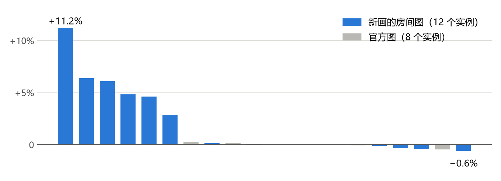

# 用网络协议调度穿门的机器人：精简版总报告

## 一页摘要

**一句话：把仓库地图当成网络来管，机器人完成的任务翻了一倍多；再往上搬现成的网络协议，只有一项在新地图上站住了。**

**问题。** 几百台机器人在一张分成很多房间的地图上不停取货送货。房间之间只靠很窄的门连通，一扇门一次只过一个方向的车。车一多，门两侧就顶牛，完成速度越跑越慢。这和网络里瓶颈链路被占满后的拥塞崩溃是同一件事。

**做了什么。** 第一阶段用网络的定律管门：限制同时往一扇门走的车数，门口一次只放一个方向，本侧走空才换方向。第二阶段做了 78 轮，每轮从一个公开的网络协议出发，搬到机器人上，按同一套流程检验。

**最好的结果。** 在官方 8 个实例上，完成数比官方入门程序多 **+113.6%（95% 区间 +107.5% 到 +120.3%）**，比“冠军的任务分配 + 修好执行器”多 +32.7%，没有碰撞。

**协议方向的结果。** 盘点的 69 项机制里，只有 **1 项**确认通过：防死锁看门狗，**+1.73%（95% 区间 +0.50% 到 +3.21%）**，已并入现在的基线。之后到第 78 轮没有新的确认通过；最后一项“门口按去向分开排队”过了开发对比，确认暂缓。

**什么没成。**

- 换路在单车道门上没有用：门是房间之间的必经之路，绕开只是走远路。
- 开发成绩换到新地图会缩水：7 项过了开发对比的机制，确认都回到 0 附近。
- 组合也没站住：四项一起开，开发对比 +3.15%，换新图后 +0.05%。每一项只在少数几张图上起作用。

## 一、问题和模型

### 单车道门是瓶颈：不管它，门的流量掉到四分之一

**车多时最贵的东西是门，门一堵，整张图都慢。**

地图是一个个格子，房间之间隔着墙，只有门能过。下图是官方 250 台车的房间图，黑线是墙，圆点是门，点越大过的车越多。

一台车走一格要 3 拍，转 90° 要 3 拍，还会随机故障，原地停 10–30 拍。**拍**是模拟里的时间单位，一局 5000 拍。成绩看一局完成了多少单，叫**完成数**。

1 格宽的门是**单车道门**，一次只能过一个方向：

- 同方向最快每 6 拍过一台，换方向最快要 15 拍。
- 不管门口时，官方 250 台车的图上，关键的那扇门从每 500 拍过 24.7 台掉到 5.8 台，车退回的次数多了约 12 倍。这就是拥塞崩溃：车越多，过得越少。

### 地图是一张多跳网络，分三层看

**门不是唯一的瓶颈链路，任务要连着过好几扇门，所以要分层建模。**

17 张开发用的房间图有 16–36 个房间、22–62 扇门。一个任务平均过 **3.6 扇门**，最忙的一扇门只占全部过门的 4%–10%。

每个机制都要先说清楚它管哪一层。层选错了，协议再好也管不到丢时间的地方。

这张网络有两点和互联网不同，决定了很多协议搬不过来：

- **无损。** 车不能丢，堵了只能原地等，不能丢掉重发。
- **闭环。** 车的总数固定，完成速度等于在干活的车数除以每单用时，多放车不一定多完成。

### 时间去哪了：只有两成是在载货前进

**能下手的损失很分散，没有一块大到一个办法就能解决。**

我们给每台车的每一拍记一类账，单位是**车·拍**（一台车一拍）。下面是 17 张图的平均。

- **没任务 30.9%** 是故意的。**名额**是同时允许多少台车拿任务、往一扇门走的上限，防止门口堵死。任务池从来没空过。
- **故障 21.1%** 是题目给定的，改不了。
- 门口的等待在面积上很集中：门格和两侧 2 步只占空地的 10%，却装下 30% 的等待。

## 二、方法：四道关，先量后做

**每项机制都走同样四道关，每道关的线都在看到结果之前写定。** 这样做是因为效果常常只有 1% 左右，不设防就会把运气当成进步。

| 关 | 做什么 | 过关的线 | 为什么要这一关 |
|---|---|---|---|
| 先量 | 用已有的运行记录，算这项机制能管的损失有多大 | 多为 2% 车·拍或门时间 | 38 项在这里就停了，省下实验 |
| 写协议 | 写明出处、管哪块损失、判据、预测，先存档再动手 | 不看结果改判据 | 防止事后找理由 |
| 开发对比 | 17 个实例上和基线比，先跑 2 局，平均低于 −1% 就停，否则跑满 10 局 | 平均 > 0，最差实例不低于 −3%，0 错误 | 快速筛掉有害的做法 |
| 确认 | 程序冻结，换新种子，在官方 8 个实例和新画的 12 个实例上比，每实例 20 局 | 平均和 95% 区间下限都 > 0，0 错误 | 看它在没见过的图上站不站得住 |

这里的**实例**是一张地图加一种车数。**最差实例**是所有实例里变化最差的那个。**95% 区间**是把实例重新抽样估出的范围，下限大于 0，才敢说真的变好了。开发用的 17 个实例都是房间图，每张 188–300 台车。官方 8 个实例还包括迷宫、随机和仓库图。

### 为什么一定要换新地图确认

**开发成绩不能当真，下表 5 项过了开发对比的机制，换新图后都回到 0 附近。**

| 机制 | 开发对比 | 新地图确认 | 结局 |
|---|---|---|---|
| 四项组合 | +3.15% | +0.05% | 没确认 |
| 给门留一成余量 | +1.69% | −0.75% | 没确认 |
| 路由抖动时才开阻尼 | +0.88% | +0.20% | 没确认 |
| 按开局实测收名额 | +0.67% | −0.05% | 没确认 |
| 门要空转时多派一台 | +0.64% | +0.25% | 没确认 |
| 防死锁看门狗 | +0.64% | **+1.73%** | **确认通过** |

开发成绩常常来自两三张特别堵的图，新地图上这种图少，平均就拉不起来。看门狗相反，开发成绩不高，但它解的是门口规则互相锁死的真问题，在新图上照样管用。

### 判据不因为差一点就放宽

**差一点没过也算没过。** 三项组合确认时 +0.47%（95% 区间 −0.0016% 到 +1.03%），下限只差 0.002 个百分点，仍然记没确认，也没有换种子重考。否则多考几次总能考过。

## 三、主结果

### 完成数翻了一倍多：换分配、修执行器、管门三步都有贡献

**在官方 8 个实例上，本文的办法比官方入门程序多 +113.6%，其中有门的地图涨得最多。**

下表是一步步加上去的结果。每一行都和官方入门程序比，每实例 20 局，都没有碰撞。

| 程序 | 比官方入门程序 | 95% 区间 |
|---|---|---|
| 换上 2024 届冠军的任务分配 | +27.0% | +23.8% 到 +30.7% |
| 再修好执行器 | +63.0% | +57.9% 到 +68.6% |
| 再加本文的门口和名额办法 | **+113.6%** | +107.5% 到 +120.3% |

**执行器**是把计划变成动作的那部分程序。官方版有个同步问题：车刚离开一格，排队记录里还占着那格，后面的车白等一个规划周期。这个问题在官方最新版上也能复现。修好后比只换冠军分配多 +26.4%（95% 区间 +23.6% 到 +29.3%）。

### 涨幅集中在有窄门的地图上

**和“冠军 + 修好执行器”比，本文的办法多 +32.7%（95% 区间 +31.1% 到 +34.6%），几乎全部来自房间图和大迷宫图。**

- 官方 3 个房间实例平均 +76.5%（95% 区间 +72.4% 到 +81.5%）。以 250 台车的房间图为例，每局平均完成数从 618 单涨到 1106 单。
- 随机图和仓库图上每局完成数都相同，说明这套办法在不需要它的图上不添乱。

这组数不含看门狗。看门狗的 +1.73% 是在另一组实例上量的，两个数不能相乘。

### 看门狗：唯一在新地图上站住的协议机制

**防死锁看门狗确认 +1.73%（95% 区间 +0.50% 到 +3.21%），最差实例 −0.61%，800 局 0 错误。**

它解决的是一个真问题。两扇门只隔一步时，两扇门的方向规则会互相锁住：三台车互相等，谁也不动。在一局开着“分两道”的实验里，一扇门从基线同一局的 199 台车掉到只过 5 台，全局完成数从 1114 掉到 700。

办法来自数据中心的无损网络。那里几台交换机互相叫停时也会永远卡住，所以交换机装了看门狗，队列卡太久就强行放开。搬到机器人上：

- 车站满 300 拍，而且它所在的门 300 拍没有车进，就判为卡死。
- 这一拍它可以不守门口规则，防撞检查照常。

涨幅来自 6 个新画的实例（+2.9% 到 +11.2%）。官方房间图在 −0.46% 到 +0.27% 之间。所以它是**保底**：平时不起作用，碰上会锁死的布局时才救场。

后来查出它出手的次数里 97% 是误判：车只是空闲等活，一接到活就被当成卡死。改成“有任务才计时”后，开发对比只多 +0.13%，这个改动单独没有做确认。

## 四、机制的结局和三条教训

### 三层都试过，确认通过的只有格子这一层的看门狗

**69 项机制分在三层，没有哪一层是漏掉没试的；另外两层一项都没确认。**

- **房间之间（24 项）。** 换路几乎都亏。名额已经按“门的速度 × 走到门的时间”算好，能调的只有一两台车。
- **门口（26 项）。** 现有门口规则已经相当于一台好交换机，17 项先量都不到线。
- **格子（19 项）。** 故障只有 10–30 拍，绕开的代价和等它恢复差不多。能确认的只有防死锁。

这个归层有判断成分，个别项换个归法，各层计数会差 1–2 项，结论不变。

第 72–78 轮不在这次盘点里，单独列在下面，不并进 69 项。

| 轮 | 机制 | 层 | 结局 |
|---|---|---|---|
| 72 | 分层名额（Google BwE、B4） | 房间之间 | 先量跳过：0.19%，线 2.0% |
| 73 | 看门狗的恢复计时；有任务才计时 | 格子 | 前者先量跳过；后者开发 +0.13% |
| 74–75 | 四项组合；三项组合 | 跨层 | 开发 +3.15%、+1.71%；确认 +0.05%、+0.47%，都没确认 |
| 76 | 分两道只用在两个真房间之间的门 | 门口 | 确认 +0.20%（95% 区间 −0.23% 到 +0.65%），没确认 |
| 77 | 到门前先转好向 | 格子 | 开发第一段 −1.32%、−2.09%，筛掉 |
| 78 | 门口按去向分开排队 | 门口 | 开发 +1.07%（95% 区间 +0.00% 到 +2.51%），确认暂缓 |

### 教训一：单车道门上，选路赚不到东西

**门是房间之间的必经之路，往别处绕只是走远路；骨干网里最有用的一类办法，在这里反而最亏。**

三类做法都试了：

- **压平路线代价**（ARPANET 后来的改法，给代价封顶、限制变化速度）。亏的原因是单车道里迎面的车不是“慢一点”，而是会顶牛。把这个代价压平，车就挤进同一条走廊。
- **限制绕路长度**（骨干网 MPLS-TE 常用的约束）。现有路线绕路是在躲迎面车，限了绕路，车被逼回最短的走廊，换路多的图掉得最多。
- **门堵了就换门**。故障只有 10–30 拍，换门的代价和等它恢复差不多。

唯一的例外是“路由抖动时才开阻尼”，它只改善了一张路线来回变的图，确认时也回到 +0.20%。

**学到的：** 换路要有并行的路才赚钱。这张网络里门是唯一的路，能管的是“放多少车”和“谁先过”，不是“走哪条路”。

### 教训二：开发成绩换到新图会缩水

**过了开发对比的机制，换到新图后除看门狗外全部落在 −0.75% 到 +0.47% 之间。**

缩水有三个原因：

- **挑出来的本来就偏高。** 这些机制是在这 17 个实例上选中的，选的时候已经沾了运气。
- **好处集中在两三张特别堵的图。** 新图里这种图少，平均就拉不起来。
- **堵不堵对时序很敏感。** 多派一台车，就可能让这一局不堵、另一局堵，大涨大跌只是换了一批局。

规则也会在新图上出事。“2 格门分两道”在开发图上 +2.32%，到了迷宫图上，同一条选门规则把 25 条普通走廊当成门分成单行道，60 台车的迷宫图掉了 22.18%。

门口按去向分开排队的 +1.07% 也要打折。它的涨幅比它能管的那块损失（0.06%）大十几倍，多半是这类波动，要等确认才算数。

**学到的：** 开发对比只用来筛掉有害的做法，不能当成绩报。

### 教训三：组合能把小提升加起来，但每项只在少数图上起作用

**四项一起开，开发对比 +3.15%，是协议方向最大的开发提升；换新图后是 +0.05%。**

用户问过：会不会每项单独看不出，加起来就看得出？开发图上答案是会。

四项管不同的层，起作用的图也大多不同，所以平均差不多能相加（相加预测 +4.00%，实测 +3.15%）。按图里从上到下，变化到 1% 的图分别只有 1、3、0、9 张。

但这也说明了它为什么站不住：平均是少数几张图拉起来的。

| 确认的版本 | 确认结果 | 95% 区间 | 最差实例 |
|---|---|---|---|
| 四项组合 | +0.05% | −3.00% 到 +2.56% | −22.18%（迷宫图） |
| 三项组合（去掉分两道） | +0.47% | −0.0016% 到 +1.03% | −0.55% |
| 分两道只用在真门上 | +0.20% | −0.23% 到 +0.65% | −2.22% |

四项组合在 15 个房间实例上是 +1.65%，这是事后看的描述，不改判定。

**学到的：** 组合值得做，因为它能看见单项看不见的小提升。但要配上“这一项该在哪种图上开”的规则，而这条规则本身也得在新图上确认。

> 本版写到主结果和三条教训。和今天骨干网的对照、还剩什么，以及附录（代号对照表、术语表、每轮一行的总表）下一轮补上。
