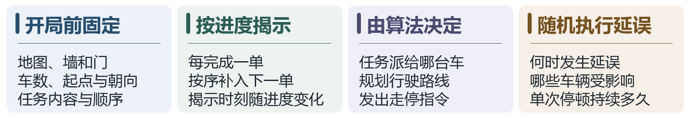

# 第一部分 问题与已有算法

## 研究范围

本项目专门围绕 League of Robot Runners 2026（LoRR 2026）的 Room 场景设计和标定优化。需要解决的是持续取送下的车队拥堵。许多任务汇入同一道必经窄门时，调度器要决定还可以派多少车去过门，门口则要决定哪一侧先走以及如何给出口留空间。衡量目标是在给定时间内完成更多整单。LoRR 2026 由 Amazon Robotics 赞助，赛事用网格仿真研究大型仓储等场景中的派单、规划和执行问题。[赛事说明](https://raw.githubusercontent.com/MAPF-Competition/web_resource/main/landing_page.md) · [官方评测规则](https://raw.githubusercontent.com/MAPF-Competition/web_resource/main/evaluation.md) · [Amazon Science 的仓储拥堵案例](https://www.amazon.science/latest-news/how-amazon-robots-navigate-congestion)

## 正式 Room 实验前提

任务内容和顺序由输入文件给定。任务何时进入可见池取决于完成进度。配对使用相同种子，车辆的实际行驶轨迹和完成时刻可以不同。[任务管理源码](https://github.com/MAPF-Competition/Start-Kit/blob/v3.1.0/src/TaskManager.cpp) · [延误生成源码](https://github.com/MAPF-Competition/Start-Kit/blob/v3.1.0/src/DelayGenerator.cpp)

| 条件 | 取值或规则 |
| --- | --- |
| 地图与开口 | 三种车队配置共用固定地图 `room-64-64-16`。地图为 64×64 格，3646 格可通行，16 个房间之间有 31 处墙上开口，其中 30 处宽一格、1 处宽两格。各局沿用地图给定的开口位置和宽度。[LoRR 地图原文件](https://raw.githubusercontent.com/MAPF-Competition/Start-Kit/v3.1.0/example_problems/room.domain/maps/room-64-64-16.map) |
| 车队与起点 | 同一底图分别设 200、250、300 台车，按固定文件读取互不重合的起点，初始均朝东。300 台配置在 250 台配置基础上补入 50 个离线选定的固定空格，原离线抽样种子尚未证实。 |
| 任务与任务池 | 共用 1375 条固定的两点任务模板，每单按取货、交货顺序完成。起始可见任务数依次为 300、375、450。每完成一单就按模板顺序补入一单，读完从头循环并分配新任务编号。已分配但未完成的任务仍在池中。调度器只见已公开任务。 |
| 运动与安全 | 仿真依据车辆位置和动作进度检查碰撞，禁止两车相向互换位置。前进一格或原地转向需 3 个执行拍。停顿或等待时车辆仍占据停下时的空间。 |
| 随机延误 | 每拍从均值为 0.01 × 车数的泊松分布抽取延误事件数，从当前未延误车辆中无放回选车。每次延误的时长在 10–30 拍之间均匀抽取。 |
| 时钟与吞吐量 | 每局 5000 个执行拍，第 0 拍首份计划就绪，此后每 15 拍切换计划。使用不将计算耗时扣入仿真时域的逻辑时钟，交通流引导固定 64 次迭代。按序到达最后一个停靠点才计入全队整单完成量。门口通过量用于诊断。 |
| 配对与共同基线 | 每个配置共用地图、车数、起点、任务序列和延误参数。延误种子 11700–11709 与规划种子 145、146 交叉，每个配置 20 对。任务揭示时刻由各版的完成进度决定。主比较的两版共用基础派单评分（取货距离权重 2）、规划器和修复后的执行器，在此基础上开关整套控制。 |
| 版本与复现 | 正式批次为 r52b，历史 Linux 程序为 `lifelong-v36a`。源码快照、启动参数、输入文件及离线复核方法见课程研究报告附录 C1。 |

Room 识别出 2 处单门割和 7 组成对割用于派单名额、6 处窄通道用于方向控制。房间图三个车队配置的控制版都启用全图上限，允许同时持有任务的车辆最多 138 台。门的识别条件、方向名额和换向规则见课程研究报告第 4、5、7、8 节。

## 其他地图的适用性检验

正式评测还包含迷宫 40／60 台、随机图 200／300 台及仓库 100 台，共四张底图八个配置。它们各自使用报告第 8.1–8.2 节列出的任务输入与延误模型。迷宫只识别到一处纳入控制的单门割，随机图和仓库图未触发该控制。

[课程研究报告 v97](../Robot_Traffic_Course_Report_v97.docx)
