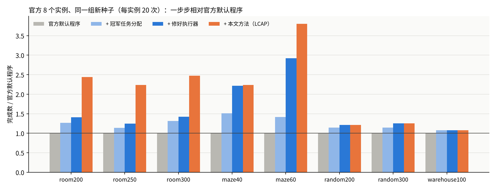
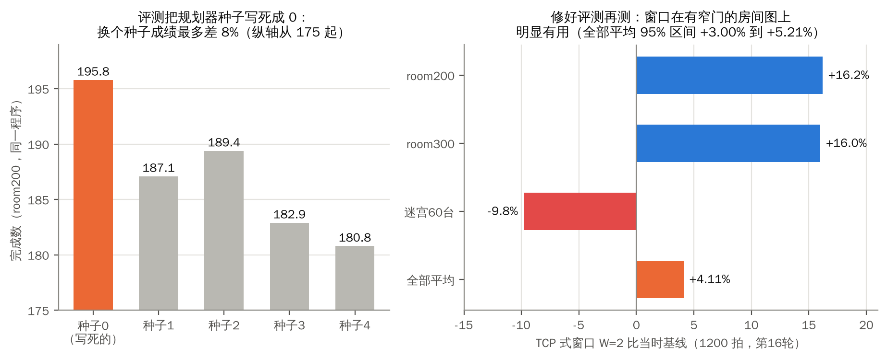
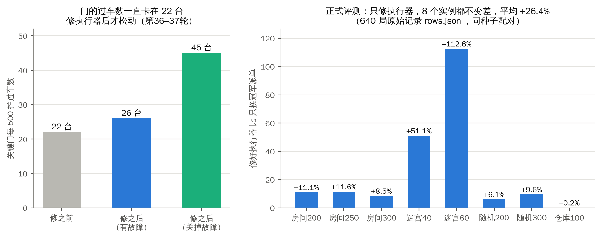
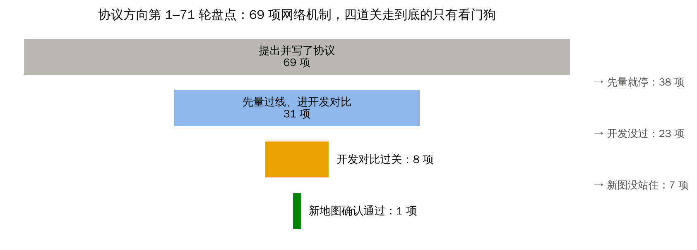
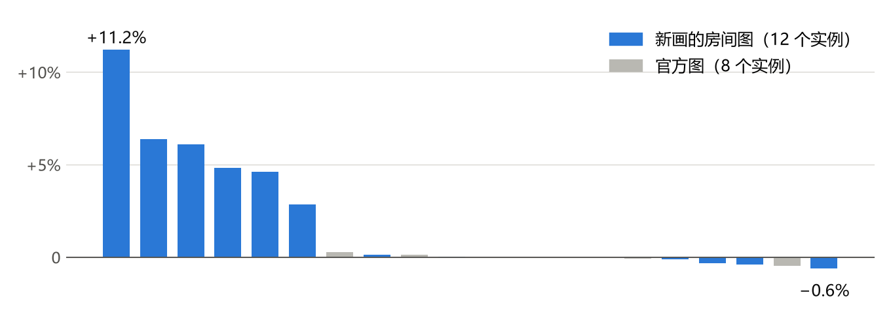
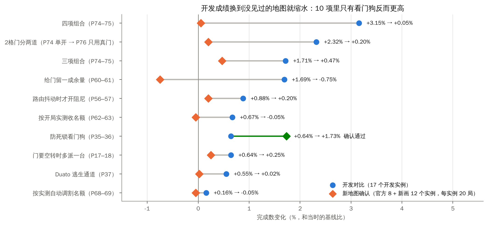
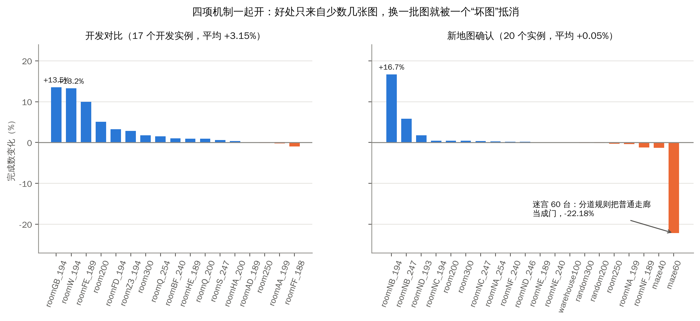

# 第三部分 关键迭代与实验图解

> 本部分只讲「我们是怎么一步步走到最终方法的」。机制本身（最大流最小割上限、TCP 窗口式每门名额、半双工成批放行、全图接单上限、执行器“信用晚还一拍”修复、PFC 看门狗）在第二部分已经讲过，这里只引用名字，不再重复原理。方括号里的编号如 [S3] 指向文末「数字来源」表，每个数字都能在仓库的原始记录或数字核对表里查到。

## 3.0 先看终点，再看路

我们前后做了将近两百轮有档案的实验和核查：第一阶段约 75 轮，用网络的定律管门；协议方向 78 轮，每轮从一个公开的网络协议出发搬到机器人上；最后 41 轮做离线建模和逐个数字核对 [S1]。大部分轮次是失败的，或者“看起来有用、换一批地图就没了”。下面这张路线图把整个过程压成一条线，标出了真正改变方向的几个转折点。

终点是正式评测：官方 8 个实例、每个实例 20 局、四个版本共 640 局 [S2]。和官方入门程序比，最终方法多完成 **+113.6%** 的任务（95% 区间 +107.5% 到 +120.3%）[S2]。这个数可以拆成三级台阶：

| 一步步加上去 | 比官方入门程序 | 95% 区间 |
|---|---|---|
| 换上 2024 届冠军的任务分配 | +27.0% | +23.8% 到 +30.7% |
| 再修好执行器（第③步） | +63.0% | +57.9% 到 +68.6% |
| 再加名额与门口规则（第②步及之后） | **+113.6%** | +107.5% 到 +120.3% |

和“冠军分配 + 修好执行器”这个更强的对照比，门口和名额的办法单独贡献 **+32.7%**（95% 区间 +31.1% 到 +34.6%），以 250 台车的官方房间图为例，每局平均完成数从 618 单涨到 1106 单 [S2]。

下面六步解释这些台阶是怎么来的，也解释为什么很多看起来很合理的“网络办法”最后没有进入正式方法。

---

## 第①步 先校准尺子：第一个 TCP 式窗口差点被冤枉

**当时看到什么。** 最早的想法很朴素：像 TCP 限制“在路上没确认的数据包”一样，限制“正在往一扇门赶的车”，我们叫它**窗口**。第一批实验里窗口看不出效果，前几轮的各种网络机制也是有时正、有时负，很像“全部无效” [S3]。

**想法：先怀疑尺子，再怀疑办法。** 生活类比：如果一把秤每次称同一袋米都差几两，那你没法用它判断哪种米更重。我们回头检查评测程序本身，查出两个问题 [S3]：

- 官方代码里有一个变量没有初始化（相当于秤的零点没调），引导路径会随编译方式变化；同一个程序在 Windows 上重新编译，54 次运行只有 5 次结果相同。
- 规划器内部的随机种子被写死成 0。我们以为每次换了“种子”，其实只换了故障，规划器每次都走同一条老路。同一台 200 车房间图，种子 0 的完成数是 195.8，换成种子 1–4 是 187.1、189.4、182.9、180.8，最多差 8%。

**怎么改。** 修好这两个问题，并且以后每一轮都带一个“随机对照”（故意做一个没有道理的改动，看它会不会也“涨”），再用 1200 拍的短局重测。

**结果。** 窗口 W=2 平均 **+4.11%**（95% 区间 +3.00% 到 +5.21%），200 台和 300 台房间图都是 +16% 左右，而随机对照是 −2.46% [S3][S4]。“网络机制全部无效”这个结论被推翻。同一批里高密度迷宫 −9.8% [S4]，说明窗口不是哪里都好用。

**启发。** 效果常常只有 1%–5%，而评测本身的抖动就可能有 8%。所以后来每项实验都要先把“秤”校准，并且固定判据：平均提升大于 0、95% 区间下限也大于 0，才算数。这条规矩贯穿了后面全部实验。窗口也是后来“每门名额”的前身。

---

## 第②步 把一局跑满：看见拥塞崩溃，才知道该管门

**当时看到什么。** 第 25 轮把 2024 届冠军的任务分配接进来，我们前面攒下的提升大半被它覆盖了 [S5]。紧接着第 27 轮把一局从 1200 拍跑满到 5000 拍，结果大幅波动，顺着查下去发现：房间里的车从 20 台左右涨到 90–160 台，九成已经拿着货，八成只是路过，堵在门口 [S5]。

**想法：这就是互联网的“拥塞崩溃”。** 生活类比：高速收费站前车越来越多，大家互相加塞，结果每分钟通过的车反而越来越少。1986 年互联网就出过这种事，解决办法是让发送方别一股脑往外发。我们对应地做两件事：派单时限制每扇门“正在赶来”的车数（TCP 窗口式每门名额），门口一次只放一个方向、本侧走空再换（半双工成批放行）。

**结果。** 名额加门口规则，在 17 个实例上比冠军分配多 **+53.8%**（95% 区间 +50.5% 到 +57.1%）[S5][S6]。单看那扇关键门：不管时每 500 拍只过 5.8 台，管住后过 24.7 台 [S7]。

**启发。** 只看短局会漏掉最重要的现象：崩溃是在一局后半段慢慢发生的。从这一步起，问题从“怎么让每台车走得聪明一点”变成了“怎么别让太多车同时挤向同一扇门”。

---

## 第③步 门卡在 22 台：问题不在门，在执行器

**当时看到什么。** 名额和门口规则都加上后，关键门每 500 拍的过车数始终卡在 **22 台**左右，怎么调名额都上不去 [S8]。按门的物理速度算，它应该能过更多。

**想法：顺着“确认”信号往下挖。** 第二部分讲过，名额要等车真的离开才“还回来”。生活类比：餐厅叫号，前一桌已经走了，但服务员晚一轮才把桌子标成“空”，门口排队的人就白等一轮。我们逐拍对照回放，发现官方执行器正是这样：车已经离开一格，排队记录里还占着那一格，后面的车白等一个规划周期（即第二部分的“信用晚还一拍”）。

**怎么改。** 补丁只有 3 行（其中 1 行注释）[S8]。

**结果。** 早期单独实验里，只修执行器就比冠军分配多 **+16.7%**（95% 区间 +15.3% 到 +18.1%），20 个实例全部为正 [S9]。官方最新版 v3.1.0 上也能复现这个问题 [S8]。在正式评测里，修执行器这一级台阶是 **+26.4%**（95% 区间 +23.6% 到 +29.3%）[S2]。

**启发。** 这是整个项目里“投入最小、回报最大”的一次：3 行代码，比几十轮网络机制加起来都多。它提醒我们，当一个瓶颈的数字顽固地不动时，先怀疑测量和执行链条，而不是继续往上叠算法。我们也把这部分收益单独报告，不算进“门口控制”的功劳里。

---

## 第④步 换路全军覆没：骨干网最有用的办法，在这里最亏

**当时看到什么。** 门口堵，很自然的想法是“让一部分车走别的门”。这正是骨干网最常用的流量工程：给拥挤的链路加价、让路线绕开、预留备用路径。

**想法和怎么改。** 我们几乎把能想到的换路办法都试了 [S10][S11]：

- 给门格加价、把全图共用格子的代价加倍、按系统最优收“过门费”（经济学里的拥堵收费）；
- 按线性规划算出最优分流后，强制每台车走指定的门序列（分段路由）；
- 骨干网路由协议：ARPANET 后期的 HN-SPF（给代价封顶、限制变化速度）、MPLS 的 CSPF（限制绕路长度）、备用门 FRER、故障时快速改道 BFD+LFA。

**结果。** 指定路线第一版在 6 个实例上全部变差，−39.2% 到 −55.4% [S11]；HN-SPF 最多 −25.88%，CSPF 限绕路 −20.98% [S10]；门格加价 −5.2%，过门费 −0.06% [S12]。唯一沾边的“路由抖动时才开阻尼”开发 +0.88%，到新地图确认只剩 +0.20%（95% 区间 −0.02% 到 +0.61%）[S13]。

**为什么。** 生活类比：一个小区只有一个大门，导航再聪明也没法让你“换一个门出去”，只会让你在小区里多绕几圈。这里的窄门大多是房间之间的必经之路，算出来的关键门利用率已经是 0.96–0.97，按系统最优重新分流只能多 0.1% [S12]。而且单车道里迎面的车不是“慢一点”，而是会顶牛；压平代价反而把车赶进同一条走廊。

**启发。** 换路要有并行的路才赚钱。这张网络里能管的是“放多少车”和“谁先过”，不是“走哪条路”。这一步之后我们不再在路线上投入，把精力放回名额和门口。

---

## 第⑤步 先量后做：69 项网络机制里，只有看门狗站住了

**当时看到什么。** 进入协议方向后，我们每轮从一个公开协议出发（802.11 预约、DiffServ 优先级、令牌桶、CoDel、PFC 暂停、令牌环……）。效果常常只有 1% 左右，很容易把运气当成进步。

**想法：给每个机制设四道关，线都在看到结果之前写好。**
1. **先量**：用已有运行记录算一算这个机制最多能省多少时间，不到线就不做；
2. **写协议**：出处、管哪块损失、判据、预测，先存档再动手；
3. **开发对比**：在 17 个开发实例上和基线比；
4. **新地图确认**：程序冻结，换新种子，在官方 8 个加新画的 12 个实例上，每个实例 20 局。

**唯一的成功：防死锁看门狗。** 一次开发实验里，一局的完成数从 1114 掉到 700。逐拍回放发现，两扇只隔一步的单格门交汇处，三台车互相等对方，门口方向规则又不许它们挪，僵局从第 330 拍持续到第 2192 拍，北门这一局只过了 5 台车（基线同一局 199 台）[S14]。办法来自数据中心的无损网络：几台交换机互相叫停时也会永远卡住，所以交换机装了看门狗，卡太久就强行放开（第二部分的 PFC 看门狗）。生活类比：路口红绿灯坏了，四个方向都在等，交警来了先放一个方向。

**结果。** 新地图确认 **+1.73%**（95% 区间 +0.50% 到 +3.21%），最差实例 −0.61%，800 局 0 错误，成为协议方向第一个、也是唯一一个通过确认的机制，已并入正式方法 [S15]。

后来还查出，它出手的 2685 次里有 2611 次（97%）是误判：车只是空闲等活，一接到任务就被当成卡死 [S16]。改成“有任务才计时”后开发只多 +0.13% [S16]，这个改动没有单独做确认。

**启发。** “先量”这一关让 38 项机制不用做实验就被筛掉 [S17]。很多协议在网络里有用，是因为数据包可以丢、可以重发、排队不占地方；机器人不能丢，排队要占格子，前提不成立，协议也就搬不过来。能搬过来的是“解僵局”这种不依赖这些前提的办法。

---

## 第⑥步 开发成绩会缩水：组合 +3.15% 变 +0.05%，迷宫走廊被当成门

**当时看到什么。** 有不少机制过了开发对比，例如给门留一成余量 +1.69%、按开局实测收名额 +0.67%。但一到新地图确认，几乎都回到 0 附近。

**想法：会不会每项单独太小，叠在一起就看得出？** 我们把四项分别管不同层次的小机制（2 格门分两道、路由抖动阻尼、按需收名额、按任务计时的看门狗）同时打开。

**结果。** 开发对比 **+3.15%**（95% 区间 +1.24% 到 +5.38%），是协议方向最大的开发提升，接近四项单独相加的 +4.00% [S18]。但新地图确认只有 **+0.05%**（95% 区间 −3.00% 到 +2.56%），没有通过 [S19]。

**为什么迷宫掉了两成多。** “2 格门分两道”的选门规则是在房间图上写的，那里 2 格宽的通道就是房间之间的门。迷宫里到处是 2 格宽的走廊，规则把 25 条普通走廊都当成门、分成了单行道，车只能绕远路，迷宫 60 台每局都少两成多（20 局 0 胜）[S19]。生活类比：一条在老城区好用的“单行道”规则，原样搬到新城区，把普通街道也改成单行，交通反而更乱。

去掉这一项的三项组合确认 +0.47%，区间下限是 −0.0016%，只差 0.002 个百分点；我们仍记为没确认，也没有换种子重考，否则多考几次总能考过 [S19]。把分道只用在“两个真房间之间的门”上，确认也只有 +0.20% [S20]。

**启发。**
- 开发成绩只用来筛掉有害的做法，不能当成绩报告。过关的机制本来就是在这批图上挑出来的，难免沾了运气；好处又常常集中在两三张特别堵的图上。
- 组合确实能把单项看不见的小提升加起来，但要配一条“这一项该在哪种图上开”的规则，而这条规则本身也要在新地图上确认。
- 最后一项“门口按去向分开排队”（交换机里的 VOQ）开发 +1.07%（95% 区间 +0.00% 到 +2.51%），但它能管的那块损失只有 0.06%，涨幅大十几倍，多半也是这类波动，所以确认暂缓 [S21]。

---

## 3.7 六步合起来学到什么

| 步 | 现象 | 借鉴的网络思路 | 关键数字 | 结局 |
|---|---|---|---|---|
| ① | 窗口看不出效果 | TCP 窗口；先校准评测 | 修评测后 +4.11% | 规矩：随机对照 + 固定判据 |
| ② | 跑满一局后越跑越慢 | 拥塞崩溃；窗口与半双工 | 比冠军 +53.8% | 留进正式方法 |
| ③ | 门卡在 22 台 | 确认信号要及时还 | 单独 +16.7%；正式 +26.4% | 留进正式方法 |
| ④ | 门口堵，想换路 | 流量工程、OSPF/CSPF | 最多 −39% 以上，全部没成 | 放弃换路 |
| ⑤ | 少数局锁死 | PFC 看门狗 | 新图确认 +1.73% | 唯一确认的协议机制 |
| ⑥ | 开发成绩到新图缩水 | 多机制组合 | +3.15% → +0.05%；迷宫 −22.18% | 没确认，规矩：开发不算成绩 |

三条最有价值的经验：

1. **先修尺子，再评办法。** 评测的种子问题和执行器的同步问题，都比大多数“聪明的机制”影响更大。
2. **能管的是“放多少车、谁先过”，不是“走哪条路”。** 门是必经之路时，换路只会绕远；控制在途量和放行顺序才有用。
3. **只信没见过的地图。** 十项开发成绩里只有一项在新地图上站住，最大的组合提升换一批图就消失了。

逐轮完整记录（早期 74 条、协议方向 P01–P78、后续 41 条核查）见附录「全部研究迭代与传统网络控制算法的对应」，即 v97 报告第十一章 11.2–11.4，正文不再展开。

---

## 数字来源

路径都相对于仓库的 `experiment-materials/`。「核对表」指 `网络协议方向/报告源/通读/数字核对表.md`；「早期笔记」指 `网络协议方向/报告源/通读/第1-75轮_通读笔记.md`；「协议笔记」指 `网络协议方向/报告源/通读/协议方向_通读笔记.md`。图的生成脚本是仓库根目录的 `figures/part3/make_figs.py`。

| 编号 | 数字 | 出处 |
|---|---|---|
| S1 | 早期 74 条、协议 78 条、后续 41 条记录 | v97 报告第十一章导言；早期笔记“编号提醒” |
| S2 | +113.6% [+107.5, +120.3]；+27.0%、+63.0%；+32.7% [+31.1, +34.6]；修执行器一级 +26.4% [+23.6, +29.3]；room250 618 → 1106；图 3.0、3.2 | `archive/workspace/analysis_r52b.md`；640 局原始记录 `archive/workspace/batches/r52b-baseline/rows.jsonl`；核对表第一、二节 |
| S3 | 变量未初始化；54 次只有 5 次相同；种子 0 = 195.8，种子 1–4 = 187.1、189.4、182.9、180.8；窗口 +4.11% [+3.00, +5.21]，room200 +16.2%、room300 +16.0%；随机对照 −2.46% | 早期笔记 wait-v4、v6、v9、v10 条；核对表第 489 行（`rounds/wait-v10/analysis_r16.json`） |
| S4 | 第 16 轮为 1200 拍；迷宫 60 台 −9.8% | 核对表“第 109 轮”节（`rounds/wait-v10/analysis_r16.md`） |
| S5 | 冠军覆盖收益（+19.4%/+36.4%）；房间车数 20 → 90–160；+53.8% | 早期笔记 wait-v15、v17、v19 条 |
| S6 | +53.8% [+50.5, +57.1] | 核对表第 505 行（`workspace/analysis_r29.json`） |
| S7 | 门 6 每 500 拍 24.7 台对 5.8 台 | 早期笔记 v30 条；核对表第 99 轮节 |
| S8 | 门 22 → 26（有故障）、45（无故障）；补丁 3 行；官方 v3.1.0 可复现 | 早期笔记 wait-v26、v27 条；补丁 `archive/workspace/executor_sync_fix.patch`；`archive/workspace/executor_check_r37.md` |
| S9 | 执行器单独 +16.7% [+15.3, +18.1]，20 实例全正 | 核对表第 517 行（`workspace/analysis_r36.json`）、第 109 轮节 |
| S10 | HN-SPF −25.88%、−24.71%、−7.93%、−6.80%；CSPF −20.98%、−8.70%；FRER −6.04%、−9.88%；BFD+LFA −2.07%；Fortz–Thorup −0.29% | 协议笔记 p04、p14、p28、p53–p55 条；核对表第 533、547 行 |
| S11 | 分段路由第一版 6 实例 −39.2% 到 −55.4% | 协议笔记“第 103–105 轮”节 |
| S12 | 门格加价 −5.2%、全图共格代价加倍 −3.76%、过门费 −0.06%；门 6 利用率 0.96–0.97，系统最优只多 0.1% | 核对表第 109–110 轮节（`rounds/wait-v43/实验结果与分析.md`）；早期笔记 wait-v43 条 |
| S13 | 抖动阻尼开发 +0.88%，确认 +0.20% [−0.02, +0.61] | 协议笔记 p56、p57 条；核对表第 535 行 |
| S14 | 1114 → 700；僵局第 330–2192 拍；北门 5 台对 199 台 | `网络协议方向/rounds/p35/实验结果与分析.md` 第 4、18 行 |
| S15 | 看门狗确认 +1.73% [+0.50, +3.21]，最差 −0.61%，800 局 0 错误；开发 +0.64%；逐实例（图 3.6b） | `网络协议方向/rounds/p36/confirm_compare.json`、`dev_compare_d300.json`、`实验结果与分析.md` |
| S16 | 2611/2685（97%）误判；有任务才计时 +0.13% [+0.02, +0.26] | `网络协议方向/rounds/p73/实验结果与分析.md`、`dev_compare.json` |
| S17 | 69 项 = 确认 1 / 过开发没确认 7 / 开发没过 23 / 先量跳过 38 | `网络协议方向/rounds/p72/inventory_p72.json` |
| S18 | 四项组合开发 +3.15% [+1.24, +5.38]，相加预测 +4.00%；三项 +1.71%；分道单开 +2.32%；图 3.8 左 | `网络协议方向/rounds/p74/additivity.json`、`dev_compare_c4.json`、`dev_compare_c3.json`、`dev_compare_pick.json` |
| S19 | 确认 +0.05% [−3.00, +2.56]；maze60 −22.18%（0/20），25 条窄通道被当成门；roomNB_194 +16.69%；三项 +0.47% [−0.0016, +1.03]；图 3.8 右 | `网络协议方向/rounds/p75/confirm_compare.json`、`confirm_compare_c3.json`、`实验结果与分析.md` 第 3–4 行 |
| S20 | 分道只用真门：确认 +0.20% [−0.23, +0.65] | `网络协议方向/rounds/p76/confirm_compare.json` |
| S21 | VOQ 开发 +1.07% [+0.00, +2.51]，可管损失 0.06% | `网络协议方向/rounds/p78/dev_compare_p2.json`、`实验结果与分析.md`；核对表第 830 行 |
| 图 3.7 | 留一成余量 +1.69% → −0.75%；按开局实测收名额 +0.67% → −0.05%；多派一台 +0.64% → +0.25%；Duato 逃生 +0.55% → +0.02%；自动调割名额 +0.16% → −0.05% | 核对表第 626、744–746、806 行；协议笔记 p17–18、p37、p60–63 条；`网络协议方向/rounds/p68/dev_compare_B2.json`、`p69/confirm_compare.json` |
