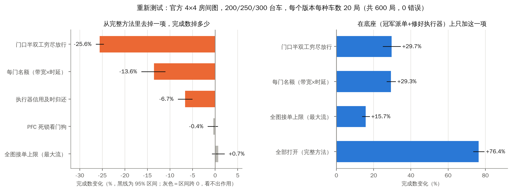
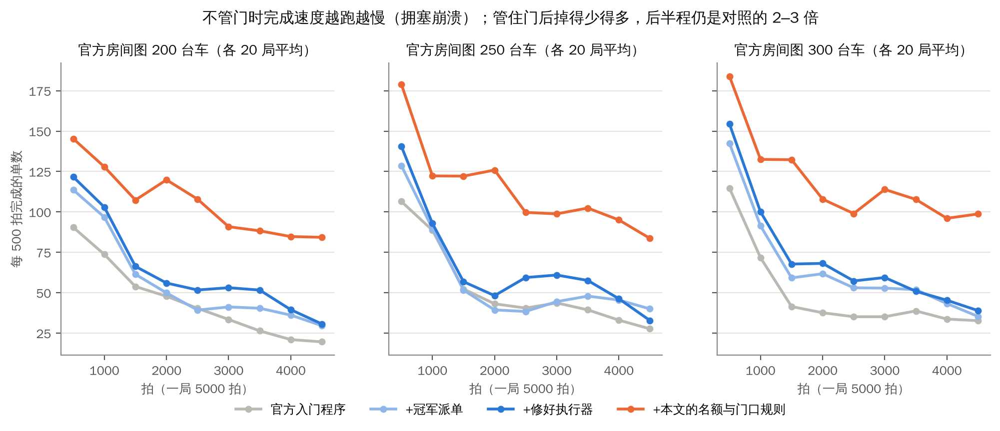
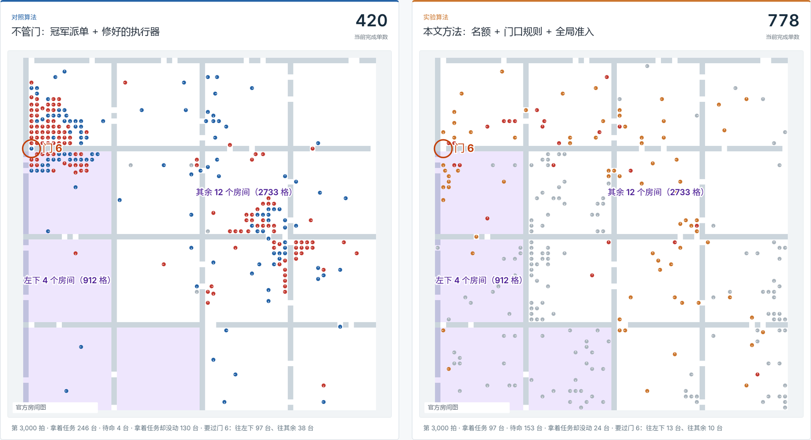
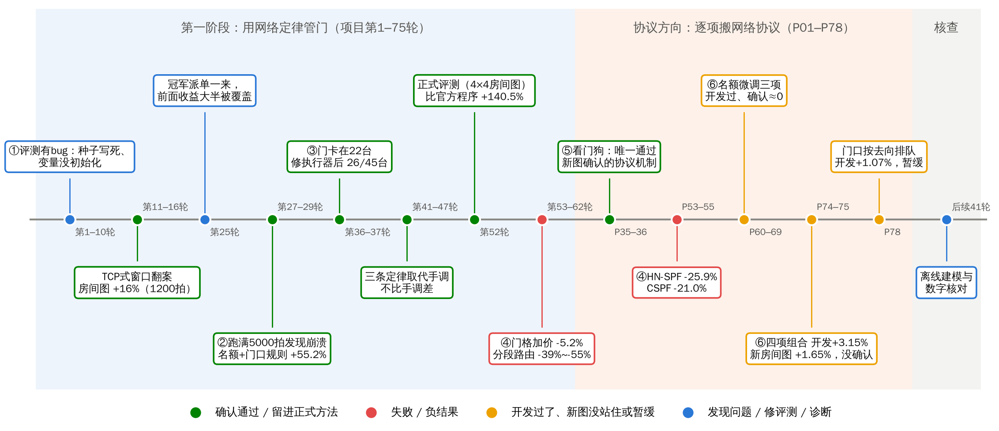
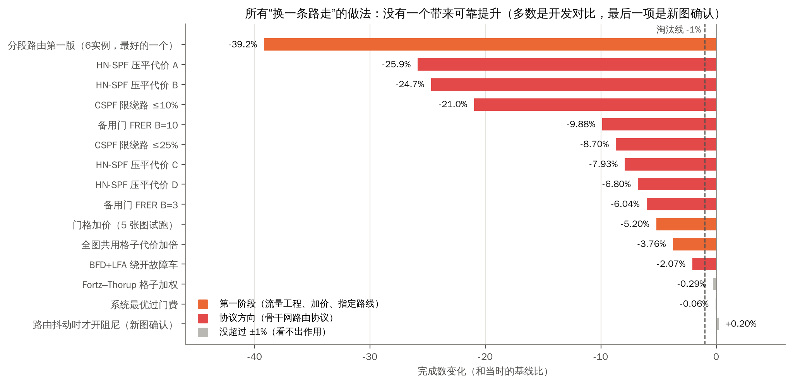

# 第三部分 房间图上最有效的优化：重新测试与伪代码

> 本部分讲在官方 4×4 房间图上真正起作用的几项优化：每项借了哪种网络算法、怎么实现（伪代码）、重新测试的效果有多大。机制原理在第二部分已经讲过，这里不重复，重点放在“哪一项贡献多少”和“具体怎么做”。
>
> **地图。** 官方 4×4 房间图：64×64 格，16 个房间，房间之间靠 1–2 格宽的窄门连通，分 200、250、300 台车三种配置。方括号里的编号如 [R1] 指向文末「数字来源」。

## 3.1 先看结论：重新测试的结果

为了把每项优化的贡献分清楚，我们重新编译了原程序，在官方 4×4 房间图上重新跑了一遍消融实验。先用旧记录验证程序：同样的种子跑出的完成数是 1130 和 1194，和存档逐局一致 [R1]。

正式实验用的是以前没用过的新种子：故障种子 11900–11909，规划种子 171、172。共 10 个版本 × 3 种车数 × 20 局 = 600 局，全部 0 错误、0 碰撞 [R1]。对照的**底座**是“冠军任务分配 + 修好的执行器”，也就是不做任何门口和名额控制的版本。



| 优化（借鉴的网络算法） | 去掉它，完整方法掉多少 | 只加它，比底座涨多少 | 在 4×4 房间图上的地位 |
|---|---|---|---|
| **门口半双工穷尽放行**（半双工链路 + 轮询系统的穷尽服务） | **−25.6%** [−26.4, −24.8] | +29.7% [+25.0, +34.4] | 贡献最大 |
| **每门名额**（按带宽×时延分配的信用流控） | **−13.6%** [−16.3, −11.1] | +29.3% [+27.1, +31.7] | 第二 |
| **执行器信用及时归还**（确认不能晚到） | **−6.7%** [−8.2, −5.1] | （底座里已经包含） | 第三 |
| 全图接单上限（最大并发流线性规划） | +0.7% [−0.7, +2.0]，看不出 | +15.7% [+14.0, +17.7] | 有了前两项后不再起作用 |
| PFC 死锁看门狗 | −0.4% [−1.6, +0.6]，看不出 | — | 在这张图上是保险，平时不出手 |
| **全部打开（完整方法）** | — | **+76.4%** [+73.6, +79.3] | |

几点读法：

- **完整方法比底座多 +76.4%**。这和正式评测用另一批种子测出的 +76.5% 几乎一样 [R1][S2]，说明结果能复现。
- **真正撑起提升的是“门口放行”和“每门名额”两项**。去掉门口放行掉四分之一，去掉名额掉七分之一。
- **两项合在一起比单独相加还多（1+1>2）。** 单独加门口放行 +29.7%，单独加名额 +29.3%；两项一起（不开全图上限）是 +77.5% [R1]。即使按“连乘”算，两项也只该有 +67.7%。原因在 3.4 节。
- **全图接单上限单独用有 +15.7%，但有了每门名额以后就多余了**：每扇门已经各自限了流，全图总数自然不会超。**看门狗**在这张图上也看不出作用。这两项留在方法里，是为了别的房间图（见 3.5 节）。

下面按贡献从大到小讲前三项，再讲两项“保险”。

---

## 3.2 优化一：门口半双工穷尽放行（贡献最大）

**问题。** 房间之间的门只有 1 格宽，一次只能过一个方向。车多以后，两个方向的车同时挤到门口，谁也过不去（顶牛），门的实际通过量从每 500 拍 24.7 台掉到 5.8 台 [S7]。这就是网络里的“拥塞崩溃”：越堵，过得越少。



**借鉴的网络算法。**

- **半双工链路**：老式以太网的同一根线上，两端轮流发，不能同时发。
- **轮询系统的“穷尽服务”**：这是排队论里一类经典的调度。服务台轮流服务几个队列，每轮把当前这个队列的人全部服务完，才换下一个。

生活类比：只有一条车道的施工路段，两头各站一个人举牌，一头的车全部放完、路段清空，才换另一头放。

**为什么这样做。** 每换一次方向，门要空等对面的车让开、新方向的车走到门口，约 15 拍；同一方向的车跟着过，最快 6 拍一台 [S7]。所以“同方向攒成一批一起过”比“来一台放一台”能多过很多车。

**伪代码**（来自 `netmac.cpp`，每拍执行一次，只管受控的单车道门）：

```text
算法 1  门口半双工穷尽放行
每一拍开始，对每扇受控的单车道门 g：
    对两侧 s：等待数[s] ← 离门 8 格以内、下一步要从 s 侧穿过 g 的车数
    d ← g 当前的放行方向
    若 等待数[d] = 0 且 等待数[对侧] > 0：
        g 进入“收尾”状态（本方向不再放新车进来）
    若 g 在收尾 且 门内没有车 且 本侧门口区（4 格）没有要过门的车：
        d ← 对侧                       # 本方向排空了，才换方向（穷尽服务）
        结束收尾

给每台车挑下一格时（在 PIBT 的候选格检查里调用，不改原有防撞检查）：
    规则 1：不是放行方向的车，不能进门格
    规则 2：门在收尾、或还没轮到自己时，不能进门口区（给出门的车留出 4 格）
    规则 3：出口一侧门口区里，等着反向过门的车只能往外让，不能站在原地堵出口
    被这三条拦下的车，排到本拍 PIBT 优先级的最后
```

**效果（重新测试）。** 去掉它，完整方法掉 **25.6%**；只加它，比底座多 **29.7%**。它在车少时作用最大：只加门口放行时，200 台 +37.1%，300 台 +19.6% [R1]。车越多，光靠“谁先过”已经不够，还得控制“放多少车过来”，也就是下一项。



---

## 3.3 优化二：每门名额 = 门的带宽 × 到门的时间（贡献第二）

**问题。** 门口放行只管“门口的车谁先过”，管不住“有多少车正往这扇门赶”。派单程序只看距离，会把大量要穿门的任务同时派出去，门外越排越长，堵住的车又挡住了不过门的车。

**借鉴的网络算法：按带宽时延积分配的信用流控。**

- **带宽时延积（BDP）**：一条链路上“同时在路上”的数据最好刚好等于“带宽 × 往返时间”。少了链路会空着，多了就只是在排队。BBR 拥塞控制就是按这个量来定在途上限的。
- **信用流控（credit-based flow control）**：发送方手里有几张“信用”，发一个包用掉一张，对方收到后再还回来。InfiniBand、数据中心交换机都用这种方式保证不丢包、不溢出。

我们的做法和普通 TCP 拥塞控制不同：不靠丢包去试探，也没有慢启动、加性增乘性减。名额是开局按地图**算出来**的。

生活类比：餐厅门口只发和桌子数相当的号，号发完了，后来的人先别往餐厅走，在原地等。

**名额怎么算。** 门的带宽用实测值：单格门每 500 拍约 26 台 [S7]。“往返时间”是一台车从派单到穿过这扇门平均要走的时间。程序开局从门格倒推最短路（前进、转身各 3 拍），算出每一侧所有空格到门的平均时间，再乘一个实测修正系数 2.23。实测时延比纯走路时间长，因为有等待和故障 [R2]。

**伪代码**（来自 `window_control.cpp` 的 `br_detect` 和 `allowed`，以及 `nms_scheduler.cpp` 的派单循环）：

```text
算法 2  每门名额（派单时检查）
开局，每张地图算一次：
    找出所有“割”：去掉后地图被分成两块的单格门，以及成对出现的窄门（门对）
    对每个割 b、每一侧 s：
        T[b][s] ← 25 + 其他侧每个空格走到 b 的平均时间（倒推最短路，前进/转身各 3 拍）
        K[b][s] ← 向上取整( 2.23 × T[b][s] × 门数(b) × (26 / 500) / 2 )
                  # 名额 = 修正后的往返时间 × 门的带宽，即带宽时延积

每个规划周期：
    在途[b][s] ← 手上的任务要从 s 侧穿过 b 的车数
                 （沿“车的位置 → 取货点 → 送货点”数要穿哪些割，每个割每个方向只算一次）
    # 车过了门，下一周期重数时就不再算它：相当于名额被“确认”还回来

派单（冠军派单程序原来的循环，只多一个检查）：
    把所有 (空闲车 r, 任务 t) 按代价从小到大放进堆
    当堆不空：
        取出代价最小的 (r, t)
        若 t 已被派出：跳过
        若 t 就是 r 手上已有的任务：保留，不再检查
        否则，若 t 要穿过的每个 (b, s) 都满足 在途[b][s] + 1 ≤ K[b][s]：
            把 t 派给 r；对这些 (b, s)：在途[b][s] += 1
        否则：
            把 r 的下一个候选任务放回堆      # 名额满了就先不派这一单
```

**效果（重新测试）。** 去掉它，完整方法掉 **13.6%**；只加它，比底座多 **29.3%**。它和门口放行正好相反，车越多作用越大：只加名额时，200 台 +19.8%，300 台 +34.6% [R1]。

**为什么用公式而不是手调。** 早期名额是试出来的固定值（每门 24）。换成上面的带宽时延积公式后，在 20 个实例上不比手调差（+0.63%，95% 区间 −0.25% 到 +1.58%），在官方房间图上还多 1.6% [R3]。公式的好处是换一张新图也能直接算，不用重新调参。

---

## 3.4 为什么两项合起来是 1+1>2

| 版本（官方 4×4 房间图，比底座） | 200 台 | 250 台 | 300 台 | 平均 |
|---|---|---|---|---|
| 只加门口放行 | +37.1% | +32.4% | +19.6% | +29.7% |
| 只加每门名额 | +19.8% | +33.5% | +34.6% | +29.3% |
| 两项一起（加看门狗，不开全图上限） | +74.3% | +82.4% | +75.6% | **+77.5%** |

两项管的是同一条“链路”的两头，缺一不可：

- **只有门口放行、没有名额**：门口排得整齐，但门外的车太多。排队的车占着格子，把不过门的车也堵住，车一多效果就下降。
- **只有名额、没有门口放行**：赶来的车数合适了，但到了门口两个方向还会顶牛，门的带宽被换方向和对峙浪费掉。
- **两项一起**：名额让门外的队“刚好够门吃饱”，门口放行让这些车按批次高效通过。网络里也是一样：发送端的流控和链路上的调度要配合，单独做哪一个都发挥不出链路的全部能力。

---

## 3.5 优化三：执行器信用及时归还（贡献第三）

**问题。** 名额和门口放行都上了以后，关键门每 500 拍的过车数一直卡在 22 台左右，怎么调都上不去 [S8]。逐拍查回放发现，问题在官方的执行器：一台车已经离开了某一格，执行器的排队记录里还把它当作占着这一格，后面的车白等一个规划周期。

**借鉴的网络概念。** 这是程序缺陷，不是一种网络算法；用网络的话说，就是“确认（ACK）晚到一拍”。在信用流控里，接收方晚一拍还信用，发送方就白白多等一拍，链路利用率直接下降。

**伪代码**（补丁只有 3 行，在 `default_executor.cpp`）：

```text
算法 3  执行器信用及时归还
每一拍，在模拟后续动作顺序之前：
    对每台车 i：
        若 i 上一拍的位置 prev ≠ 现在的位置 curr，且 prev 这一格的排队记录里排第一的就是 i：
            把 i 从 prev 的排队记录中删掉      # 离开了就马上“还”这一格
        记下 prev ← curr
```

**效果。** 重新测试中，从完整方法里去掉这个修复，完成数掉 **6.7%** [R1]。修好以后，同一扇门从每 500 拍 22 台涨到 26 台（有故障）和 45 台（关掉故障）[S8]。官方最新版 v3.1.0 也有这个问题 [S8]。正式评测里，它单独带来 +10.4% [S2]。这部分我们单独报告，不算进门口控制的功劳。

---

## 3.6 两项“保险”：全图接单上限与死锁看门狗

这两项在官方 4×4 房间图上看不出作用，但在别的房间图上能防止大跌，所以留在方法里。

### 全图接单上限（最大并发流线性规划）

**借鉴的网络算法。** 把房间当节点、门当带宽有限的链路，用**最大并发流**线性规划算出整张图每 500 拍最多能完成多少单。它的对偶解就是最小割，指出哪扇门是整张图的瓶颈。这和骨干网集中式流量工程（SWAN、B4、BwE）先算网络容量、再决定放多少流量进来的做法相同。

```text
算法 4  全图接单上限
开局（离线，用 Python 预先算好）：
    λ ← 最大并发流（房间为节点，门为链路，门带宽取实测值）
    比例 r ← 1.76 × λ × 2.23 × (25 + 送货段平均时间) / 车数     # 吞吐 × 时延 = 在途量
    只有地图上存在“绕路很长的窄通道”时才启用
派单时：
    预算 ← 向下取整(r × 车数) − 已经拿着任务的车数
    预算用完，本周期不再派新任务
```

在官方房间图上，三种车数算出来都是同时最多 138 台车接单 [S2]。

**效果。** 单独使用 +15.7%，但已经有每门名额时，再加它看不出作用（+0.7%，区间跨 0）[R1]。原因是每扇门已经各自限流，总数自然不会超。早期版本里，去掉它会让部分房间图掉 5%–11%，例如 roomQ_254 −11.1% [R4]，所以保留作为兜底。

### PFC 死锁看门狗

**借鉴的网络算法。** 数据中心无损以太网里，几台交换机互相发“暂停”时可能永远卡住，所以交换机配了看门狗：队列卡太久就强行放开。我们在开发图上见过同样的事：两扇只隔一步的门交汇处，三台车互相等，门口规则又不许它们挪，一局完成数从 1114 掉到 700 [S14]。

```text
算法 5  PFC 死锁看门狗
每一拍，对每台车 i：
    若 i 有任务、没在故障、在同一格已站满 300 拍，
       且 i 所在的门 300 拍内没有车进过：
        这一拍 i 不受门口三条规则限制（防撞检查照常）
```

**效果。** 在官方 4×4 房间图上看不出作用（−0.4%，区间跨 0）[R1]。在新画的、容易锁死的房间图上，确认实验平均 +2.30%，最多 +11.2% [S15]。它是协议方向 69 项网络机制里唯一通过新地图确认的一项 [S17]。

---

## 3.7 我们是怎么找到这几项的（简述）

前后做了近两百轮有档案的实验和核查 [S1]。下图标出几个转折点：修好评测程序以后，跑满一整局才看见拥塞崩溃，于是有了名额和门口放行；门卡在 22 台，引出执行器修复；后面又逐项试了 69 种网络协议，只有看门狗站住了。



没进入最终方法的方向里，最有代表性的是**换路**（骨干网流量工程，包括 OSPF/CSPF 一类的路由协议）。在房间图上全部变差，最多掉 39% 以上 [S10][S11]。门是房间之间的必经之路，换路只会绕远。在这张网络里能管的是“放多少车”和“谁先过”，不是“走哪条路”。



---

## 3.8 小结

| 排名 | 优化 | 网络来源 | 重新测试（官方 4×4 房间图） |
|---|---|---|---|
| 1 | 门口半双工穷尽放行 | 半双工链路、轮询系统的穷尽服务 | 去掉 −25.6%；单加 +29.7% |
| 2 | 每门名额 | 带宽时延积（BBR）、信用流控（InfiniBand） | 去掉 −13.6%；单加 +29.3% |
| 3 | 执行器信用及时归还 | 确认不能晚到（修程序缺陷） | 去掉 −6.7% |
| 保险 | 全图接单上限 | 最大并发流线性规划与最小割（SWAN/B4） | 单加 +15.7%，有名额后看不出 |
| 保险 | 死锁看门狗 | 无损以太网 PFC 看门狗 | 这张图看不出，新房间图最多 +11.2% |
| 合计 | 全部打开 | | **比底座 +76.4%**（正式评测 +76.5%） |

一句话：在 4×4 房间图上，最有效的是把每扇门当成一条半双工链路来管，**上游按带宽时延积发名额，门口按批次穷尽放行**。两项配合起来，才把门的通过能力用满。

---

## 数字来源

路径相对于仓库根目录。「核对表」指 `experiment-materials/网络协议方向/报告源/通读/数字核对表.md`；「早期笔记」指同目录的 `第1-75轮_通读笔记.md`。

| 编号 | 数字 | 出处 |
|---|---|---|
| R1 | 本次重新测试（2026-11-18）：程序由 `experiment-materials/网络协议方向/src/dev_src_p78` 在 Linux 上编译；回归 room250、room300（种子 9700 × 101）= 1130、1194，与存档 `rounds/baseline_v2_LCAPWD/regress_9700_101.jsonl` 一致；600 局原始记录 `figures/part3/rerun/ablation_room_4x4.jsonl`，运行脚本 `run.py`、`ablation.py`，统计 `analyze.py`（与 `archive/workspace/scripts/ana.py` 同样按实例内配对重抽 4000 次）；各版本开关见 `ablation.py` | `figures/part3/rerun/` |
| R2 | 名额公式与常数 2.23、26/500、25 | `src/dev_src_p78/default_planner/window_control.cpp` 第 104、422–447 行；早期笔记 wait-v31、v42 条 |
| R3 | 名额公式替代手调：+0.63% [−0.25, +1.58]；官方房间 +1.6% | `experiment-materials/archive/workspace/analysis_r41.md` |
| R4 | 早期版本去掉全图上限：roomQ_254 −11.1%、room300 −5.1% | 早期笔记 wait-v31 条；核对表第 111 轮节 |
| S1 | 早期 74 条、协议 78 条、后续 41 条记录 | v97 报告第十一章导言 |
| S2 | 正式评测（官方房间 3 个配置）：完整方法比冠军 + 修好执行器 +76.5% [+72.4, +81.5]；修执行器一步 +10.4%；全图上限 138 台 | `experiment-materials/archive/workspace/analysis_r52b.md`；`batches/r52b-baseline/rows.jsonl`；v97 报告 8.2 节 |
| S7 | 门 6 每 500 拍 24.7 对 5.8 台；单格门实测约 26 台/500 拍；同向最快 6 拍、换向约 15 拍 | 早期笔记 v30、v31、v42 条；核对表第 99 轮节 |
| S8 | 门 22 → 26 / 45 台；补丁 3 行；官方 v3.1.0 可复现 | 早期笔记 wait-v26、v27 条；`experiment-materials/archive/workspace/executor_sync_fix.patch` |
| S10–S11 | 换路类做法：HN-SPF −25.88%、CSPF −20.98%、分段路由 −39.2% 到 −55.4% 等 | 协议方向通读笔记 p53–p55、第 103–105 轮节；核对表第 547 行 |
| S14 | 一局 1114 → 700，僵局第 330–2192 拍 | `experiment-materials/网络协议方向/rounds/p35/实验结果与分析.md` |
| S15 | 看门狗确认：房间图 15 实例 +2.30%，最多 +11.2% | `experiment-materials/网络协议方向/rounds/p36/confirm_compare.json` |
| S17 | 69 项网络机制，确认通过 1 项 | `experiment-materials/网络协议方向/rounds/p72/inventory_p72.json` |
